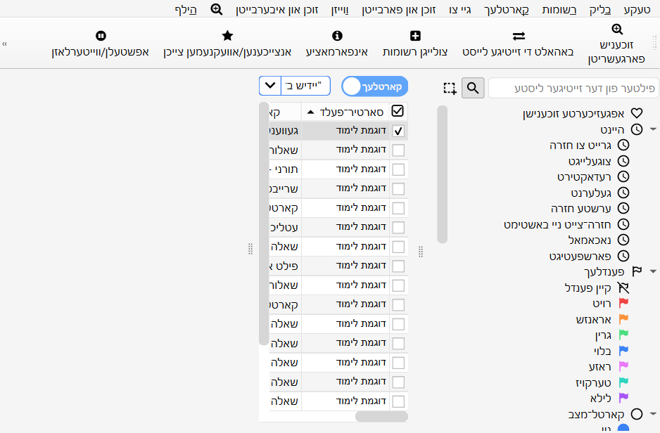
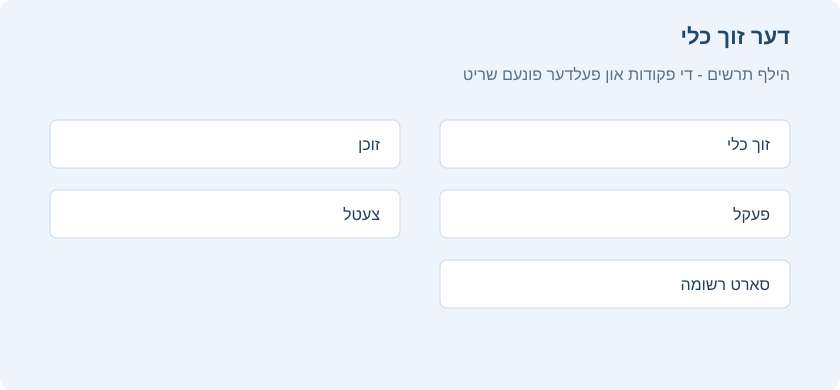
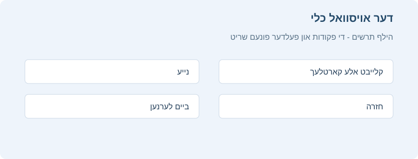
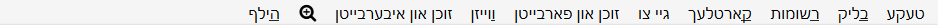
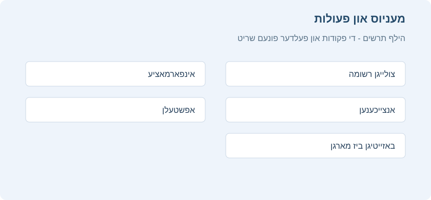
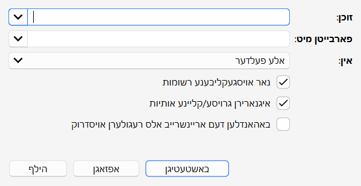
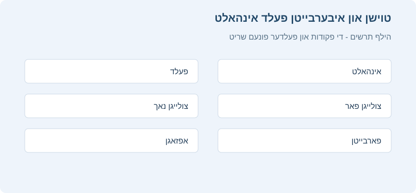

# דורכבלעטערן

<!-- toc -->

דער דורכבלעטערער פענסטער ערלויבט אייך צו זוכן און רעדאקטירן אייערע קארטלעך און רשומות.
מען עפנט אים מיט א דרוק אויף **דורכבלעטערן** אינעם הויפט פענסטער, אדער מיטן קנעפל <kbd>B</kbd>.
ער האט דריי חלקים: דער _זייט סרגל_ רעכטס, די _קארטל/רשומה טאבעלע_ אויבן לינקס, און דער _רעדאקטירער שטח_ אונטן לינקס.
שטעלט דעם מויז צווישן צוויי חלקים, דריקט און שלעפט, כדי צו פארברייטערן איינעם און פארקלענערן דעם אנדערן.

## טאבעלע מצבים

אנקי האט צוויי מצבים: די טאבעלע ווייזט אדער קארטלעך אדער רשומות.
מען קען טוישן דעם מצב מיטן שאלטער אויבן, רעכטס פונעם זוך פעלד, אדער מיט <kbd>Ctrl</kbd>+<kbd>Alt</kbd>+<kbd>T</kbd>. דער שאלטער ווייזט אויך צי מען זעט יעצט **ק**ארטלעך אדער **ר**שומות.

**הערה**: כדי עס זאל זיין פשוט, גייט דער מדריך געווענליך אויס פון קארטל מצב.
וואו עס שטייט אויסקלייבן, געפינען און אזוי ווייטער פון "קארטלעך", לייענט דאס לויטן יעצטיגן מצב: קארטלעך אדער רשומות.

## דער זייט סרגל

דער _זייט סרגל_ רעכטס גיט א שנעלן צוטריט צו געווענליכע זוך אויסדרוקן. עס האט אויך א זוך סרגל, כלים צו רעדאקטירן צעטלעך און פעקלעך, און צוויי באזונדערע כלים וואס ווערן ערקלערט ווייטער.
מען טוישט צווישן די כלים מיטן סרגל אויבן אינעם זייט סרגל, אדער מיט די קיצורים
<kbd>Alt</kbd>+<kbd>1</kbd>/<kbd>2</kbd>.

### דער זוך כלי

א דרוק אויף א פריט אינעם זייט סרגל זוכט לויט אים.

האלט <kbd>Ctrl</kbd> ביים דריקן צו צולייגן דעם פריט צום יעצטיגן זוכן מיט א תנאי AND, דאס הייסט נאך א תנאי, אנשטאט אנהייבן א נייע זוכעניש.
צום ביישפיל, אויב איר ווילט ווייזן קארטלעך _ביים לערנען_ אינעם פעקל "סוכה", דריקט אויף "לערנען"
און דערנאך אויף "סוכה" בשעת איר האלט <kbd>Ctrl</kbd>.

האלט <kbd>Shift</kbd> צו שאפן א זוכעניש מיט OR, דאס הייסט אדער, אנשטאט AND.
צום ביישפיל, דריקט אויף איין פעקל און דערנאך אויף אן אנדערן מיט <kbd>Shift</kbd>, צו ווייזן קארטלעך פון ביידע פעקלעך צוזאמען.

האלט <kbd>Alt</kbd> צו אויסשליסן א תנאי פונעם זוכן, מיט א `-` פאר אים: צום ביישפיל, נישט צו ווייזן די קארטלעך פון א געוויסן פעקל.
מען קען צוזאמנעמען <kbd>Alt</kbd> מיט <kbd>Ctrl</kbd> אדער <kbd>Shift</kbd>. א דרוק מיט <kbd>Ctrl</kbd>+<kbd>Alt</kbd>, צום ביישפיל, לייגט צו א נייעם אויסשליס תנאי.

מען קען אויך האלטן <kbd>Ctrl</kbd> און
<kbd>Shift</kbd> צוזאמען ביים דריקן אויף א זוך אויסדרוק, כדי איבערצובייטן אלע תנאים פונעם זעלבן סארט.
נעמט אן אז איר האט געשריבן די צוזאמענגעשטעלטע זוכעניש
`deck:שבת (is:due or tag:important)`
און איר ווילט יעצט דעם זעלבן זוכן פארן פעקל עירובין. האלט
<kbd>Ctrl</kbd>+<kbd>Shift</kbd> ביים דריקן אויף פעקל עירובין אינעם זייט סרגל, און איר באקומט:
`deck:עירובין (is:due or tag:important)`.

### דער אויסוואל כלי

דער אויסוואל כלי ערלויבט אויסצוקלייבן מערערע פריטים אויף איינמאל, דורך האלטן <kbd>Ctrl</kbd>
אדער <kbd>Shift</kbd> ביים דריקן. מען קען אויך שלעפן און אראפלאזן צו טוישן דעם סדר פון פעקלעך און
צעטלעך.

צום ביישפיל: איר האט די צעטלעך `היזק_ראיה`, `חלוקה` און `השותפין`.
דריקט אויף דער צעטל `ברירה`, און דערנאך אויף `חלוקה` מיט <kbd>Ctrl</kbd>. ביידע צעטלעך
זענען יעצט אויסגעקליבן. שלעפט איינע פון זיי צו `השותפין`, כדי ביידע זאלן ווערן אירע אונטערצעטלעך.
אנקי האט דערביי געטוישט די נעמען צו
`השותפין::חלוקה` און `השותפין::היזק_ראיה`, לויטן סדר, און האט דערהיינטיגט די רשומות דערמיט.

נאך א באניץ פאר מערערע אויסגעקליבענע פריטים איז זוכן: דריקט רעכטס אויף
די אויסוואל און קלייבט **זוכן > אלע/איינער פון די אויסגעקליבענע**.
מען קען דאס צוזאמנעמען מיט די קנעפלעך ערקלערט ביי [דער זוך כלי](#כלי החיפוש),
כדי צו צולייגן די געשאפענע זוכעניש צום יעצטיגן זוכן.

### אפגעזיכערטע זוכענישן

אויב איר זוכט כסדר דאס זעלבע,
קענט איר אפזיכערן די יעצטיגע זוכעניש: דריקט רעכטס אויפן אויבערשטן פריט אינעם זייט סרגל,
קלייבט "זיכער אפ די יעצטיגע זוכעניש" און שרייבט א נאמען.
מען קען אויך שלעפן יעדן פריט פונעם זייט סרגל צו דעם שטח צו צולייגן א פאסיגע אפגעזיכערטע זוכעניש,
און אזוי זי צושטעלן אויבן.

### רעדאקטירן פריטים

מען קען אויסמעקן אדער טוישן נעמען פון צעטלעך, פעקלעך און אפגעזיכערטע זוכענישן גלייך אינעם זייט סרגל,
דורכן רעכטן מויז מעניו, אדער מיט א קיצור: <kbd>Del</kbd> און
<kbd>F2</kbd>. מען קען אויך אויסמעקן מערערע פריטים אויף איינמאל
(זעט [דער אויסוואל כלי](#כלי-הבחירה)).

### געפינען פריטים

צו געפינען א געוויסן פריט אינעם זייט סרגל בוים, טייפט א חלק פון זיין נאמען אינעם זוך סרגל
אויבן.

## דער זוך קעסטל

איבער דער קארטל ליסטע איז א זוך קעסטל. דארט קען מען טייפן פארשידענע זאכן
צו זוכן קארטלעך. פארן זוך סינטאקס,
זעט [זוכן](searching.md).

### פארגעשריטענע זוכעניש און אויסצייכענען רעזולטאטן

צו עפענען די פארגעשריטענע זוכעניש, עפנט דעם דורכבלעטערער פענסטער און דריקט **פארגעשריטענע זוכעניש** אינעם אויבערשטן סרגל. מען קען זי אויך עפענען דורך **זוכן און איבערבייטן > פארגעשריטענע זוכעניש**, אדער מיט <kbd>Ctrl</kbd>+<kbd>Shift</kbd>+<kbd>F</kbd>. א זייט פענסטערל מיט קאטאגאריעס וועט זיך עפענען. עס בויט פאר אייך דעם אנקי זוך סינטאקס, אן אז איר זאלט דארפן געדענקען אלע ענגלישע ווערטער.

דער אויבערשטער חלק איז א פרייע אויסדרוק שורה. טייפט א ווארט אדער אן אויסדרוק, און נוצט **און** / **אדער** צו באשטימען צי אלע תנאים מוזן פאסן אדער איינער איז גענוג. לייגט צו קלאמערן פאר א צוזאמענגעשטעלטע זוכעניש, און שלעפט אויסדרוקן צו טוישן זייער סדר. ווען די שאילתה איז ריכטיג, דריקט דעם זוך קנעפל אדער Enter.

צו פארשטיין קלאמערן, טראכט פון יעדן אויסדרוק אלס א תנאי. א רווח צווישן תנאים מיינט געווענליך **און**, און `or` מיינט **אדער**. קלאמערן זאגן אנקי קודם צו אויסרעכענען די גרופע אינעווייניג. צום ביישפיל, `deck:ברכות (tag:דף_ב or tag:דף_ג)` מיינט: זוך נאר אינעם פעקל ברכות, און ווייז דארט קארטלעך מיט דער צעטל דף ב אדער דף ג. אן די קלאמערן קען `deck:ברכות tag:דף_ב or tag:דף_ג` אויך צוריקברענגען קארטלעך מיט דער צעטל דף ג פון דרויסן דעם פעקל ברכות, ווייל `or` טיילט די שאילתה אין צוויי ברייטערע מעגליכקייטן.

מען קען צוזאמנעמען קלאמערן מיט אויסשליסן. א מקף פאר א תנאי מיינט **נישט**: `deck:ברכות -(tag:קל or tag:חזרה_מהירה)` זוכט אינעם פעקל ברכות, אבער לאזט ארויס יעדע קארטל מיט איינע פון די צוויי צעטלעך אינעם קלאמער. אזוי בויט מען א גענויע זוכעניש אן איבערצוזאגן דעם זעלבן תנאי כסדר.

אין דער קאטאגאריע **פלאץ און סארט** קלייבט מען אויס פעקלעך, סארטן רשומה און צעטלעך. נוצט זי ווען איר ווייסט אין וועלכן תחום צו זוכן: א באזונדערן פעקל, א סארט רשומה פון פראגעס און ענטפערס, אדער א צעטל פאר א מסכתא אדער נושא. **קארטל מצב** פילטערט לויט ניי, ביים לערנען, ביים חזרן, ווארט פאר היינט, אפגעשטעלט אדער באזייטיגט ביז מארגן. **פענער** פילטערט לויטן פאן קאליר. **דאטום מרווח** זוכט לויטן צולייג דאטום, לערן דאטום אדער געפלאנטן דאטום. **מאסן** פילטערט לויט מרווח, צאל חזרות, דורכפאלן און מעגליכקייט צו דערמאנען.

אינעם מעניו **זוכן און איבערבייטן** זענען אויך פאראן כלים פאר געווענליכע זוכענישן: **זוך לויטן צולייג דאטום**, **זוך לויטן רעדאקטיר דאטום**, **זוך לויטן לעצטן לערן דאטום** און **זוך געשיכטע**. די כלים לייגן אריין דעם פאסיגן אויסדרוק אינעם זוך קעסטל. דערנאך קען מען אים אליין רעדאקטירן אדער צולייגן נאך תנאים.

ווען די רעזולטאטן ווערן געוויזן, קען מען אנשאלטן **צייכן אויס ווערטער אין זוך רעזולטאטן** כדי אנצוצייכענען די געפונענע ווערטער אין דער טאבעלע און אינעם רעדאקטירער שטח. דאס העלפט ביי א געווענליכן ווארט, אדער ווען דער זעלבער קארטל האט עטליכע ענליכע ערטער. אויב איר האט געטוישט א קארטל אין אן אנדערן פענסטער און די רעזולטאטן זענען נישט דערהיינטיגט, דריקט **פריש אויף** אינעם סרגל אדער מעניו צו לאדענען די קארטל ליסטע פון פריש.

## קארטל/רשומה טאבעלע

די טאבעלע שורות שטעלן פאר קארטלעך אדער רשומות וואס פאסן צו דער יעצטיגער זוכעניש.
ביים דריקן אויף א שורה ווערט די פאסיגע רשומה געוויזן אונטן.

### שורות

אויב איר שלעפט דעם מויז אדער האלט <kbd>Ctrl</kbd> צו אויסקלייבן מערערע
שורות, ווערט דער קארטל רעדאקטירער צייטווייליג באהאלטן. פארשידענע פעולות, ווי
טוישן פעקל, קענען זיך צולייגן צו מערערע קארטלעך אדער רשומות אויף איינמאל, אן זיך צו ווענדן
אינעם יעצטיגן מצב. דערפאר ווערט אין קארטל מצב א רשומה גערעכנט אלס אויסגעקליבן
אויב איינע פון אירע קארטלעך איז אויסגעקליבן. אין רשומה מצב ווערט א קארטל גערעכנט אלס אויסגעקליבן
אויב איר רשומה איז אויסגעקליבן.

אנדערע פעולות, ווי ווייזן קארטל אינפארמאציע, ארבעטן נאר אויף איין
קארטל אדער רשומה. דאס הייסט דער _יעצטיגער_ קארטל אדער רשומה, געווענליך דער
לעצטער וואס מען האט אויסגעקליבן אדער געדריקט.
אין קארטל מצב געהערט די יעצטיגע רשומה צום יעצטיגן קארטל. אין
רשומה מצב איז דער יעצטיגער קארטל דער ערשטער פון דער יעצטיגער רשומה.

דער הינטערגרונט קאליר ווענדט זיך אינעם קארטל און דער רשומה. אין קארטל מצב
גייט דער ערשטער תנאי וואס פאסט:

1. אויב דער קארטל האט **א פאן**, נוצט מען דעם פאן קאליר.
2. אויב דער קארטל איז **אפגעשטעלט**, געל.
3. אויב די רשומה פונעם קארטל איז **אנגעצייכנט**, לילא.

אין רשומה מצב גייט דער קאליר נאר אן אויף אנגעצייכנטע רשומות.\
פאר מער אינפארמאציע וועגן אנגעצייכנטע רשומות און אפגעשטעלטע קארטלעך, זעט [רעדאקטירן און נאך](studying.md#עריכה-ועוד).

### שפאלטן

מען קען איינשטעלן די שפאלטן: דריקט רעכטס אויף איינעם פון זיי, אדער <kbd>Ctrl</kbd> מיט א דרוק,
כדי צו אויסקלייבן וועלכע שפאלטן איר ווילט זען.
מען קען שלעפן שפאלטן צו טוישן זייער סדר. א דרוק אויף א שפאלט סארטירט לויט אים;
דריקט ווידער צו איבערקערן דעם סדר, פון אנהייב צו סוף אדער פארקערט. מען קען
נישט סארטירן לויט די פראגע
און ענטפער שפאלטן.
אינעם זעלבן רעכטן מויז מעניו איז אויך אן אונטערמעניו **- פארגעשריטן -**. עפנט אים און צייכנט אן די נאך שפאלטן וואס איר ווילט ווייזן. אזוי שאלט מען אן די באזונדערע שפאלטן; זיי ווייזן זיך נישט אויטאמאטיש פאר מען שאלט זיי אליין אן אינעם שפאלט מעניו.

אלע שפאלטן זענען צוטריטלעך סיי אין [קארטל מצב און סיי אין רשומה מצב](#מצבי-טבלה),
אבער אמאל מיט אביסל אנדערע נעמען און דאטן. די פאלגנדע טאבעלע ערקלערט
זייער אויפפירונג אין ביידע מצבים.

<!-- prettier-ignore -->

| שפאלט | קארטל מצב | רשומה מצב |
| --------------- | -------------------------------------------------------------------------------------------------------------------------------------------------------------------------------------------------------------------------------------- | -------------------------------------------------------------------------------------------------------------------------------------------------------------------------------------------------------------- |
| ענטפער | דער הינטערשטער זייט פונעם קארטל אין איין שורה, אן דער פראגע. מען קען אויך אויסקלייבן אן [אייגענעם אויסשטעל](templates/styling.md) אינעם סארט קארטל רעדאקטירער. | ווי אין קארטל מצב, אבער פארן ערשטן קארטל פון דער רשומה. |
| קארטל(עך) | דער נאמען פונעם קארטל סארט רשומה. | די צאל קארטלעך אין דער רשומה. |
| קארטל געטוישט | דאס לעצטע מאל וואס דער קארטל איז געטוישט געווארן, צום ביישפיל ביי א חזרה ווען די חזרה געשיכטע און דער מרווח זענען דערהיינטיגט געווארן. | דאס לעצטע מאל וואס איינער פון דער רשומה קארטלעך איז געטוישט געווארן. |
| געשאפן | ווי אין רשומה מצב, פאר דער רשומה פונעם קארטל. | דער שאף דאטום פון דער רשומה. |
| פעקל | דער נאמען פונעם פעקל וואו דער קארטל ליגט. | די צאל פארשידענע פעקלעך וואו די רשומה קארטלעך ליגן, אדער דעם פעקל נאמען אויב אלע ליגן אינעם זעלבן פעקל. |
| געפלאנטער דאטום | דער געפלאנטער דאטום פאר קארטלעך ביים חזרן אדער ביים לערנען אדער איבערלערנען; פאר נייע קארטלעך — זייער פלאץ אינעם נייע קארטל ריי. דער ווערט איז אין קלאמערן אויב דער קארטל איז אפגעשטעלט אדער באזייטיגט. מען סארטירט קודם לויטן סארט, און דערנאך לויט דאטום אדער פלאץ. | דער געפלאנטער דאטום פון דער רשומה קומענדיגן חזרה אדער לערן/איבערלערן קארטל וואס איז נישט אפגעשטעלט, באזייטיגט אדער אין א געפילטערטן פעקל. |
| גרינגקייט (דורכשניט) | די קארטל גרינגקייט, אויב ער איז נישט ניי. | די דורכשניטליכע גרינגקייט פון דער רשומה קארטלעך וואס זענען נישט ניי. |
| מרווח (דורכשניט) | דער קארטל מרווח, אויב ער איז ביים חזרן אדער איבערלערנען. | דער דורכשניטליכער מרווח פון דער רשומה קארטלעך ביים חזרן אדער איבערלערנען. |
| דורכפאלן | וויפיל מאל דער קארטל איז אפגעשאצט געווארן אלס "נאכאמאל". | סך הכל דורכפאלן פון אלע רשומה קארטלעך. |
| רשומה | ווי אין רשומה מצב, פאר דער רשומה פונעם קארטל. | דער נאמען פונעם רשומה סארט. |
| רשומה געטוישט | ווי אין רשומה מצב, פאר דער רשומה פונעם קארטל. | דאס לעצטע מאל וואס מען האט רעדאקטירט די רשומה, צום ביישפיל א פעלד אינהאלט. |
| פראגע | דער פארנט זייט פונעם קארטל אין איין שורה. מען קען אויך אויסקלייבן אן [אייגענעם אויסשטעל](templates/styling.md) אינעם סארט קארטל רעדאקטירער. | ווי אין קארטל מצב, אבער פארן ערשטן קארטל פון דער רשומה. |
| חזרות | וויפיל מאל מען האט געחזרט דעם קארטל. | סך הכל חזרות פון אלע רשומה קארטלעך. |
| סארטיר פעלד | ווי אין רשומה מצב, פאר דער רשומה פונעם קארטל. | דער אינהאלט פונעם פעלד באשטימט אלס סארטיר פעלד פאר דעם סארט רשומה. נאר דעם פעלד קען מען ווייזן און לויט אים סארטירן. מען טוישט אים מיט א דרוק אויף **פעלדער...** אינעם רעדאקטירער שטח. |
| צעטלעך | ווי אין רשומה מצב, פאר דער רשומה פונעם קארטל. | די רשומה צעטלעך. |

## דער רעדאקטירער שטח

דער אונטערשטער רעכטער שטח ווייזט די רשומה פון דער יעצט אויסגעקליבענער שורה.
פאר מער וועגן קארטלעך און רשומות, זעט [אנהייבן](getting-started.md).
פאר מער וועגן אויסשטעל קנעפלעך, זעט [רעדאקטירן](editing.md).

מען קען פארויסקוקן וויאזוי דער יעצט אויסגעקליבענער קארטל וועט אויסזען
ביים חזרן, מיט א דרוק אויף **פארויסקוק** אויבן אינעם רעדאקטירער שטח.
אין דעם פארויסקוק ווייזן זיך נישט די 'טייפט די ענטפער' פעלדער,
כדי מען זאל קענען שנעל קוקן דעם קארטל.
אין רשומה מצב ווייזט דער פארויסקוק דעם ערשטן קארטל פון דער אויסגעקליבענער רשומה.

## מעניוס און פעולות

אויבן אינעם דורכבלעטערער פענסטער געפינט זיך א סרגל מיט פארשידענע מעניוס,
מיט פעולות וואס מען קען דארט דורכפירן.

אונטער אים איז א שורה פון קיצורים פאר פעולות פון די מעניוס. זייער ערקלערונג קומט ווייטער.

### דער קיצור סרגל

דער קיצור סרגל ווייזט נאר די פעולות אינעם בילד. האלט דעם מויז איבער אן אייקאן צו זען דעם פעולה נאמען, קלייבט אויס איין אדער מער שורות, און דריקט דעם פאסיגן אייקאן. פון רעכטס צו לינקס זענען דאס:

<!-- prettier-ignore -->

| פעולה | ווען נוצט מען זי |
| --- | --- |
| פארגעשריטענע זוכעניש | עפנט א זוך פענסטערל לויט פעקל, צעטל, סארט רשומה, קארטל מצב, דאטומען און מאסן. פאסיג ווען מען וויל נישט אליין טייפן דעם זוך סינטאקס. |
| באהאלט דעם זייט סרגל | באהאלט אדער ווייזט דעם זייט סרגל צו מאכן פלאץ פאר דער קארטל טאבעלע און רעדאקטירן. |
| לייג צו רשומות | עפנט דעם צולייג פענסטער צו שאפן א נייע רשומה. דעם פעקל און סארט רשומה באשטימט מען אויבן אינעם צולייג פענסטער. |
| אינפארמאציע | ווייזט אינפארמאציע פונעם יעצטיגן קארטל, מיטן צייטפלאן מצב און חזרה געשיכטע. די פעולה איז פאר איין קארטל אויף א מאל. |
| צייכן אן | לייגט צו אדער נעמט אוועק די צעטל `marked` פון די אויסגעקליבענע רשומות. אנגעצייכנטע רשומות ווייזן זיך מיט א באזונדערן קאליר. |
| שטעל אפ | שטעלט אפ אדער שאלט ווידער אן די אויסגעקליבענע קארטלעך. אפגעשטעלטע קארטלעך קומען נישט צום לערנען ביז מען ברענגט זיי אליין צוריק. |
| לייג באזייטיג | לייגט באזייטיג אדער ברענגט צוריק די אויסגעקליבענע קארטלעך. באזייטיגן באהאלט א קארטל ביז מארגן, אן אויסמעקן און אן טוישן די רשומה. |
| טויש פעקל | פירט די אויסגעקליבענע קארטלעך אין אן אנדערן פעקל. אויב א רשומה האט מערערע קארטלעך, ווערן נאר די אויסגעקליבענע אריבערגעפירט. |
| טויש דעם סארט רשומה | טוישט די אויסגעקליבענע רשומות צו אן אנדערן סארט, מיט א פארבינדונג פון די אלטע און נייע פעלדער. |
| לייג צו צעטלעך | לייגט צו איין אדער מער צעטלעך צו אלע אויסגעקליבענע רשומות. צעטלעך געהערן צו דער רשומה, דערפאר ווייזן זיי זיך אויף אלע קארטלעך וואס ווערן געשאפן פון איר. |
| נעם אוועק צעטלעך | נעמט אוועק צעטלעך פון די אויסגעקליבענע רשומות. שרייבט די נעמען צו אוועקנעמען און באשטעטיגט. |
| ריין אויס נישט גענוצטע צעטלעך | נעמט אוועק פון דער צעטלעך ליסטע די צעטלעך וואס געהערן נישט צו קיין רשומה. דאס מעקט נישט אויס קארטלעך אדער רשומות. |
| מעק אויס | מעקט אויס די אויסגעקליבענע רשומות און אלע קארטלעך וואס זענען געשאפן פון זיי. נוצט דאס נאר נאכן נאכקוקן אז די אויסוואל איז ריכטיג. |
| שטעל א געפלאנטן דאטום | באשטימט אליין א חזרה צייט פאר די אויסגעקליבענע קארטלעך, צום ביישפיל אין א צאל טעג אדער אין א טאג מרווח. פאסיג פאר א באזונדערן צייטפלאן טויש. |
| שטעל א נייעם פלאץ | טוישט דעם פלאץ פון נייע קארטלעך אינעם נייע קארטל ריי. פאסיג אויסצושטעלן די סדר פון נייעם חומר פארן אנהייבן לערנען. |

נאך דורכבלעטערער פעולות זענען צוטריטלעך דורך די מעניוס און מיט א רעכטן דרוק אויף א שורה, אבער זענען נישט אינעם קיצור סרגל פונעם בילד.

### טעקע

<!-- prettier-ignore -->

| נאמען | פעולה |
| -------------------- | ----------------------------------------------------------------------------------------------------------------------------------------------------------------------------------------------------------------------------- |
| מאך צוריק | מאכט צוריק די לעצטע פעולה. |
| קלייב אלעס אויס | קלייבט אויס אלע געוויזענע שורות. |
| קלייב אויס רשומות | ווייזט נאר די יעצט אויסגעקליבענע רשומות און קלייבט אויס אלע שורות. |
| קער איבער די אויסוואל | קלייבט אויס די ביז יעצט נישט אויסגעקליבענע שורות, און נעמט אוועק די ביז יעצטיגע אויסוואל. |
| שאף א געפילטערטן פעקל מיט די אנגעצייכנטע פראגעס | ווייזט דעם [געפילטערטן פעקל](filtered-decks.md#יצירה-ידנית) פענסטער מיט די אויסגעקליבענע פראגעס אלס פילטער. א דרוק אויף באשטעטיגן שאפט א געפילטערטן פעקל מיט די קארטלעך אויסגעקליבן אין דער טאבעלע. |
| שאף א געפילטערטן פעקל | ווייזט דעם [געפילטערטן פעקל](filtered-decks.md#יצירה-ידנית) פענסטער מיט דער יעצטיגער זוכעניש אלס פילטער. נוצט <kbd>Alt</kbd> צו באשטימען אנשטאט דעם צווייטן פילטער. |
| פיר סארטן רשומה | עפנט דעם פענסטער צו פירן סארטן רשומה. |
| פריש אויף | לאדט דעם דורכבלעטערער פענסטער פון פריש. נוצט דאס נאך א טויש אין אן אנדערן פענסטער, ווי צולייגן א נייע רשומה. |

### רשומות

רוב פון די פאלגנדע פעולות ארבעטן אויף די אויסגעקליבענע רשומות. זיי זענען אויך צוטריטלעך דורכן
רעכטן מויז מעניו אויף אן אויסגעקליבענער שורה אין רשומה מצב. אין קארטל מצב
געפינט מען זיי אין אן אונטערמעניו פונעם רעכטן מויז מעניו.

<!-- prettier-ignore -->

| נאמען | פעולה |
| ----------------- | ------------------------------------------------------------------------------------------------------------------------------------------------------------------------------------------------------------------------------------------------------------------------------------------------------------------------------------------ |
| לייג צו רשומות | עפנט דעם [צולייג](editing.md#הוספת-כרטיסים-ורשומות) פענסטער. |
| שאף א קאפיע | עפנט א קאפיע פון דער יעצטיגער רשומה אינעם [רעדאקטירער](editing.md#הוספת-כרטיסים-ורשומות). מען קען זי אביסל טוישן און גרינג שאפן פארשידענע ווערסיעס פון אייערע קארטלעך. אלס ברירת מחדל ווערט די קאפיע געשאפן אינעם זעלבן פעקל ווי דער אריגינאל. |
| עקספארטיר רשומות | עפנט דעם [עקספארט](exporting.md) פענסטער. |
| לייג צו צעטלעך | לייגט צו צעטלעך צו אלע אויסגעקליבענע רשומות. |
| נעם אוועק צעטלעך | שרייבט די צעטלעך און נעמט זיי אוועק פון אלע אויסגעקליבענע רשומות. |
| ריין אויס נישט גענוצטע צעטלעך | נעמט אוועק פונעם זייט סרגל אלע צעטלעך וואס געהערן נישט צו קיין רשומה. |
| צייכן אן | אויב די יעצטיגע רשומה איז אנגעצייכנט, דאס הייסט זי האט די צעטל _Marked_, נעמט מען אוועק דעם סימון פון אלע אויסגעקליבענע רשומות. אויב זי איז נישט אנגעצייכנט, צייכנט מען אלע אויסגעקליבענע רשומות אן. |
| טויש דעם סארט רשומה | טוישט די אויסגעקליבענע רשומות פון איין סארט צום אנדערן. צום ביישפיל: איר האט א סארט פאר _מערערע פראגעס און ענטפערס_, אבער בטעות אריינגעלייגט פארבונדענעם טעקסט אין _01 שאלה רגילה_. מיט דער אפציע קען מען פאררעכטן דעם טעות. דער קארטל צייטפלאן ווערט נישט געטוישט. |
| מעק אויס | מעקט אויס אלע אויסגעקליבענע רשומות און זייערע קארטלעך. מען קען נישט אוועקנעמען באזונדערע קארטלעך, ווייל די באזונדערע קארטלעך ווערן באשטימט דורך [מוסטערן](templates/intro.md). |
| מאך א קאפיע פון דער רשומה | שאפט קאפיעס פון די אויסגעקליבענע רשומות אן עפענען דעם רעדאקטירער פענסטער. |

### קארטלעך

די פאלגנדע פעולות ארבעטן אויף די יעצט אויסגעקליבענע קארטלעך. זיי זענען אויך צוטריטלעך דורכן
רעכטן מויז מעניו אויף אן אויסגעקליבענער שורה אין קארטל מצב. אין רשומה מצב
געפינט מען זיי אין אן אונטערמעניו פונעם רעכטן מויז מעניו.

<!-- prettier-ignore -->

| נאמען | פעולה |
| -------------- | ------------------------------------------------------------------------------------------------------------------------------------------------------------------------------------------------------------------------------------------------------------------------------------------------------------------------------------------------------------------------------------------------------------------------------------------------------------------------------------------------------------------------------------------------------------------------------------------------------------------------------------------------------------------------------------------------------------------------------------------------------------------------------------------------------------------------------------------------------------------------------------------------------------------------------------------------------------------------------------------------------------------------------------------------------------------------------------ |
| טויש פעקל | פירט די יעצט אויסגעקליבענע קארטלעך אין אן אנדערן פעקל. |
| שטעל א געפלאנטן דאטום | טוישט נייע קארטלעך צו חזרה קארטלעך און באשטימט א געפלאנטן דאטום. דאס קען העלפן צו רוקן קארטלעך א פאר טעג פאראויס אדער צוריק ווען אייער לערן סדר ווערט געשטערט. א מרווח ווי `60-90` שטעלט דעם דאטום צווישן 60 און 90 טעג פון היינט. נייע קארטלעך באקומען א מרווח גלייך צום אפשטופ; חזרה קארטלעך באקומען א נייעם דאטום אן טוישן זייער יעצטיגן מרווח, סיידן מען לייגט צו אן אויסרוף צייכן (`!`) ביים סוף. די ענטפער צייט ווערט נישט רעקארדירט ביים מאנועל איינשטעלן קארטלעך, ווייל מען קען דאס טון אויך אויסער א חזרה, און אנקי ווייסט נישט וועלכער קארטל ווערט אפשר געוויזן אין יענער צייט. |
| פארגעס | פירט די יעצט אויסגעקליבענע קארטלעך צום סוף פונעם נייע קארטל ריי. די ביז יעצטיגע חזרה געשיכטע בלייבט. מען קען אויסקלייבן צוריקצוברענגען דעם אריגינעלן פלאץ און צוריקצושטעלן די קארטל דורכפאל און חזרה ציילערס. |
| שטעל א נייעם פלאץ | טוישט דעם סדר ווי נייע קארטלעך וועלן זיך ווייזן. די יעצטיגע פלעצער קען מען זען דורך אנשאלטן דעם _געפלאנטער דאטום_ שפאלט, ווי ערקלערט אויבן ביי דער [טאבעלע](#עמודות). מיט מערערע אויסגעקליבענע קארטלעך גיט די פעולה יעדן קארטל א וואקסנדיגן נומער לויטן סדר. אלס ברירת מחדל שטייגט דער נומער מיט איינס פאר יעדן קארטל, אבער מען קען טוישן דעם "טריט". **רוק דעם פלאץ פון עקזיסטירנדע קארטלעך** ערלויבט אריינצולייגן קארטלעך צווישן עקזיסטירנדע און שטופן די עקזיסטירנדע ווייטער. צום ביישפיל, ביי פינף קארטלעך, אויב איר ווילט רוקן 3, 4 און 5 צווישן 1 און 2, וועט די אפציע געבן דעם סדר 1, 3, 4, 5, 2. אויב זי איז אויסגעשאלטן, וועלן 1 און 2 באקומען דעם זעלבן פלאץ נומער, און מען וועט נישט קענען פאראויס וויסן וועלכער פון זיי קומט קודם. ווען די אפציע איז איינגעשאלטן, ווערט יעדער קארטל מיט א העכערן פלאץ געטוישט. |
| שטעל אפ | [שטעלט אפ](studying.md#עריכה-ועוד) אדער שאלט ווידער אן אלע אויסגעקליבענע קארטלעך, לויט צי דער יעצטיגער קארטל איז אפגעשטעלט. |
| לייג באזייטיג | [לייגט באזייטיג](studying.md#עריכה-ועוד) ביז מארגן אדער ברענגט צוריק אלע אויסגעקליבענע קארטלעך, לויט צי דער יעצטיגער קארטל איז באזייטיגט. |
| צייכן אן מיט א פאן | טוישט די פענער פון אלע אויסגעקליבענע קארטלעך. צי מען לייגט צו אדער נעמט אוועק דעם פאן, ווענדט זיך צי דער יעצטיגער קארטל האט שוין דעם אויסגעקליבענעם פאן. |
| אינפארמאציע | ווייזט פארשידענע אינפארמאציע פונעם יעצטיגן קארטל, מיט זיין חזרה געשיכטע. פאר מער, זעט [קארטל אינפארמאציע](stats.md#מידע-על-כרטיס). |

### גיי צו

דער מעניו גיט קלאוויאטור קיצורים צו שפרינגען צווישן פארשידענע חלקים
פונעם דורכבלעטערער און צו גיין ארויף און אראפ אין דער קארטל ליסטע.

### זוכן און איבערבייטן

<!-- prettier-ignore -->

| נאמען | פעולה |
| ------------------------- | ------------------------------------------------------------ |
| פארגעשריטענע זוכעניש | עפנט א פענסטער צו זוכן גענויער לויט פארשידענע פילטערס, ווי דאטומען און סארט קארטל. דריקט אויף איינע פון די אפציעס; דער פאסיגער זוך אויסדרוק ווערט אויטאמאטיש געשריבן לויט [אנקי זוך אויסדרוקן](searching.md). |
| זוך געשיכטע | עפנט א פענסטער מיט אייערע לעצטע זוכענישן. |
| זוך לויטן צולייג דאטום | פילטערט קארטלעך צוגעלייגט צווישן געוויסע דאטומען. |
| זוך לויטן רעדאקטיר דאטום | פילטערט קארטלעך רעדאקטירט צווישן געוויסע דאטומען. |
| זוך לויטן לעצטן לערן דאטום | פילטערט קארטלעך וואס מען האט צום לעצטן מאל געלערנט צווישן געוויסע דאטומען. |
| געפין דאפלטע | עפנט דעם [דאפלטע](#מציאת-כפילויות) פענסטער. |
| געפין און בייט איבער | עפנט דעם [געפין און בייט איבער](#מצא-והחלף) פענסטער. |
| טוישן און איבערבייטן פעלד אינהאלט | עפנט דעם [טוישן און איבערבייטן פעלד אינהאלט](#שינוי-והחלפת-תוכן-לשדות) פענסטער. |

צו שאפן א געפילטערטן פעקל פון די קארטלעך וואס ווערן געוויזן, צייכנט אן די געוואונטשענע קארטלעך און קלייבט **טעקע > שאף א געפילטערטן פעקל מיט די אנגעצייכנטע פראגעס**. אנקי עפנט דעם געפילטערטן פעקל פענסטער מיט דער פאסיגער זוכעניש שוין אריין. באשטעטיגט צו שאפן א צייטווייליגן פעקל פאר א געצילטע לימוד, צום ביישפיל פאר א מבחן אדער צו באהאנדלען קארטלעך מיט א פאן.

צו קאפירן א רשומה, צייכנט זי אן און קלייבט **רשומות > מאך א קאפיע פון דער רשומה**, אדער נוצט דעם רעכטן מויז מעניו. די פעולה שאפט א קאפיע אן אויסמעקן דעם אריגינאל. דאס פאסט ווען מען וויל בויען עטליכע ענליכע פראגעס פונעם זעלבן מקור, היטן א יסודותדיגן נוסח און טוישן נאר איין פרט. ביים אויסשטעלן נייע קארטלעך, נוצט די פלאץ פעולות צו רוקן קארטלעך ארויף אדער אראפ אינעם נייע קארטל ריי.

צו טוישן דעם סארט פון אסאך רשומות צוזאמען, צייכנט אן די רשומות און קלייבט **רשומות > טויש דעם סארט רשומה (געמישטע אויסוואל)**. קלייבט דעם נייעם סארט אינעם פענסטער וואס עפנט זיך, און פארבינדט דערנאך יעדן אלטן פעלד מיטן פאסיגן נייעם פעלד. אויב איר ווילט נישט אריבערפירן א פעלד, קלייבט **איבערהיפן**. דאס העלפט ווען חומר איז בטעות אריינגעלייגט געווארן אינעם אומריכטיגן סארט רשומה.

צו רעדאקטירן פעלד אינהאלט אין אסאך רשומות, צייכנט אן די רשומות און קלייבט **זוכן און איבערבייטן > טוישן און איבערבייטן פעלד אינהאלט**. קלייבט דעם פעלד און צי צו איבערבייטן, צולייגן אדער אוועקנעמען טעקסט. מאכט זיכער אז **נאר אויסגעקליבענע רשומות** איז אנגעצייכנט אויב איר ווילט נישט טוישן די גאנצע זאמלונג. דאס פאסט צו פאררעכטן א מקור וואס קומט אין אסאך קארטלעך, טוישן א שטענדיגן נוסח, אדער צולייגן א צעטל אדער הילף טעקסט צו א גרופע רשומות.

מען קען צולייגן נאך אינפארמאציע שפאלטן, ווי חזרות, מרווח, גרינגקייט, טויש דאטום, צייטפלאן מצב און רשומה פרטים. דריקט רעכטס אויפן שפאלט קעפל, עפנט **- פארגעשריטן -** פאר באזונדערע שפאלטן, און צייכנט אן וואס איר ווילט זען. דערנאך שלעפט די שפאלטן צו אויסשטעלן זייער סדר און דריקט אויפן קעפל צו סארטירן. די שפאלטן העלפן דערקענען שווערע קארטלעך, אלטע חזרות, רשומות מיט אסאך דורכפאלן און קארטלעך וואס דארפן באהאנדלט ווערן.

## געפין און בייט איבער

דער פענסטער ערלויבט איבערצובייטן טעקסט אין רשומות. ווי ערקלערט אויבן, איז ער צוטריטלעך
דורכן **זוכן און איבערבייטן** מעניו און דורכן טאבעלע רעכטן מויז מעניו.

אינעם ערשטן פעלד שרייבט מען דעם טעקסט צו איבערבייטן, און אינעם צווייטן
דעם נייעם טעקסט. דערנאך איז דא א אראפפאל מעניו אויסצוקלייבן
וואו אנקי זאל זוכן דעם טעקסט: אין רשומה צעטלעך,
אין אלע פעלדער אדער נאר אין א געוויסן פעלד. נאר פעלדער וואס געהערן צו דער אויסגעקליבענער
רשומה ווערן געוויזן אין דער ליסטע.

אלס ברירת מחדל ווערן נאר אויסגעקליבענע רשומות געטוישט. צו אוועקנעמען
די גרעניץ, נעמט אוועק דעם סימון פון "נאר אויסגעקליבענע רשומות".

## געפינען דאפלטע

מיט **רשומות > געפין דאפלטע** קען מען זוכן רשומות
מיטן זעלבן אינהאלט. ביים עפענען דעם פענסטער קוקט אנקי אלע
אייערע סארטן רשומה און ווייזט א ליסטע פון אלע מעגליכע פעלדער. צו
זוכן דאפלטע אינעם _הינטערשטן_ פעלד, קלייבט אים אויס
און דריקט **זוך**.

אלס ברירת מחדל זוכט מען אין אלע סארטן רשומה מיט דעם געבעטן פעלד.
דאס איז אנדערש פון דער דאפלט בדיקה ביים אליין צולייגן קארטלעך,
וואס איז באגרעניצט צו איין סארט רשומה.

דער **אפציאנעלער פילטער** פעלד באגרעניצט וואו אנקי
זוכט דאפלטע. אויב איר ווילט זוכן נאר
אין "01שאלה רגילה" און "בסיסי", שרייבט:

    "note:01שאלה רגילה" or "note:בסיסי"

אדער, צו זוכן דאפלטע נאר אין א געוויסן פעקל,
נוצט:

    "deck:עירובין"

דער זוך סינטאקס איז דער זעלבער ווי אינעם דורכבלעטערער.
פאר מער, זעט [זוכן](searching.md).

דריקט אויף איינעם פון די לינקס אין דער רעזולטאט ליסטע צו ווייזן
די דאפלטע רשומות אין דער זעלבער גרופע. אויב די זוכעניש ברענגט אסאך
דאפלטע, קענט איר דריקן **לייג א צעטל אויף דאפלטע**,
וואס לייגט די צעטל _duplicate_ אויף אלע פאסיגע רשומות. דערנאך זוכט
די צעטל אינעם דורכבלעטערער און באהאנדלט אלע פון איין עקראן.

## טוישן און איבערבייטן פעלד אינהאלט

צו טוישן דעם אינהאלט פון אסאך רשומות אויף איינמאל, קלייבט אויס די
געוואונטשענע רשומות און דריקט **זוכן און איבערבייטן > טוישן און איבערבייטן פעלד אינהאלט**.
אינעם פענסטער קען מען צולייגן אינהאלט צו די געוואונטשענע פעלדער אין אלע אויסגעקליבענע קארטלעך/רשומות,
פאר אדער נאך דעם ביז יעצטיגן טעקסט אין יעדן פעלד, אדער אים איבערבייטן.
