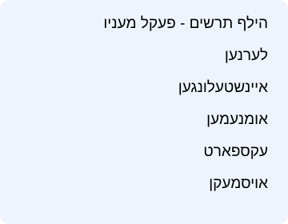
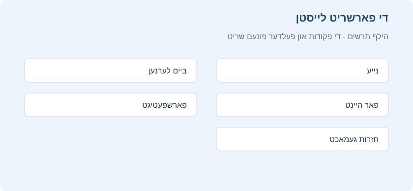

# דער פעקלעך פענצטער

<!-- toc -->

דער פעקלעך פענצטער איז דער הויפט פענצטער פון דער פראגראם. פון דארט קלייבט מען וואס צו לערנען, זעט וויפיל קארטלעך ווארטן, לייגט צו פראגעס, עפנט דורכבלעטערן און קומט צו די געווענליכע פעקל פעולות.

## די פעקלעך ליסטע

יעדער פעקל האט אן אייגענע שורה. דרוקן אויפן נאמען קלייבט אויס דעם פעקל און עפנט זיין סיכום פענצטער. אויב דער פעקל האט אונטערפעקלעך, עפנט און פארמאכט דער פייל נעבן אים די אינערליכע ליסטע. ווען עס זענען דא אסאך פעקלעך, קען מען נוצן דאס זוכן פעלד אינעם הויפט פענצטער צו פארקלענערן די ליסטע לויטן פעקל נאמען אדער וועג.

די שורה מיט א גראען הינטערגרונט איז דער יעצטיגער פעקל. רוב קורצוועג פעולות אינעם פעקלעך פענצטער, ווי אנהייבן לערנען אדער עפענען אויסוואלן, גייען אן אויפן אנגעצייכנטן פעקל. נאכן אריינגיין אין א פעקל, קומט זיין נאמען אויך אין דעם קעפל פונעם סיכום און לערנען פענצטער, כדי קלאר צו זען וואו מען האלט.

## די קנעפלעך אין דער פעקל שורה

ביי דער זייט פון יעדער פעקל שורה זענען דא קליינע קנעפלעך פאר שנעלע פעולות:

- **שרייבט א פראגע**: עפנט דעם צולייגן פענצטער מיט דעם פעקל שוין אויסגעקליבן אלס ציל.
- **דורכבלעטערן**: עפנט דעם דורכבלעטערן פענצטער מיטן זוכן באגרעניצט צו דעם פעקל.
- **שאפן אן אונטערפעקל**: לייגט צו א נייעם פעקל אינעם יעצטיגן פעקל.
- **לערנען**: עפנט דעם חזרה פענצטער.

דרוקן מיטן רעכטן מייז קנעפל אויף א פעקל שורה עפנט נאך פעולות, ווי טוישן נאמען, אויסמעקן, עקספארטירן, פעקל אויסוואלן, אייגענע לערנען, פילטערן פראגעס און צוריקברענגען פון באזייטיגן ביז מארגן. ביי געפילטערטע פעקלעך איז אויך דא איבערבויען אדער אויסליידיגן.

## די פארשריט לייסטן

אין מיטן פון דער פעקל שורה איז דא א קאלירטע לייסט וואס גיט א סיכום פונעם פעקל פאר היינט. האלטן דעם מייז איבער אירע טיילן ווייזט מער גענויע פרטים.

- **נייע קארטלעך**: חומר וואס איז נאכנישט געלערנט געווארן.
- **ביים לערנען**: קארטלעך אין קורצע לערנען טריט וואס דארפן בקרוב צוריקקומען.
- **קארטלעך פאר חזרה**: קארטלעך וועמענס חזרה צייט איז אנגעקומען.
- **חזרות געטון היינט**: א גראער טייל וואס ווייזט וויפיל איר זענט שוין דורכגעגאנגען היינט.
- **פאר מארגן**: ווען עס איז נישט דא נאך חומר פאר היינט אבער עס זענען דא קארטלעך פאר מארגן, קען די לייסט ווייזן מארגן'ס עול.

נומערן אין קלאמערן אין דער לייסט ווייזן קארטלעך איבער דער יעצטיגער טעגליכער גרענעץ. למשל, חזרות וואס זענען באהאלטן צוליב דער טעגליכער חזרה גרענעץ וועלן שטיין אין קלאמערן און נישט דווקא אריינגיין אינעם לערנען רונדע, ביז איר טוישט די גרענעץ אדער נוצט א פאסיגן כלי.

## צושטאנד סימבאלן

נעבן יעדן פעקל איז דא א צושטאנד סימבאל. א ליידיגער פעקל ווערט אנגעצייכנט אנדערש פון א פעקל מיט חומר. ווען אלע חומר פאר היינט איז פארטיג, קומט א פארטיג סימן. אויב עס זענען דא קארטלעך וואס זענען באזייטיגט ביז מארגן, קען דער סימבאל ווייזן אז דער פעקל איז פארטיג, אבער עס איז נאך דא חומר וואס איז באהאלטן ביז מארגן אדער ביז מען ברענגט עס צוריק. א געפילטערטער פעקל האט אן אייגענעם סימן, כדי קלאר צו ווייזן אז זיינע קארטלעך זענען געקומען פון אנדערע היים פעקלעך.

## חזרות היץ מאפע

אינעם הויפט פענצטער און אינעם פעקל סיכום איז דא א חזרות היץ מאפע, ווי א קאלירטער קאלענדאר. יעדער טאג וואס איר האט געלערנט באקומט א קאליר לויטן צאל חזרות. אזוי זעט מען שנעל א רצף פון לערנען, פארנומענע טעג און שטילערע טעג.

## סטאטיסטיק און א קיילעכדיגער דיאגראם

ביי דער זייט פונעם פעקלעך פענצטער איז דא א סטאטיסטיק געגנט מיט א סיכום פון דער זאמלונג פאר היינט. אויבן זעט מען **סך הכל קארטלעך פאר חזרה**, וויפיל קארטלעך זענען צוגעקומען היינט און די געשאצטע לערנען צייט. די פארשריט לייסט אונטן טיילט די ארבעט אין קאטעגאריעס, ווי חזרות שוין געטון היינט, קארטלעך פאר היינט, פארשפעטיגטע קארטלעך און נייע קארטלעך. דרוקן אויף א טייל סטאטיסטיק נומערן עפנט א בחינה אויף די קארטלעך פון יענעם נומער, למשל חזרה אויף קארטלעך פאר היינט. דרוקן אויף אנדערע נומערן עפנט דורכבלעטערן מיט א פאסיגן זוכן, כדי מען זאל קענען זען פון וועלכע קארטלעך דער נומער באשטייט איידער מען באשליסט וואס צו טון.

אונטער דער היץ מאפע איז דא א קיילעכדיגער דיאגראם מיטן נאמען **סטאטיסטיק**. דער שליסל טיילט די זאמלונג אין **בוגר**, **יונג**, **נייע**, **ביים לערנען**, **אפגעשטעלט** און **באזייטיגט ביז מארגן**. האלטן דעם מייז איבער א טייל אדער זיין באשרייבונג ווייזט אן הסבר און נומערן. דרוקן דערויף עפנט דורכבלעטערן געפילטערט צו יענער גרופע.

אויף **סך הכל קארטלעך פאר חזרה** קען מען עפענען א מעניו מיטן רעכטן מייז קנעפל. דארט קען מען באשטימען צי אויך אריינצונעמען נייע קארטלעך אין דער חזרה, אויסקלייבן דעם סדר פון די קארטלעך וואס מען הייבט אן פונעם הויפט פענצטער, אדער מקדים זיין חזרה אויף מארגן'ס קארטלעך וואס זענען נישט יונג. אינעם צוזאמענגעדריקטן מצב ווערט דער קאלענדאר באהאלטן און די סטאטיסטיק קלענער, צו לאזן מער פלאץ פאר דער פעקלעך ליסטע. זעט [צוזאמענגעדריקטער מצב און גראע שאטירונגען](#מצב-דחוס-וגווני-אפור).

## ווארענונג וועגן א גרויסן עול

אונטער דער צאל חזרות פאר היינט קען דער פענצטער ווייזן א ווארענונג איבער קומענדיגע טעג מיט א גרויסן ערווארטעטן צאל חזרות. די ווארענונג איז נישט פארבונדן מיט פראגעס וואס זענען שוין פארשפעטיגט; זי העלפט אייך זען אן אנקומענדיגן עול פאראויס. דרוקן אויף א טאג אין דער ווארענונג הייבט אן א חזרה אויף עלטערע פראגעס וואס זענען באשטימט פאר יענעם טאג, און וואס מען קען א ביסל מקדים זיין אן א גרויסן פארלוסט.

## צוזאמענגעדריקטער מצב און גראע שאטירונגען

ווער עס ארבעט מיט אסאך פעקלעך קען אנצינדן **צוזאמענגעדריקטער מצב**. דאס באהאלט דעם קאלענדאר אינעם הויפט פענצטער און מאכט די סטאטיסטיק קלענער, צו באפרייען פלאץ פאר דער פעקלעך ליסטע. מען קען אויך פארקלענערן די גרייס פונעם צוזאמענגעדריקטן אויסשטעל לויט פראצענט.

צו אנצינדן דעם מצב, עפנט **הויפט מעניו > איינשטעלונגען > אויסזען**, און ביי **אויסזען פונעם הויפט בלאט** צייכנט אן **צוזאמענגעדריקטער מצב**. אויפן זעלבן פלאץ קען מען אויך טוישן **אויסשטעל גרייס אינעם צוזאמענגעדריקטן מצב**.

דארט קען מען אויך אנצינדן **הויפט עקראן אין גראע שאטירונגען (אן קאלירן)**. דאס פארבייט די קאלירטע פעקלעך תצוגה מיט א שטילערן אויסשטעל, פאר ווער עס וויל ווייניגער קאלירן ביים לערנען.

## אויסקלייבן עטליכע פעקלעך

אויבן אין דער פעקלעך ליסטע איז דא א בחירה קנעפל. אין דעם מצב קען מען אנצייכענען עטליכע פעקלעך און טון אויף זיי פעולות ווי קאפירן, אויסשניידן, אריינקלעבן אדער אויסמעקן, לויט די אויסוואלן אויפן לייסט. נוצט דאס פארזיכטיג ווען איר שטעלט איבער א גרויסן בוים פון פעקלעך.

## קורצוועגן פונעם פעקלעך פענצטער

מען קען איינשטעלן קורצוועגן פאר געווענליכע פעקל פעולות אינעם **איינשטעלן קורצוועג קנעפלעך** פענצטער פונעם הויפט מעניו. עפנט דארט דעם **הויפט עקראן** קוויטל און זוכט די גרופע **קורצוועג קנעפלעך פאר פעקל אויסוואלן**. דארט זענען פעולות ווי טוישן נאמען, אויסוואלן, עקספארטירן, אויסמעקן, שאפן אן אונטערפעקל, סיכום, פילטערן פראגעס און אייגענע לערנען.
