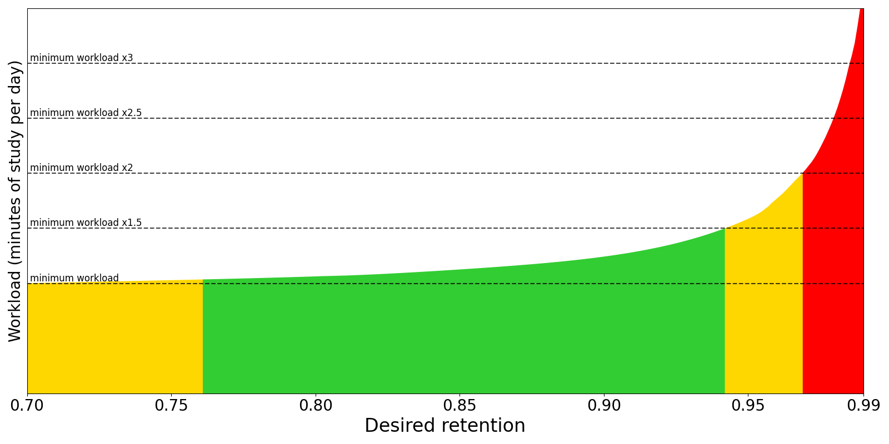

# פעקל אפציעס

<!-- toc -->

פעקל אפציעס באשטימען בעיקר ווי אנקי פלאנירט די קארטלעך. עס איז כדאי צו נוצן די ברירות מחדל פאר עטליכע וואכן, כדי זיך באקענען מיט אנקי איידער מען הייבט אן צופאסן די אויסוואלן. מאכט זיכער אז איר פארשטייט די אויסוואלן פארן זיי טוישן, ווייל טעותן קענען פארמינערן אנקי'ס ווירקזאמקייט.

אויפן קאמפיוטער, טוט איינס פון די פאלגנדע צו עפענען די פעקל אפציעס:

- דרוקט מיטן רעכטן מייז קנעפל אויפן געוואונטשענעם פעקל אינעם הויפט פענצטער.
- דרוקט דערנאך **אפציעס** אונטן אינעם פענצטער.
- אדער דרוקט **נאך > אפציעס** בשעת א בחינה.

## פאראיינשטעלונג

אנקי לאזט טיילן אויסוואלן צווישן פארשידענע פעקלעך, כדי גרינג צו דערהיינטיגן אסאך פעקלעך אויף איינמאל. דערפאר ווערן די אויסוואלן געגרופירט אין _פאראיינשטעלונגען_. אויב איר טוישט אן אויסוואל אין א פאראיינשטעלונג, גייט די ענדערונג אן אויף אלע פעקלעך וואס נוצן זי. אלע נייע פעקלעך נוצן "ברירת מחדל".

צו טוישן די אויסוואלן אין איין פעקל אן צו טוישן אנדערע, דרוקט דעם פייל סימבאל אויבן רעכטס אינעם פעקל אפציעס פענצטער. מען קען טון די פאלגנדע:

- **אפזיכערן**: זיכערט אפ אלע ענדערונגען אין די פעקל אפציעס.
- **צולייגן פאראיינשטעלונג**: לייגט צו א נייע פאראיינשטעלונג פאר דעם פעקל מיט די ברירת מחדל אויסוואלן.
- **קאפירן פאראיינשטעלונג**: קאפירט די יעצטיגע פאראיינשטעלונג, נוצליך ווען מען וויל טוישן א טייל אויסוואלן און לאזן דעם רעשט ווי פריער.
- **טוישן נאמען פון פאראיינשטעלונג**: טוישט דעם נאמען פון דער יעצטיגער פאראיינשטעלונג.
- **אראפנעמען פאראיינשטעלונג**: מעקט אויס די יעצטיגע פאראיינשטעלונג.
- **אפזיכערן פאר אלע אונטערפעקלעך**: ווי **אפזיכערן**, און טיילט אויך צו די אויסגעקליבענע פאראיינשטעלונג צו אלע אונטערפעקלעך פונעם יעצטיגן פעקל.

פעקל אפציעס גייען נישט אן למפרע. למשל, אויב איר טוישט דעם אויסוואל וואס באשטימט דעם אפשטאנד נאך א פארגעסענעם קארטל, וועלן קארטלעך וואס איר האט פארגעסן פאר דער ענדערונג נאך האלטן דעם אלטן אפשטאנד.

## אונטערפעקלעך

אויב אייער פעקל האט אונטערפעקלעך און איר ווילט אז איינער אדער מער זאלן האבן אנדערע איינשטעלונגען פונעם הויפט פעקל, קען מען זיי צוטיילן צו אנדערע פאראיינשטעלונגען. ביים ווייזן א קארטל קוקט אנקי צו וועלכן אונטערפעקל עס געהערט און נוצט יענעם פעקל'ס אויסוואלן. עס זענען דא צוויי אויסנאמען:

- די [גרענעצן](#מגבלות-יומיות) פון **נייע קארטלעך א טאג** און **מערסטע חזרות א טאג** ביי אן אונטערפעקל באשטימען וויפיל קארטלעך מען קען נעמען פון אים. אבער דער גאנצער צאל קארטלעך אינעם לערנען רונדע ווערט באשטימט דורך די גרענעצן פונעם פעקל וואס איר האט אויסגעקליבן צו לערנען.
- די [סדר פון ווייזן](#סדר-חזרה) אויסוואלן קומען פונעם פעקל וואס איר האט אויסגעקליבן צו לערנען, נישט פונעם פעקל פונעם יעצטיגן קארטל.

למשל, שטעלט זיך פאר אז איר האט די פאלגנדע זאמלונג:

    - פעקל א' (פאראיינשטעלונג 1)
      - פעקל א'::אונטערפעקל ב' (פאראיינשטעלונג 2)

פאראיינשטעלונג 1 און 2 זענען די זעלבע, מיט צוויי חילוקים:

- פאראיינשטעלונג 1:
  - **לערן טריט**: `1m 10m`
  - **סדר פון נייע קארטלעך/חזרות**: `אויסמישן מיט חזרות`
- פאראיינשטעלונג 2:
  - **לערן טריט**: `20m 2h`
  - **סדר פון נייע קארטלעך/חזרות**: `ווייזן נאך די חזרות`

אויב איר קלייבט צו לערנען אונטערפעקל ב':

- די לערנען טריט פאר אלע נייע קארטלעך זענען `20m 2h` (פאראיינשטעלונג 2 גייט אן).
- אלע נייע קארטלעך קומען נאך די חזרות (פאראיינשטעלונג 2 גייט אן).

אויב איר קלייבט צו לערנען פעקל א':

- די לערנען טריט פאר נייע קארטלעך אין פעקל א' זענען `1m 10m` (פאראיינשטעלונג 1 גייט אן).
- די לערנען טריט פאר נייע קארטלעך אין אונטערפעקל ב' זענען `20m 2h` (פאראיינשטעלונג 2 גייט אן).
- אלע נייע קארטלעך ווערן געמישט מיט חזרות (פאראיינשטעלונג 1 גייט אן).

באמערקונג: צוליב טעכנישע גרענעצן שרייבט מען די לערנען טריט מיט ענגלישע אותיות. זייער באדייט איז:

- s = סעקונדעס, למשל 1s פאר איין סעקונדע.
- m = מינוטן.
- h = שעה'ן.
- d = טעג.

## טעגליכע גרענעצן

### נייע קארטלעך א טאג

דער אויסוואל באשטימט וויפיל נייע קארטלעך מען קען ווייזן אין יעדן טאג וואס איר עפנט די פראגראם. אויב איר לערנט ווייניגער פונעם גרענעץ אדער פארפעלט א טאג, הייבט דער ציילער צומארגנס אן פון אנהייב. איר וועט נישט באקומען מער קארטלעך ווי אייער גרענעץ ערלויבט.

ביים לערנען א פעקל מיט אונטערפעקלעך, באשטימען די גרענעצן פון יעדן אונטערפעקל דעם מאקסימום וואס מען נעמט פון יענעם פעקל. די גרענעצן פונעם אויסגעקליבענעם פעקל באשטימען דעם גאנצן צאל קארטלעך וואס מען ווייזט.

לערנען נייע קארטלעך פארגרעסערט צייטווייליג די טעגליכע חזרות, ווייל לעצטנס געלערנטן חומר דארף מען חזרן עטליכע מאל פאר די אפשטאנדן קענען פיל וואקסן. אויב איר לערנט קבוע 20 נייע קארטלעך א טאג, קענט איר ערווארטן בערך 200 חזרה קארטלעך א טאג. מען קען פארמינערן די נויטיגע חזרות דורך ווייזן ווייניגער נייע קארטלעך טעגליך ביז דער חזרה עול ווערט קלענער. נישט ווייניג אנקי באניצער האבן מיט התלהבות געלערנט הונדערטער נייע קארטלעך אין די ערשטע טעג, און דערנאך זיך געפונען איבערגעלאדן מיט חזרות.

### מערסטע חזרות א טאג

לאזט באשטימען א מאקסימום צאל חזרה קארטלעך פאר א טאג. ווען מען דערגרייכט די גרענעץ, ווייזט אנקי נישט נאך חזרה קארטלעך אין יענעם טאג, אפילו נאך ווארטן. ביים קבוע'ן לערנען קען דאס אויסגלייכן צייטווייליגע העכערונגען אינעם צאל גרייטע קארטלעך און פארמיידן א שרעק ביים צוריקקומען נאך א וואך הפסקה. ווען דער אויסוואל באהאלט חזרות, קומט א מעלדונג אינעם סיכום פענצטער וואס לייגט פאר צו פארגרעסערן די גרענעץ אויב איר האט צייט.

צו שנעל אראפנעמען כמעט די גאנצע טעגליכע גרענעץ, עפנט דעם הויפט מעניו און קלייבט **מאגר געצייג > אראפנעמען די טעגליכע חזרה גרענעץ**. דאס קלייבט נישט אויס קיין באזונדערן פעקל און טוישט נישט זיין נאמען. עס שטעלט פשוט די נייע קארטלעך און חזרה גרענעצן אין די פאראיינשטעלונגען צו א זייער הויכן ווערט, אזוי אז די גרענעץ וועט אייך כמעט נישט אפשטעלן.

ביים לערנען א פעקל מיט אונטערפעקלעך, ארבעט די חזרה גרענעץ ענליך צו דער נייע קארטלעך גרענעץ.

אנקי רעכנט אויך אלע לערנען קארטלעך וואס האבן [אריבער א טאג גרעניץ](./preferences.md#חזרה) אינעם חזרה צאל. די קארטלעך זענען דערפאר אויך אונטער דער חזרה גרענעץ.

### טעגליכע גרענעצן לויט פעקל

מען קען נוצן די זעלבע פאראיינשטעלונג פאר פארשידענע פעקלעך, מיט אן אייגענער גרענעץ פאר יעדן פעקל. אזוי דארף מען נישט מאכן קאפיעס פון פאראיינשטעלונגען נאר דערפאר, און מען קען גרינגער איינשטעלן באזונדערע גרענעצן פאר אונטערפעקלעך.

אנקי גיט דריי מעגליכקייטן פאר טעגליכע גרענעצן:

- **פאראיינשטעלונג**: גייט אן אויף אלע פעקלעך וואס נוצן די פאראיינשטעלונג.
- **דער פעקל**: נאר פאר א געוויסן פעקל.
- **נאר היינט**: נאר פאר א געוויסן פעקל און צייטווייליג.

### נייע קארטלעך איגנארירן די חזרה גרענעץ

לויט דער ברירת מחדל גייט די חזרה גרענעץ אויך אן אויף נייע קארטלעך. מען ווייזט נישט נייע קארטלעך ווען די חזרה גרענעץ איז דערגרייכט. אויב דער אויסוואל איז אנגעצונדן, קומען נייע קארטלעך אפגעזען פון דער חזרה גרענעץ.

אויב איר האט א הויפן פארשפעטיגטע חזרה קארטלעך, איז כדאי אפצושטעלן נייע קארטלעך ביז איר האט נאכגעהאלטן דעם הויפן. ווייטער צולייגן נייע קארטלעך בשעת איר זענט שוין הינטערשטעליג קען פארגרעסערן דעם הויפן.

### גרענעצן הייבן זיך אן פון אויבן

לויט דער ברירת מחדל גייען די טעגליכע גרענעצן פון א העכערן פעקל נישט אן ווען איר קלייבט אן אונטערפעקל. א הויפט פעקל קען האבן א גרענעץ פון 10 נייע קארטלעך א טאג, בשעת זיינע אונטערפעקלעך האבן א גרענעץ פון 20. דער הויפט פעקל'ס גרענעץ ווירקט נישט אויפן צאל נייע קארטלעך וואס איר קענט לערנען פון זיין אונטערפעקל.

ווען דער אויסוואל איז אנגעצונדן, גייען די העכערע פעקלעך גרענעצן אויך אן ביים אויסקלייבן אן אונטערפעקל. אינעם פריערדיגן ביישפיל קענט איר נאר לערנען 10 נייע קארטלעך פון די אונטערפעקלעך אנשטאט 20.

דאס קען העלפן אויב איר ווילט לערנען באזונדערע אונטערפעקלעך און דערביי האלטן אן אלגעמיינע גרענעץ פאר די קארטלעך פון אלע אונטערפעקלעך צוזאמען.

## נייע קארטלעך

די אויסוואלן דא ווירקן נאר אויף נייע קארטלעך און [קארטלעך ביים לערנען](getting-started.md#מצבי-כרטיסים). נאכדעם וואס א קארטל איז פארטיג מיט אלע לערנען טריט, גייען די אויסוואלן אין דעם טייל שוין נישט אן אויף אים.

### לערן טריט

די איינשטעלונג באשטימט דעם צאל לערנען חזרות און די אפשטאנדן צווישן זיי. שרייבט איין אדער מער אפשטאנדן, צעטיילט מיט רווחים. יעדעס דרוקן אויף **גוט** ברענגט דאס קארטל צום קומענדיגן טריט. יעדעס דרוקן אויף **נאכאמאל** ברענגט עס צוריק צום ערשטן טריט.

למשל, שטעלט זיך פאר אז די לערנען טריט זענען `1m 10m 1d`.

- מיט **נאכאמאל** גייט דאס קארטל צום ערשטן טריט און קומט ווידער נאך איין מינוט.
- מיט **גוט** אויף א נייעם קארטל אדער נאך דעם איין מינוט טריט, גייט עס צום קומענדיגן טריט און קומט ווידער אין 10 מינוט.
- מיט **גוט** נאך דעם 10 מינוט טריט, קומט עס נישט ווידער ביז צומארגנס.
- מיט **גוט** צומארגנס, ענדיגט עס די לערנען טריט און ווערט א חזרה קארטל. עס קומט ווידער נאך דעם אפשטאנד באשטימט דורך _אפשטאנד ביים ענדיגן לערנען_.

**שווער** ארבעט אנדערש לויט דעם טריט וואו איר האלט.

- ביים ערשטן טריט ווייזט **שווער** אן אפשטאנד פון `6m`. `6m` איז דער דורכשניט פון די ערשטע צוויי טריט: `1m` און `10m`.
  - אן אויסנאם: מיט נאר איין לערנען טריט ווייזט **שווער** 1.5 מאל דעם טריט. דער אפשטאנד קען זיין העכסטנס איין טאג לענגער פונעם לערנען טריט.
- ביי יעדן אנדערן טריט חזרט **שווער** דעם זעלבן טריט.

אויב עס איז נישט דא אנדערע חומר צום לערנען, ווייזט אנקי לויט דער ברירת מחדל לערנען קארטלעך ביז 20 מינוט פאר דער צייט. צו אויסלעשן דאס אדער טוישן די פאראויס צייט, זעט [איינשטעלונגען](preferences.md).

#### טאג גרענעצן

אנקי באהאנדלט קורצע טריט אנדערש פון טריט וואס [גייען איבער א טאג גרעניץ](./preferences.md#חזרה). קורצע טריט קומען ווי נאר דער אפשטאנד איז פארביי, מיט א קדימה פאר חזרה און נייע קארטלעך, כדי מען זאל קענען ענטפערן ווי נאענט ווי מעגליך צו דער געוואונטשענער צייט. ווען א טריט גייט איבער א טאג גרעניץ, ווערט דער אפשטאנד אויטאמאטיש פארוואנדלט אין טעג. למשל, אויב דער קומענדיגער טאג הייבט זיך אן אין 5 שעה'ן און דער אפשטאנד איז 6 שעה'ן, מאכט אנקי דערפון איין טאג.

### אפשטאנד ביים ענדיגן לערנען

דער צאל טעג צו ווארטן פארן נאכאמאל ווייזן א קארטל נאך "גוט" אויפן לעצטן לערנען טריט. דאס איז דער ערשטער אפשטאנד נאכן ענדיגן לערנען. זעט דעם ביישפיל [פריער אין דעם טייל](deck-options.md#שלבי-למידה).

### אפשטאנד פאר גרינג

דער צאל טעג צו ווארטן פארן נאכאמאל ווייזן א קארטל נאך "גרינג".

**גרינג** מאכט לערנען קארטלעך צו חזרה קארטלעך אפגעזען פונעם יעצטיגן טריט, און גיט זיי דעם אפשטאנד פון דעם אויסוואל. דער גרינג אפשטאנד דארף שטענדיג זיין כאטש אזוי לאנג ווי דער אפשטאנד ביים ענדיגן לערנען, און געווענליך עטליכע טעג לענגער.

### סדר פון אריינלייגן

אין עלטערע ווערסיעס האט דער אויסוואל באשטימט צי אנקי זאל צולייגן נייע קארטלעך צופעליג אדער לויטן סדר. ביים טוישן דעם אויסוואל סארטירט אנקי איבער די פעקלעך פון דער יעצטיגער פאראיינשטעלונג.

למעשה טוישט דער אויסוואל דא נישט דעם לערנען סדר. לאזט עס אויף `לויטן סדר (עלטערע קארטלעך צום ערשט)` און שטעלט אנשטאט דעם איין דעם [סדר פון ווייזן](deck-options.md#סדר-חזרה).

## פארגעסונגען

ווען איר דרוקט **נאכאמאל** אויף א קארטל בשעת חזרה, הייסט דאס א _פארגעסונג_. די אויסוואלן דא ווירקן אויף אזעלכע קארטלעך.

### איבערלערן טריט

ווי לערנען טריט, אבער פאר קארטלעך וואס מען האט פארגעסן. ווען איר פארגעסט א חזרה קארטל און דרוקט **נאכאמאל**, גייט דאס קארטל דורך _איבערלערן טריט_ פאר עס ווערט ווידער א חזרה קארטל.

אויב די טריט זענען ליידיג, שפרינגט דאס קארטל איבער איבערלערנען און באקומט לויט דער ברירת מחדל א נייעם אפשטאנד פון איין טאג.

### קלענסטער אפשטאנד

דער קלענסטער צאל טעג וואס א קארטל דארף ווארטן נאכן ענדיגן איבערלערנען. די ברירת מחדל איז איין טאג: עס קומט ווידער צומארגנס ווי נאר איבערלערנען איז פארטיג.

### עלוקות

באשטימט ווי אנקי באהאנדלט עלוקות. פאר פרטים, זעט [עלוקות](leeches.md).

## סדר פון ווייזן

די אויסוואלן אין דעם טייל גייען אן אויפן פעקל וואס איר האט אויסגעקליבן צו לערנען אינעם הויפט פענצטער, נישט אויפן פעקל פון דעם קארטל וואס ווערט יעצט געוויזן.

מער איבער דעם סדר איז דא אינעם [לערנען טייל](studying.md#סדר-התצוגה).

### סדר פון נעמען נייע קארטלעך

באשטימט ווי אנקי נעמט נייע קארטלעך פון א פעקל. די אויסוואלן זענען:

- **פעקל**: נעמט קארטלעך פון יעדן אונטערפעקל לויטן סדר, פון אויבן אן. אין יעדן אונטערפעקל ווערן קארטלעך גענומען פון נידריגן צו הויכן פלאץ. אויב דער אויסגעקליבענער פעקל'ס טעגליכע גרענעץ ווערט דערגרייכט, קען דאס נעמען זיך אפשטעלן פאר איר האט געחזרט אלע אונטערפעקלעך. דער סדר איז דער שנעלסטער אין גרויסע זאמלונגען, און לאזט געבן א קדימה פאר אונטערפעקלעך וואס זענען נאענטער צום אויבערשטן טייל.

  פעקלעך און אונטערפעקלעך זענען שטענדיג אויסגעשטעלט לויטן אלף בית. מען קען דעריבער געבן א נומער פרעפיקס ווי 001 צו באשטימען זייער סדר. מען קען אויך נוצן `_` און `~` אלס פרעפיקס צו שטעלן זאכן אויבן אדער אונטן.

  דער פלאץ סדר ווענדט זיך ביים אנהייב אין סדר פון אריינלייגן, אבער מען קען [ניי באשטימען דעם פלאץ](./browsing.md#כרטיסים) מיט דער האנט אויף פארשידענע וועגן.

- **פעקל, דערנאך צופעליגע רשומות**: נעמט קארטלעך פון יעדן אונטערפעקל לויטן סדר, פון אויבן אן. אין יעדן אונטערפעקל נעמט מען קארטלעך פון צופעליג אויסגעקליבענע רשומות.

- **פון נידריגן צו הויכן פלאץ**: נעמט קארטלעך לויט אן אויפגייענדיגן פלאץ (חזרה נומער), געווענליך פונעם עלטסטן צוגעלייגטן קארטל אן.

- **פון הויכן צו נידריגן פלאץ**: נעמט קארטלעך לויט אן אראפגייענדיגן פלאץ (חזרה נומער), געווענליך פונעם נייסטן צוגעלייגטן קארטל אן.

- **צופעליגע רשומות**: נעמט קארטלעך פון צופעליג אויסגעקליבענע רשומות.

- **צופעליגע קארטלעך**: נעמט קארטלעך אין א צופעליגן סדר.

### סארטיר סדר פאר נייע קארטלעך

באשטימט ווי מען סארטירט די נייע קארטלעך נאכן זיי נעמען. די אויסוואלן זענען:

- **סארט קארטל, דערנאך סדר פון נעמען**: ווייזט קארטלעך לויטן נומער פונעם סארט קארטל. קארטלעך פון יעדן נומער קומען אין דעם סדר ווי מען האט זיי גענומען. אויב באזייטיגן ברידער איז אויסגעלאשן, קומען אלע פארנט←הינטן קארטלעך פאר אלע הינטן←פארנט קארטלעך. דער סדר העלפט ווען מען וויל נישט אז ברידער זאלן קומען צו נאענט איינס צום אנדערן.

- **סדר פון נעמען**: ווייזט די קארטלעך פונקט ווי מען האט זיי גענומען. אויב באזייטיגן ברידער איז אויסגעלאשן, מאכט דאס געווענליך אז אלע ברידער זאלן קומען איינס נאכן אנדערן.

- **סארט קארטל, דערנאך צופעליג**: ווייזט קארטלעך לויטן נומער פונעם סארט קארטל, אבער מישט די קארטלעך פון יעדן נומער. דער סדר העלפט ווען מען וויל נישט אז ברידער זאלן קומען צו נאענט צוזאמען, און דאך וויל מען א צופעליגן סדר.

- **צופעליגע רשומה, דערנאך סארט קארטל**: קלייבט צופעליגע רשומות און ווייזט דערנאך אלע זייערע ברידער לויטן סדר.

- **צופעליג**: מישט אינגאנצן די גענומענע קארטלעך.

### סדר פון נייע קארטלעך/חזרות

באשטימט צי נייע קארטלעך זאלן ווערן געמישט מיט חזרה קארטלעך, קומען פאר זיי אדער נאך זיי.

### סדר פון לערנען פון פריערדיגע טעג/חזרות

באשטימט צי לערנען אדער איבערלערנען קארטלעך וואס גייען איבער א טאג גרעניץ זאלן ווערן געמישט מיט חזרה קארטלעך, קומען פאר זיי אדער נאך זיי. לערנען קארטלעך זענען געווענליך שווערער פון חזרה קארטלעך. א טייל באניצער ווילן זיי דערפאר צום סוף, צו טון קודם די גרינגע זאכן, אדער ביים אנהייב, כדי צו האבן מער צייט ווידער צו חזרן די פארגעסענע.

### סארטיר סדר פאר חזרות

באשטימט ווי מען סארטירט חזרה קארטלעך. די אויסוואלן זענען:

- **חזרה דאטום, דערנאך צופעליג**: דער פעליקייט סדר גיט א קדימה פאר קארטלעך וואס האבן לענגער געווארט. דאס איז דער רעקאמענדירטער סדר ווען איר האלט מיט אלע חזרות, אדער האט נאר א קליינעם פארשפעטיגטן הויפן. נאך א לאנגע הפסקה אדער ביים זיין הינטערשטעליג, קען מען צייטווייליג טוישן דעם סדר.
- **חזרה דאטום, דערנאך פעקל**: גיט אויך א קדימה פאר קארטלעך וואס האבן לענגער געווארט, און ווייזט דערנאך די חזרות פון יעדן אונטערפעקל אין זיין ריי.
- **פעקל, דערנאך חזרה דאטום**: ווייזט די חזרות פון יעדן אונטערפעקל אין זיין ריי. דער סדר איז געווענליך נישט רעקאמענדירט, ווייל שטענדיג זען חומר אינעם זעלבן סדר מאכט גרינגער צו ראטן דעם ענטפער לויטן הקשר און ברענגט שוואכערע זכרונות.
- **פון קורצע צו לאנגע אפשטאנדן**: ווייזט ערשט קארטלעך מיט קורצערע אפשטאנדן.
- **פון לאנגע צו קורצע אפשטאנדן**: ווייזט ערשט קארטלעך מיט לענגערע אפשטאנדן.
- **פון ווייניגער צו מער גרינגקייט**: ווייזט ערשט שווערערע קארטלעך.
- **פון מער צו ווייניגער גרינגקייט**: ווייזט ערשט גרינגערע קארטלעך.
- **פארשפעטיגונג לויטן אפשטאנד**: ווייזט ערשט די קארטלעך וואס איר האט מסתמא מער פארגעסן. דאס איז געווענליך רעקאמענדירט פאר א גרויסן הויפן וואס וועט נעמען צייט דורכצוגיין, כדי ווייניגער צו ריזיקירן פארגעסן נאך קארטלעך.

  מיטן SM-2 אלגאריטם באשטימט מען די פארשפעטיגונג דורך פארגלייכן ווי פארשפעטיגט דאס קארטל איז מיט דער לענג פון זיין אפשטאנד. למשל, א קארטל מיט א 5 טאג אפשטאנד וואס איז 2 טעג פארשפעטיגט וועט קומען פאר א קארטל מיט א 10 טאג אפשטאנד וואס איז 3 טעג פארשפעטיגט.

  ווען FSRS איז אנגעצונדן, ווערט דער אויסוואל אראפגענומען. דער ענליכער FSRS אויסוואל איז **פון נידריגן צו הויכן שאנס צו געדענקען**, גערעכנט לויטן שאנס צו געדענקען יעדעס קארטל און דער געוואונטשענער געדענק ראטע פון דער פאראיינשטעלונג.

## באזייטיגן ביז מארגן

ווען אנקי נעמט קארטלעך, נעמט עס ערשט לערנען קארטלעך אינעם זעלבן טאג, דערנאך לערנען קארטלעך וואס גייען איבער טעג, דערנאך חזרה קארטלעך און צום סוף נייע קארטלעך. דאס ווירקט אויפן באזייטיגן:

- אויב אלע באזייטיגן אויסוואלן זענען אנגעצונדן, קומט דער ברודער וואס איז דאס פריסטע אין דער ליסטע. למשל, א חזרה קארטל קומט פאר א נייעם קארטל.
- שפעטערדיגע ברידער אינעם סדר קענען נישט באזייטיגן פריערדיגע סארטן קארטלעך. למשל, אויב באזייטיגן נייע קארטלעך איז אויסגעלאשן און איר לערנט א נייעם קארטל, וועט עס נישט באזייטיגן קיין לערנען קארטל פון א פריערדיגן טאג אדער קיין חזרה קארטל. מען קען דעריבער זען סיי א חזרה ברודער און סיי א נייעם ברודער אינעם זעלבן רונדע.

די אויסוואלן זענען:

- **באזייטיגן פארבונדענע נייע קארטלעך**: צי אנדערע נייע קארטלעך פון דער זעלבער רשומה, ווי פארקערטע קארטלעך און שכינות'דיגע אויסלאזן, זאלן ווערן אפגעשטופט ביז מארגן.
- **באזייטיגן פארבונדענע חזרה קארטלעך**: צי אנדערע חזרה קארטלעך פון דער זעלבער רשומה זאלן ווערן אפגעשטופט ביז מארגן.
- **באזייטיגן פארבונדענע לערן קארטלעך פון פריערדיגע טעג**: צי אנדערע לערנען קארטלעך פון דער זעלבער רשומה וואס זענען אריבער א טאג גרעניץ זאלן ווערן אפגעשטופט ביז מארגן.

פאר מער איבער באזייטיגן קארטלעך, זעט [דעם טייל](./studying.md#אחים-והטמנה) אינעם מדריך.

## קול

- **נישט אויטאמאטיש אפשפילן קול**: לויט דער ברירת מחדל שפילט אנקי אויטאמאטיש יעדן קול אויף אייערע קארטלעך. מיט דעם אויסוואל וועט אנקי נישט שפילן קול ביז איר דרוקט נאכאמאל אפשפילן, <kbd>R</kbd> אדער <kbd>F5</kbd>.

- **אויסלאזן פראגע ביים נאכאמאל אפשפילן ענטפער**: באשטימט צי מען זאל שפילן דעם פראגע זייט'ס קול ביים נאכאמאל אפשפילן פון דער ענטפער זייט. אנקי שפילט נישט אויטאמאטיש קול פונעם `{{FrontSide}}` פעלד. דער אויסוואל ווירקט נישט אויפן אויטאמאטישן אפשפילן.

## זייגערס

אנקי פאלגט נאך וויפיל צייט עס נעמט אייך ענטפערן יעדעס קארטל, כדי צו זען וויפיל צייט איר האט געלערנט יעדן טאג. די צייט ווירקט נישט אויפן צייט פלאן.

### אינערליכער זייגער

- גרעסטע צאל סעקונדעס פאר אן ענטפער: די ברירת מחדל גרענעץ איז 60 סעקונדעס. אויב עס נעמט לענגער, נעמט אנקי אן אז איר זענט אוועק פונעם קאמפיוטער אדער עפעס האט אייך אפגעצויגן. עס באגרעניצט די איינגעשריבענע צייט צו 60 סעקונדעס, כדי נישט צו געבן אומגענויע סטאטיסטיק.
- דער אינערליכער זייגער ארבעט פון ווען די פראגע קומט ביז איר דרוקט אן אפשאצונג קנעפל פארן ענטפער. אויב איר נוצט קבוע מער פון 60 סעקונדעס פאר א קארטל, קען מען פארגרעסערן די גרענעץ. נאך בעסער איז צו מאכן אייערע קארטלעך פשוטער.

### זייגער אויפן עקרן

- ווייזן א זייגער אויפן עקרן: ווייזט אינעם לערנען פענצטער א זייגער וואס ציילט די צייט פון לערנען יעדעס קארטל. ער שטעלט זיך אפ ווען מען דערגרייכט די מאקסימום סעקונדעס פאר אן ענטפער וואס זענען באשטימט פארן אינערליכן זייגער.
- אפשטעלן דעם זייגער ביים ווייזן ענטפער: באשטימט צי דער עקרן זייגער זאל ווייטער לויפן פון ווען דער ענטפער קומט ביז איר דרוקט אן אפשאצונג קנעפל. דער אויסוואל ווירקט נישט אויף דער צייט וואס ווערט איינגעשריבן אין אייער סטאטיסטיק.

## אויטאמאטיש ווייטערגיין

אויטאמאטיש ווייטערגיין טוט געוויסע פעולות אויטאמאטיש נאך א באשטימטער צייט. צו נוצן עס, שטעלט ערשט א צייט העכער פון נול ביי **סעקונדעס צו ווייזן די פראגע** און/אדער **סעקונדעס צו ווייזן דעם ענטפער**. אינעם לערנען פענצטער, נוצט דערנאך אויטאמאטיש ווייטערגיין אונטער **נאך אויסוואלן** צו אנהייבן.

**ווארטן אויף קול** באשטימט צי די אויסגעקליבענע פעולה זאל אנהייבן פאר דער קול פון דער פראגע אדער ענטפער ענדיגט זיך.

צו אנצינדן אויטאמאטיש ווייטערגיין אלס ברירת מחדל, עפנט **פעקל אפציעס**, גייט צו **אויטאמאטיש ווייטערגיין**, שטעלט וויפיל סעקונדעס צו ווארטן ביי דער פראגע און/אדער ענטפער, און צייכנט אן אז עס זאל זיין אקטיוו פארן פעקל אדער דער פאראיינשטעלונג. נאכן אפזיכערן, אויב איר זענט שוין אינעם חזרה פענצטער, ווערט אויך דער יעצטיגער רונדע דערהיינטיגט. מען דארף נישט פארמאכן אנקי.

בשעת חזרה קען מען נאך אנצינדן אדער אויסלעשן אויטאמאטיש ווייטערגיין דורך **נאך אויסוואלן > אויטאמאטיש ווייטערגיין**. נוצט דאס פאר א רונדע מיט דער האנט ביי א טייל קארטלעך און אויטאמאטיש ביי אנדערע. הייבט אן מיט גענוג צייט פאר פראגע און ענטפער, קוקט אז דער קצב לייגט נישט קיין דרוק, און ערשט דערנאך פארקירצט די צייטן.

## גרינגע טעג

צו נוצן ווייניגער צייט אויף אנקי אין געוויסע וואכן טעג, ווי פרייטאג און שבת, קען די מעגליכקייט העלפן. נאכן רעכענען דעם אפשטאנד ווערט ער א ביסל צוגעפאסט, כדי צו טוישן דעם חזרה דאטום. שטעלן אלע טעג צו "ווייניגער" אדער "דאס ווייניגסטע" וועט געבן דעם זעלבן עול ווי אלע טעג אויף "געווענליך". דאס ארבעט סיי מיט FSRS און סיי מיטן אלטן SM-2 אלגאריטם. טוישן די גרינגע טעג איינשטעלונגען טוישט נישט עקזיסטירנדע אפשטאנדן למפרע, נאר קומענדיגע. אין פשוטע ווערטער, איר וועט נישט גלייך זען א ענדערונג אינעם צאל גרייטע קארטלעך.

## FSRS

דער פרייער אפשטאנד חזרה פלאנירער (FSRS) איז אן אנדער מעגליכקייט צו אנקי'ס אלטן SuperMemo 2 (SM-2) אלגאריטם. דורך גענויער באשטימען וויפיל אינפארמאציע איר גייט מסתמא פארגעסן, קען ער העלפן געדענקען מער חומר אינעם זעלבן צייט.

ווען איר צינדט אן FSRS, ווערן נייע אויסוואלן צוטריטליך, און SM-2 אויסוואלן ווי **אפשטאנד ביים ענדיגן לערנען** און **גרינג צוגאב** ווערן באהאלטן. דער אויסוואל איז געמיינזאם פאר אלע פאראיינשטעלונגען.

כדי צו פארמיידן געווענליכע טעותן, קומט אינעם ממשק א קורצער הסבר איבער FSRS איינשטעלונגען און וואס עס מיינט צו טוישן די געוואונטשענע געדענק ראטע, פאראמעטערס און חזרה צייטן. אויב א ווארענונג קומט, לייענט זי פארן באשטעטיגן. זי קומט געווענליך פארמיידן אז אסאך קארטלעך זאלן ווערן אפגעשטופט אדער מקדים אויף איינמאל אן אייער כוונה.

מען קען אויך גרינג אנצינדן, אויסלעשן אדער טוישן צווישן FSRS און SM-2 דורך **מאגר געצייג > חזרה פלאנירונג שיטה**. דער פענצטער ווייזט וואס איז יעצט אקטיוו, לאזט גלייך טוישן די שיטה און גיט קורצע עצות פאר ריכטיגן באנוץ. אויב איר ווייסט נישט וואס אויסצוקלייבן, עפנט ערשט דעם פענצטער, לייענט זיין קורצן הסבר און באשליסט דערנאך צי אריבערצוגיין.

### א קורצער מדריך

- צינדט אן FSRS אינעם "FSRS" טייל אונטן אין די פעקל אפציעס. מען קען נאר אנצינדן FSRS פאר דער גאנצער זאמלונג, נישט פאר א טייל פאראיינשטעלונגען און פאר אנדערע אויסלעשן.
- מאכט זיכער אז אלע [לערן טריט](#שלבי-למידה) און [איבערלערן טריט](#שלבי-למידה-מחדש) זענען קירצער פון איין טאג און קענען ווערן פארענדיגט אינעם זעלבן טאג. 23 שעה'ן זענען נישט רעקאמענדירט אפילו עס איז ווייניגער פון א טאג, ווייל איר קענט נישט פארענדיגן דעם טריט אינעם זעלבן טאג ווי די ערשטע חזרה. טריט ווי 10 אדער 30 מינוט זענען גוט.
- דרוקט "פארבעסערן די איצטיגע פאראיינשטעלונג" אונטער "FSRS פאראמעטערס". אויב עס קומט "די FSRS פאראמעטערס זעען יעצט אויס ווי די בעסטע מעגליכע", איז דאס אין ארדענונג.
- קלייבט א [געוואונטשענע געדענק ראטע](#שימור-רצוי): דער פראצענט קארטלעך וואס איר וועט מצליח זיין צו געדענקען ווען זיי זענען גרייט צו חזרה. **דאס איז די וויכטיגסטע FSRS איינשטעלונג. א העכערע ראטע ברענגט קורצערע אפשטאנדן און מער חזרות א טאג.** די ברירת מחדל איז 90%, א גוטער באלאנס צווישן געדענקען און ארבעט. העכער 90% וואקסט די ארבעט זייער שנעל, און העכער 97% קען דער עול זיין איבערוועלטיגנד. מען קען נוצן דעם [סימולאטאר](#הסימולטור) צו פארגלייכן ראטעס און זען זייער ערווארטעטן השפעה אויפן חזרה עול.
  פאראמעטערס און געוואונטשענע געדענק ראטע זענען באזונדער פאר יעדער פאראיינשטעלונג. מען קען מאכן עטליכע פאראיינשטעלונגען מיט אנדערע פאראמעטערס און ראטעס.

FSRS קען זיך צופאסן צו כמעט יעדן הרגל, חוץ איין זאך: דרוקן "שווער" אנשטאט "נאכאמאל" ווען איר פארגעסט דעם ענטפער. ביים דרוקן "שווער" נעמט FSRS אן אז איר האט ריכטיג געדענקט, כאטש מיט ספיקות און פיל אנשטרענגונג. אויב איר דרוקט "שווער" ווען איר האט נישט געקענט דעם ענטפער, ווערן אלע אפשטאנדן אומפארשטענדליך גרויס. אויב איר האט דעם הרגל, טוישט אים און נוצט "נאכאמאל" ווען איר פארגעסט.

וועגן ניי באשטימען צייטן מיט דער האנט: עס איז נישט רעקאמענדירט דאס צו טון פאר קארטלעך. אויב זיי זענען גרינג און איר ווילט לענגערע אפשטאנדן, וועלן עטליכע חזרות מיט "גרינג" גענוג זיין. אויב איר קענט נישט דעם ענטפער, דרוקט "נאכאמאל". דאס וועט נישט פיל פארגרעסערן דעם חזרה עול, ווייל אפילו נאך נאכאמאל ווערן די אפשטאנדן נישט ווי ביי א נייעם קארטל.

### געוואונטשענע געדענק ראטע

די געוואונטשענע געדענק ראטע באשטימט דעם שאנס אז איר וועט געדענקען קארטלעך ווען זיי זענען באשטימט צו חזרה. די ברירת מחדל פון `0.90` פלאנירט די קארטלעך אזוי אז איר זאלט האבן א 90% שאנס זיי צו געדענקען ביים קומענדיגן חזרה. געווענליך זאל דאס געבן בערך 90% ריכטיגע ענטפערס און נאר בערך 10% פארגעסונגען.

דא איז א גראף וואס ווייזט ווי טוישן דעם ווערט ווירקט אויפן עול:

דער גענויער פארעם פונעם גראף איז אנדערש ביי יעדן, אבער צוויי מוסטערן זענען אמת ביי אלעמען:

- וואס נאענטער די געוואונטשענע ראטע קומט צו 1.0, אלץ שטערקער וואקסט דער עול.
  שטעלט זיך פאר א קארטל וואס איר האט א 90% שאנס צו געדענקען נאך 100 טעג. מיט א געוואונטשענער ראטע פון `0.90` וועט איר אים ווידער חזרן אין 100 טעג. אבער מיט `0.95` וועט איר אים דארפן חזרן נאך 46 טעג.
  דאס מיינט אז מיט `0.95` ווערן די אפשטאנדן כמעט האלב אזוי גרויס, און איר דארף חזרן צוויי מאל אזוי אפט ווי מיט `0.90`.
  ביי `0.97` איז דער אפשטאנד 27 טעג, און איר דארף חזרן 3.7 מאל אזוי אפט.
  ביי `0.99` איז דער אפשטאנד נאר 9 טעג, און איר דארף חזרן מער ווי 10 מאל אזוי אפט ווי מיט די ברירות מחדל.

- וואס נידריגער די געוואונטשענע ראטע, אלץ גרעסער דער פראצענט קארטלעך וואס איר פארגעסט און דארף ווידער חזרן. צום סוף קומט א פונקט וואו די פארגעסענע קארטלעך לייגן צו מער ארבעט ווי די לענגערע אפשטאנדן שפארן. אויך, אפט פארגעסן חומר קען אפשוואכן דעם חשק צום לערנען.

דערפאר ראטן מיר צו זיין פארזיכטיג ביים טוישן דעם נומער, און געווענליך האלטן אים אונטער `0.97`. אויב איר קלייבט צווישן עטליכע ווערטן, נוצט דעם [סימולאטאר](#הסימולטור) צו זען דעם ערווארטעטן חזרה עול און טעגליכן צייט פארן טוישן די איינשטעלונג.

### FSRS פאראמעטערס

FSRS פאראמעטערס ווירקן אויף דעם קארטלעך צייט פלאן. טוישט זיי נישט מיט דער האנט און קאפירט זיי נישט פון אן אנדערן.

**פארבעסערן FSRS פאראמעטערס**

דער FSRS פארבעסערער נוצט מאשין לערנען צו דערקענען אייערע זכרון מוסטערן און געפינען די פאסיגסטע פאראמעטערס פאר אייער חזרות היסטאריע. ער דארף דערפאר א צאל חזרות כדי צו צופאסן די פאראמעטערס.

ווען איר דרוקט **פארבעסערן די איצטיגע פאראיינשטעלונג**, אנאליזירט FSRS אייער חזרות היסטאריע און שאפט די פאסיגסטע פאראמעטערס פאר אייער זכרון און דעם חומר וואס איר לערנט. אויב איר האט פעקלעך מיט זייער פארשידענער שוועריגקייט, איז כדאי צו געבן זיי באזונדערע פאראיינשטעלונגען, ווייל גרינגע און שווערע פעקלעך וועלן האבן אנדערע פאראמעטערס. מען דארף נישט אפט פארבעסערן די פאראמעטערס; איינמאל א חודש איז גענוג.

לויט דער ברירת מחדל ווערן די פאראמעטערס גערעכנט פון דער חזרות היסטאריע פון אלע פעקלעך וואס נוצן די יעצטיגע פאראיינשטעלונג. מען קען [צופאסן דעם זוכן](./searching.md) פארן פארבעסערן אויב איר ווילט אויסשליסן געוויסע קארטלעך.

מען קען אויך פארבעסערן אלע פאראיינשטעלונגען צוזאמען מיט **פארבעסערן אלע פאראיינשטעלונגען**.

**אפשאצן FSRS פאראמעטערס**

מיט **אפשאצן** קען מען זען מאסן ווי גוט די פאראמעטערס שטימען מיט אייער חזרות היסטאריע. קלענערע נומערן ווייזן א בעסערע צופאסונג.

Log loss האט נישט קיין פשוטן אינטואיטיוון פירוש. RMSE (bins) קען מען פארשטיין ווי דעם דורכשניטליכן חילוק צווישן דעם פאראויסגעזאגטן שאנס צו געדענקען א קארטל (R) און דעם אמת'ן שאנס געמאסטן פון אייער חזרות היסטאריע. למשל, RMSE=5% מיינט אז FSRS טועה דורכשניטליך מיט 5% ביים פאראויסזאגן R. מען דארף נישט פארשטיין די מאסן צו נוצן FSRS.

Log loss און RMSE (bins) שטימען נישט אינגאנצן איינס מיטן אנדערן. צוויי פעקלעך קענען דעריבער האבן ענליכע RMSE ווערטן מיט זייער אנדערע Log loss ווערטן, אדער פארקערט.

לויט דער ברירת מחדל ווערן Log loss און RMSE (bins) גערעכנט פון אלע פעקלעך מיט דער יעצטיגער פאראיינשטעלונג. מען קען [צופאסן דעם זוכן](./searching.md) פארן אפשאצן צו טוישן וועלכע קארטלעך מען נעמט אריין.

פרטים: ווי צו לייענען די אפשאצונג פון FSRS פאראמעטערס

**אפשאצן** זאגט נישט צי איר "לערנט גוט" אדער צי דער פעקל איז גרינג. עס קוקט ווי גוט די יעצטיגע FSRS פאראמעטערס פאראויסזאגן דעם וועג וואס מען זעט אין אייער חזרות היסטאריע. אין פשוטע ווערטער, FSRS פרובירט צו שאצן דעם שאנס אז איר וועט געדענקען א קארטל אין א געוויסן חזרה צייט, און פארגלייכט די שאצונג מיט וואס האט באמת פאסירט אין אייערע חזרות.

RMSE (bins) איז גרינגער צו פארשטיין: עס באשרייבט בערך דעם דורכשניטליכן חילוק צווישן FSRS'ס געשאצטן שאנס און דער געמאסטענער הצלחה ראטע אין גרופעס פון ענליכע קארטלעך. א נידריגער ווערט מיינט געווענליך א בעסערע צופאסונג. Log loss איז א מאטעמאטישער מאס וואס איז מער עמפינדליך צו טעותן, בפרט ווען דער מאדעל איז זייער זיכער און דאך טועה. דערפאר קען RMSE זיין ענליך ביי צוויי פעקלעך און Log loss זייער אנדערש.

מען דארף נישט נאכלויפן א גאנץ פולקומענעם נומער. די מאסן ווענדן זיך אינעם צאל חזרות, ווי אייניג דער חומר איז, אייערע דרוק געוואוינהייטן און וועלכע קארטלעך איר האט אריינגענומען אינעם זוכן. אויב די מאסן זעען אויס שלעכט אדער טוישן זיך שטארק, קוקט ערשט אז איר האט כסדר גענוצט **נאכאמאל**, **שווער**, **גוט** און **גרינג** ריכטיג, און נישט געמישט זייער פארשידענע שוועריגקייטן אינעם זעלבן פאראיינשטעלונג. געווענליך איז גענוג צו פארבעסערן פון צייט צו צייט, און נישט טוישן די פאראמעטערס מיט דער האנט לויט די מאסן.

### ניי באשטימען חזרה צייטן ביים טוישן

דער אויסוואל באשטימט צי קארטלעך חזרה דאטומען זאלן זיך טוישן ביים אנצינדן FSRS, טוישן די געוואונטשענע געדענק ראטע אדער די פאראמעטערס. די ברירת מחדל איז נישט ניי צו באשטימען: קומענדיגע חזרות נוצן דעם נייעם צייט פלאן, אבער דער עול טוישט זיך נישט גלייך. ווען ניי באשטימען איז אנגעצונדן, טוישן זיך די קארטלעך דאטומען. לויט אייער געוואונטשענער ראטע קען דאס אפט מאכן אסאך קארטלעך גרייט צו חזרה. דערפאר **איז דער אויסוואל נישט רעקאמענדירט** ביים ערשטן אריבערגיין פון SM-2.

נוצט דעם אויסוואל זעלטן, ווייל עס לייגט צו א חזרה איינשרייבונג פאר יעדן קארטל און פארגרעסערט אייער זאמלונג.

אויב איר גייט דאס ערשטע מאל אריבער פון SM-2 און דאך ווילט נוצן דעם אויסוואל, איז כדאי ערשט צו מאכן א גיבוי, אנצינדן FSRS מיט ניי באשטימען, און דערנאך, אויב נויטיג, צוריקנעמען אדער צוריקשטעלן פונעם גיבוי.

### דער סימולאטאר

מען קען נוצן דעם סימולאטאר צו באקומען א שאצונג פון אייער עול, סיי חזרות א טאג און סיי לערנען מינוטן א טאג.

- **טעג צו סימולירן** באשטימט די לענג פון דער נאכגעמאכטער לערנען היסטאריע.
- **נאך נייע קארטלעך צו סימולירן** באשטימט צי דער סימולאטאר זאל נאכמאכן מער קארטלעך ווי די פאראיינשטעלונג האט יעצט. למשל, אויב עס זענען דא 100 קארטלעך און איר שטעלט דעם אויסוואל צו 50, סימולירט עס 150 קארטלעך צוזאמען. דאס העלפט ווען איר פלאנירט צולייגן נאך נייע קארטלעך.
- **נייע קארטלעך א טאג** און **מערסטע חזרות א טאג** באשטימען וויפיל נייע קארטלעך מען לערנט טעגליך און דעם מאקסימום צאל חזרות א טאג.
- **גרעסטער אפשטאנד** באשטימט די גרעסטע לענג פונעם אפשטאנד אין טעג.

כדי די סימולאציע זאל זיין ווי נאענט צום אמת ווי מעגליך, נעמט דער סימולאטאר אין חשבון די אמת'ע זכרון צושטאנדן פון אייערע קארטלעך: שוועריגקייט, פעסטקייט און שאנס צו געדענקען. ער נוצט אויך אייערע FSRS פאראמעטערס און געוואונטשענע געדענק ראטע, דעריבער טוישן זיי אויך די סימולאציע.

#### לערנען און איבערלערנען טריט

לערנען און איבערלערנען טריט פון איין טאג אדער מער זענען נישט רעקאמענדירט מיט FSRS. זיי זענען געווען פאפולער מיטן אלטן SM-2 בעיקר ווייל נאכאמאל פארגעסן א קארטל נאכן ענדיגן לערנען האט געקענט שטארק פארמינערן זיין גרינגקייט. א טייל האבן דאס גערופן "גרינגקייט גיהנום". FSRS האט נישט דעם פראבלעם. מיט טריט קירצער פון א טאג לאזט איר FSRS באשטימען די צייטן וואס עס האט גערעכנט אלס די בעסטע פאר אייער חומר און זכרון. נאך א סיבה נישט צו נוצן לאנגע טריט איז אז FSRS קען באשטימען די ערשטע חזרה קירצער פונעם לעצטן לערנען טריט. דאס קען מאכן אז **שווער** זאל ווייזן א לענגערע צייט ווי **גוט**.

עס איז אויך כדאי צו האלטן ווייניג לערנען טריט. באווייזן ווייזן אז חזרן א קארטל עטליכע מאל אין איין טאג לייגט נישט צו פיל צום זכרון אויף לאנג. אייער צייט ווערט דערפאר בעסער גענוצט אויף אנדערע קארטלעך אדער א קירצערן לערנען רונדע.

מען קען לאזן FSRS באשטימען דעם קורצן צייט פלאן דורך לאזן די לערנען און איבערלערנען טריט פעלדער ליידיג. דאס איז א נסיון מעגליכקייט. אפילו FSRS-5 _קען_ געבן אפשטאנדן קירצער פון א טאג, מיינט עס נישט אז עס _וועט_ דאס טון. אייער **נאכאמאל** אפשטאנד קען זיין איין טאג אדער נאך לענגער.

## פארגעשריטן

### גרעסטער אפשטאנד

דער גרעסטער צאל טעג וואס א חזרה קארטל קען ווארטן פארן ווידער קומען. ווען חזרות דערגרייכן די גרענעץ, געבן **שווער**, **גוט** און **גרינג** אלע דעם זעלבן אפשטאנד. וואס קירצער איר שטעלט דעם אפשטאנד, אלץ גרעסער ווערט דער עול. די ברירת מחדל איז 100 יאר. מען קען דאס פארקלענערן אויב איר זענט גרייט צו לערנען מער צייט פאר א העכערע געדענק ראטע.

### פריערדיגע געדענק ראטע

די איינשטעלונג איז באהאלטן ווען FSRS איז נישט אנגעצונדן.

ווען א טייל פון אייער חזרות היסטאריע פעלט, דארף FSRS אויספילן דאס פעלנדיגע. לויט דער ברירת מחדל נעמט עס אן אז איר האט געדענקט 90% פונעם חומר ביים טון יענע אלטע חזרות. אויב אייער אלטע געדענק ראטע איז געווען פיל העכער אדער נידריגער פון 90%, וועט צופאסן דעם אויסוואל העלפן FSRS בעסער שאצן די פעלנדיגע חזרות.

אייער חזרות היסטאריע קען זיין נישט פולשטענדיג צוליב צוויי סיבות:

- איר נוצט **איגנארירן קארטלעך געחזרט פאר**.
- איר האט פריער אויסגעמעקט חזרה יומנים צו באפרייען פלאץ, אדער אימפארטירט חומר פון אן אנדער חזרה פראגראם.

די צווייטע מעגליכקייט איז גאנץ זעלטן. אויב איר נוצט נישט די ערשטע מעגליכקייט, דארף מען מסתמא נישט צופאסן די איינשטעלונג.

### איגנארירן חזרות פאר

ווען עס איז באשטימט, ווערן קארטלעך געלערנט פאר דעם דאטום נישט אריינגערעכנט ביים פארבעסערן FSRS פאראמעטערס. דאס העלפט אויב איר האט אימפארטירט אן אנדערן'ס צייט פלאן דאטן אדער געטוישט ווי איר נוצט די ענטפער קנעפלעך.

### אנהייב גרינגקייט

באשטימט מיט וועלכער גרינגקייט קארטלעך הייבן אן. עס ווערט באשטימט ווען א קארטל ענדיגט לערנען צום ערשטן מאל. די ברירת מחדל איז 2.50. דעריבער, נאך וואס איר האט פארענדיגט לערנען א קארטל, וועט **גוט** אין די קומענדיגע חזרות פארגרעסערן דעם אפשטאנד בערך 2.5 מאל. למשל, נאך א 10 טאג אפשטאנד וועט דער קומענדיגער זיין ארום 25 טעג. לויט אייערע קומענדיגע אפשאצונגען קען די גרינגקייט ארויפגיין אדער אראפגיין פונעם אנהייב ווערט.

### גרינג צוגאב

נאך א פאקטאר אויפן אפשטאנד ווען א חזרה קארטל ווערט געענטפערט **גרינג**. מיט דער ברירת מחדל פון 1.30 וועט **גרינג** געבן 1.3 מאל דעם "גוט" אפשטאנד. למשל, אויב "גוט" וואלט געווען 10 טעג, וועט "גרינג" זיין ארום 13 טעג.

### אפשטאנד פאקטאר

נאך א פאקטאר פאר אלע חזרות. מיט דער ברירת מחדל פון 1.00 טוט עס גארנישט. מיט 0.80 ווערן די אפשטאנדן 80% פון זייער געווענליכער גרייס, אזוי אז א 10 טאג אפשטאנד ווערט 8 טעג. מען קען דערמיט מאכן די חזרות אפטער אדער זעלטענער.

פאר מיטל שווערע חומר זאל דער דורכשניטליכער באניצער געדענקען בערך 90% פון די [באפעסטיגטע קארטלעך](getting-started.md#מצבי-כרטיסים) ווען זיי קומען צו חזרה. מען קען איבערקוקן אייערע רעזולטאטן דורך עפענען די גראפן / סטאטיסטיק פונעם פעקל און קוקן אויפן ענטפער קנעפלעך גראף. די באפעסטיגטע געדענק ראטע איז דער פראצענט ריכטיגע ענטפערס אויף דער רעכטער זייט. אויב איר לערנט נאך נישט לאנג, האט איר אפשר נאכנישט קיין באפעסטיגטע קארטלעך. די רעזולטאטן ביי נייע און פרישע קארטלעך קענען זיך שטארק טוישן. ווארט דערפאר ביז איר האט א שיינעם צאל באפעסטיגטע חזרות פארן ארויסנעמען מסקנות וועגן אייער געדענק ראטע.

אויפן SuperMemo וועבזייטל שטייט אז מען קען געפינען א פאסיגן פאקטאר פאר א געוואונטשענע געדענק ראטע. זייער נוסחא איז:

    log(געוואונטשענע געדענק ראטע%) / log(יעצטיגע געדענק ראטע%)

שטעלט זיך פאר אז די יעצטיגע געדענק ראטע איז 85% און מיר ווילן זי פארגרעסערן צו 90%. מען רעכנט דעם פאקטאר אזוי:

    log(90%) / log(85%) = 0.65

אויב איר לייגט אריין די רעזולטאט 65% אינעם אפשטאנד פאקטאר, וועט איר מיט דער צייט זען אז אייער געדענק ראטע קומט נאענטער צום געוואונטשענעם ווערט.

דער צוזאמענהאנג צווישן לערנען צייט און געדענק ראטע איז נישט לינעאר. דא זעט מען אז צו פארגרעסערן די ראטע מיט 5 פראצענט פונקטן, דארף מען לערנען 35% אפטער. אויב דער חומר איז זייער וויכטיג, קען עס זיין כדאי די צוגעלייגטע מי; דאס מוז איר אליין באשליסן. אויב איר זארגט פשוט אז איר פארגעסט צו פיל, קען מער צייט אינעם ערשטן לערנען אדער זכרון סימנים געבן מער תועלת מיט ווייניגער מי.

צום סוף, אנקי צווינגט א נייעם אפשטאנד צו זיין כאטש איין טאג לענגער פונעם פריערדיגן, כדי מען זאל נישט בלייבן מיטן זעלבן אפשטאנד אויף אייביג. צו חזרן א קארטל איינמאל א טאג פאר עטליכע טעג, לייגט צו מער לערנען טריט אנשטאט צופאסן דעם פאקטאר.

### שווער אפשטאנד

דער פאקטאר וואס גייט אן ביים דרוקן **שווער**. דער פראצענט איז לויטן פריערדיגן אפשטאנד. למשל, מיט דער ברירת מחדל פון 1.20 באקומט א קארטל מיט א 10 טאג אפשטאנד 12 טעג.

### נייער אפשטאנד

דער פאקטאר ביים דרוקן **נאכאמאל** אויף א חזרה קארטל. די ברירת מחדל 0.00 מיינט אז דער אפשטאנד ווערט צוריקגעשטעלט צו נול ביים פארגעסן. דאס ווערט דערנאך איין טאג דורך דעם [קלענסטן אפשטאנד](#מרווח מינימלי).

אויב מען טוישט די ברירת מחדל, קענען פארגעסענע קארטלעך האלטן א טייל פונעם פריערדיגן אפשטאנד. למשל, א קארטל מיט א 100 טאג אפשטאנד וועט באקומען א נייעם אפשטאנד פון 20 טעג אויב איר שטעלט **נייער אפשטאנד** צו 0.20.

כאטש האלטן א טייל פונעם אפשטאנד קען אויסזען מסתבר, האט SuperMemo באמערקט אז עס קען באמת שאטן. דערפאר ראטן מיר דאס צו לאזן אויף דער ברירת מחדל.

### אייגענע חזרה פלאנירונג

פאר פארגעשריטענע באניצער: מען קען באקומען מער שליטה איבער אנקי'ס צייט פלאן דורך אייגענעם JavaScript אינעם אייגענע חזרה פלאנירונג פעלד. דאס איז אן אלגעמיינער אויסוואל; דער קוד דא גייט אן אויף אלע פאראיינשטעלונגען.
