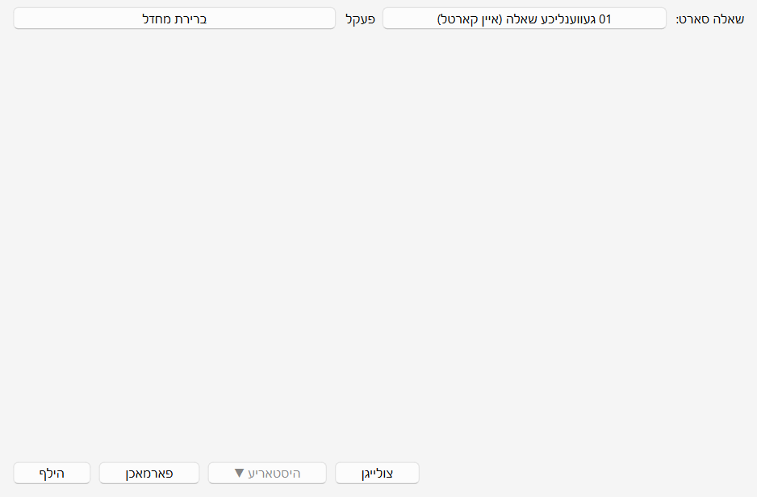
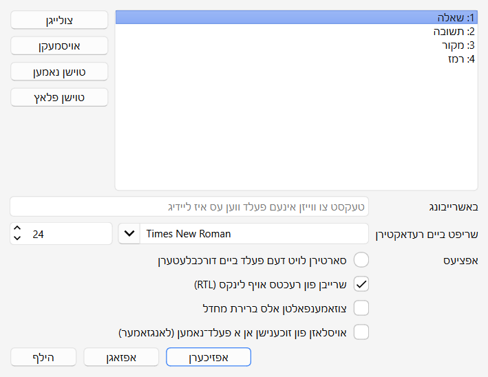
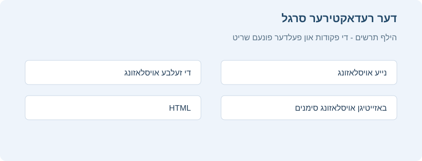
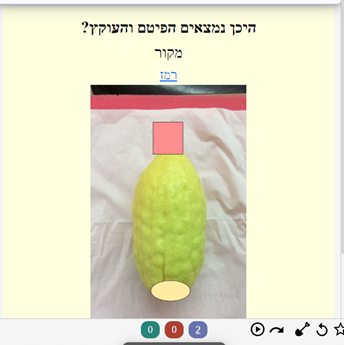

<a id="הוספהעריכה"></a>

# צולייגן/רעדאקטירן

<!-- toc -->

<a id="הוספת-כרטיסים-ורשומות"></a>

## צולייגן קארטלעך און רשומות

ווי ערקלערט אין די [יסודות](getting-started.md), לייגט מען אין אנקי צו רשומות, און אנקי שאפט פון זיי די קארטלעך. דריקט **לייג צו**  אין דער פעקל שורה אויפן [פעקל עקראן](deck-browser.md), און דער רשומה צולייג פענסטער וועט זיך עפענען.



דער אויבערשטער רעכטער חלק ווייזט דעם יעצטיגן [סארט רשומה](getting-started.md#סוגי-רשומות), לויט וועלכן די קארטלעך ווערן געשאפן.

דער אויבערשטער לינקער חלק ווייזט דעם [פעקל](getting-started.md#חפיסות) וואו די קארטלעך וועלן אריינגיין. אלס ברירת מחדל איז דאס דער פעקל וואס איר האט געדריקט זיין צולייג קנעפל. צו צולייגן קארטלעך אין אן אנדערן פעקל, דריקט דעם פעקל נאמען און דערנאך **לייג צו**.

אונטערן סארט רשומה זענען עטליכע קנעפלעך און א שטח מיט די קעפלעך "שאלה", "תשובה", "מקור" און "רמז". דאס זענען די [פעלדער](getting-started.md#רשומות-ושדות). מיט א דרוק אויף "פעלדער…" אויבן קען מען טוישן געוויסע פרטים פון זיי.

אונטער די פעלדער איז נאך א שטח, **צעטלעך**. צעטלעך זענען עטיקעטעס וואס מען לייגט צו רשומות, כדי זיי גרינגער צו ארגאניזירן און געפינען. מען קען לאזן דעם שטח ליידיג, אדער צולייגן איין אדער מער צעטלעך. מען טיילט אפ צעטלעך מיט א רווח. אויב דארט שטייט

```
קרבן_פסח קרבן_תודה
```

וועט די נייע רשומה האבן צוויי צעטלעך. צו אפטיילן ווערטער אינעם זעלבן צעטל, נוצט אן אונטערשטריך ווי אינעם ביישפיל. מען שרייבט אן אונטערשטריך מיט <kbd>Shift</kbd>+<kbd>-</kbd>.

נאכן שרייבן טעקסט אינעם פארנט און הינטערשטן פעלד, דריקט "לייג צו" אדער Ctrl+Enter צו צולייגן די רשומה צו דער זאמלונג. אנקי שאפט דערביי אויך א קארטל און לייגט אים אינעם אויסגעקליבענעם פעקל. צו רעדאקטירן א פריש צוגעלייגטן קארטל, דריקט דעם געשיכטע קנעפל צו געפינען אים אינעם [דורכבלעטערער](browsing.md).

פאר מער וועגן די קנעפלעך צווישן דעם סארט רשומה און די פעלדער, זעט [דער רעדאקטירער](#תכונות-עריכה).

<a id="בדיקת-כפילויות"></a>

### בדיקה פאר דאפלטע

אנקי קוקט צי דער ערשטער פעלד איז איינציג, און וועט אייך ווארענען אויב צוויי קארטלעך האבן דעם זעלבן אינהאלט אינעם פארנט פעלד. די בדיקה גייט נאר אן אינעם יעצטיגן סארט רשומה. אויב איר לערנט פארשידענע נושאים, ווערן צוויי קארטלעך מיטן זעלבן פארנט פעלד נישט גערעכנט אלס דאפלטע, כל זמן יעדער נושא האט אן אנדערן סארט רשומה.

כדי צו ארבעטן עפעקטיוו, קוקט אנקי נישט אויטאמאטיש דאפלטע אין אנדערע פעלדער. אינעם דורכבלעטערער איז אבער דא "געפין דאפלטע", וואס מען קען פון צייט צו צייט אויספירן.

<a id="למידה-יעילה"></a>

### ווירקזאם לערנען

פארשידענע מענטשן חזרן אנדערש, אבער א פאר אלגעמיינע יסודות זענען ראטזאם צו געדענקען. די SuperMemo ארטיקלען זענען א גוטער אריינפיר. באזונדער:

- **האלט פשוט**: וואס קירצער די קארטלעך, אלץ גרינגער צו חזרן. מען קען ווערן געצויגן אריינצולייגן אסאך אינפארמאציע "אויב מען וועט דארפן", אבער די חזרות ווערן דערביי שנעל שווער.
- **לערנט נישט אויסנווייניג אן פארשטיין**: ביים לערנען א ליסטע פון באגריפן, צום ביישפיל, פרובירט אויסצומיידן לאנגע ווארט ליסטעס. עס איז בעסער צו לערנען אין א צוזאמענהאנג, ווען מען זעט ווי די ווערטער ווערן גענוצט אין א זאץ.

<a id="התאמה-אישית-של-שדות"></a>

## צופאסן פעלדער

צו צופאסן פעלדער, דריקט "פעלדער…" ביים צולייגן אדער רעדאקטירן א רשומה, אדער ווען דער סארט רשומה איז אויסגעקליבן אינעם 'פיר סארטן רשומה' פענסטער.



צו טוישן דעם סדר פון פעלדער אין דעם פענסטער און אינעם צולייג פענסטער, נוצט דעם פלאץ קנעפל. ער פרעגט וועלכן נומער דער פעלד זאל באקומען. צו מאכן א פעלד צום ערשטן, צום ביישפיל, שרייבט "1".

מען קען אויך שלעפן די פעלד נעמען צו טוישן זייער סדר. נוצט דעם מויז אדער פינגער צו שלעפן דעם פעלד צום געוואונטשענעם פלאץ. אן אנצייגער וועט ווייזן וואו ער וועט גיין.

די אפציעס אונטן טוישן פעלד אייגנשאפטן ביים צולייגן און רעדאקטירן קארטלעך. זיי גייען אן אויפן רעדאקטירער פענסטער. דעם אויסזען פון קארטלעך ביים חזרן פאסט מען צו אין אן אנדערן ארט.

- **רעדאקטירער שריפט** באשטימט די שריפט און גרייס ביים רעדאקטירן רשומות. מען קען פארקלענערן ווייניגער וויכטיגע אינפארמאציע אדער פארגרעסערן דעם טעקסט פאר באקוועמליכקייט. די טוישן האבן נישט אן השפעה אויפן קארטל אויסזען ביים חזרן. אויב "טייפט די ענטפער" איז איינגעשאלטן, ניצט דער אריינגעטייפטער טעקסט אבער די דא באשטימטע שריפט גרייס.
- **סארטיר לויט דעם פעלד…** זאגט אנקי צו ווייזן דעם פעלד אינעם דורכבלעטערער סארטיר שפאלט. מען קען אזוי סארטירן קארטלעך לויט אים. נאר איין פעלד קען זיין דער סארטיר פעלד אויף א מאל.
- **קער איבער די טעקסט ריכטונג** איז נוצליך פאר שפראכן וואס שרייבן פון לינקס צו רעכטס (LTR), ווי ענגליש. אויך די איינשטעלונג גייט יעצט נאר אן ביים רעדאקטירן.
- **מאך צו אלס ברירת מחדל**. מען קען צומאכן און אויסברייטערן פעלדער. די אנימאציע קען מען אויסשאלטן אין די [איינשטעלונגען](preferences.md).
- **ווייז נישט זוך רעזולטאטן פון דעם פעלד, סיידן דער זוכן איז באזונדער אויף דעם פעלד (פאמעליכער)**. נוצט דאס ווען איר ווילט נישט אז א געוויסער פעלד אינהאלט זאל זיך ווייזן אין זוכענישן [וואס זענען נישט באגרעניצט צו א באזונדערן פעלד](searching.md#הגבלה-לשדה).

<a id="שינוי-חפיסה-סוג-רשומה"></a>

## טוישן פעקל / סארט רשומה

ביים צולייגן קען מען דריקן דעם אויבערשטן רעכטן קנעפל צו טוישן דעם סארט רשומה, און דעם אויבערשטן לינקן צו טוישן דעם פעקל. אינעם פענסטער וואס עפנט זיך קען מען אויסקלייבן א פעקל אדער סארט רשומה, און אויך צולייגן נייע פעקלעך אדער פירן די סארטן רשומה.

פאר א פראקטישע ערקלערונג פון די תורה סארטן רשומה, וויפיל קארטלעך יעדער שאפט און וועלכע פעלדער מען פילט אן, זעט [סארטן רשומה](getting-started.md#סוגי-רשומות).

אויב די עקזיסטירנדע סארטן פאסן נישט פונקט צו אייער באדערפעניש, קען מען שאפן א נייעם סארט אינעם אויסוואל פענסטער. **+ נייעם סארט** עפנט א פענסטער אויסצוקלייבן דעם סטרוקטור: א געווענליכע פראגע און ענטפער, אריינטייפן די ענטפער, אויספילן דאס פעלנדיגע אדער באהאלטן א בילד. מען קען דארט באשטימען א נאמען, פעלדער, צי צו שאפן אן איבערגעקערטן קארטל, און א יסודותדיגן אויסשטעל מיט שריפט, גרייס, אויסריכטונג און הינטערגרונט קאליר. אזוי גרייט מען צו א נייעם סארט פראגע אן בויען אלעס יעדעס מאל פון פריש.

נאכן דערהיינטיגן פון אן אלטער ווערסיע מיט תורה רשומות, קען זיין אז טייל אלטע סארטן זענען נישט דערהיינטיגט געווארן. מען קען אויך שפעטער אויספירן **הויפט מעניו > זאמלונג כלים > דערהיינטיג פאר נייע רשומות**. דער כלי פירט אלטע רשומות צו די פאסיגע נייע סטרוקטורן, כדי די פראגעס, ענטפערס, מקורות און רמזים זאלן ווייטער זיך ווייזן אן אליין קאפירן דעם אינהאלט. עס איז ראטזאם אים אויסצופירן ווען אלטע און נייע סארטן געפינען זיך צוזאמען אין דער זאמלונג, אדער ווען דער צולייג פענסטער ווייזט א סטרוקטור וואס פאסט נישט צו די נייע.

<a id="ארגון-תוכן"></a>

## ארגאניזירן אינהאלט

<a id="שימוש-נכון-בחפיסות"></a>

### ריכטיג נוצן פעקלעך

- [פעקלעך](getting-started.md#חפיסות) טיילן אייער אינהאלט אין ברייטע קאטאגאריעס וואס איר ווילט לערנען באזונדער, ווי גמרא, הלכה און אזוי ווייטער. עס קען זיך וועלן שאפן אסאך קליינע פעקלעך פאר סדר, ווי "דף ג" אדער א סעיף אין שו"ע, אבער דאס איז נישט ראטזאם צוליב די פאלגנדע סיבות:
- אסאך קליינע פעקלעך קענען ברענגען אז קארטלעך קומען אין א פעסטן סדר. אין אלטע צייטפלאן ווערסיעס האט מען געקענט אריינלייגן נייע קארטלעך נאר לויטן פעקל סדר. אויב מען האט געדריקט יעדן פעקל באזונדער, וואס נעמט צייט, האט מען געחזרט א גאנצן נושא צוזאמען. אזוי קען מען צו גרינג טרעפן די ענטפערס פונעם צוזאמענהאנג, און דער זכרון ווערט שוואכער. ווען מען דארף זיך דערמאנען א ווארט אדער אויסדרוק אויסער אנקי, וועט מען נישט אלעמאל זען פארבונדן אינהאלט קודם!
- הגם דער פראבלעם איז היינט קלענער ווי אין פריערדיגע אנקי ווערסיעס, קענען הונדערטער פעקלעך פארלאנגזאמען דעם פראגראם.

<a id="שימוש-בתגיות"></a>

### נוצן צעטלעך

אנשטאט אסאך קליינע פעקלעך, איז בעסער צו נוצן צעטלעך און/אדער פעלדער צו קלאסיפיצירן דעם אינהאלט. צעטלעך העלפן פארבעסערן זוך רעזולטאטן, געפינען א באזונדערן אינהאלט און היטן סדר אין דער זאמלונג. עס זענען דא אסאך וועגן צו נוצן צעטלעך און פענער ווירקזאם. טראכט פאראויס ווי איר ווילט זיי נוצן, כדי צו אויסקלייבן וואס פאסט אייך בעסטן.

טייל מענטשן האלטן סדר מיט פעקלעך און אונטערפעקלעך, אבער צעטלעך האבן א גרויסן מעלה: מען קען צולייגן מערערע צעטלעך צו איין רשומה, בשעת א קארטל קען געהערן נאר צו איין פעקל. צעטלעך זענען דערפאר אין רוב פעלער א שטארקער און מער בייגזאמער קלאסיפיקאציע סיסטעם. מען קען אויך אויסשטעלן צעטלעך אין ביימער, [ווי ביי פעקלעך](getting-started.md#חפיסות).

צום ביישפיל, אנשטאט שאפן א פעקל פאר א באזונדערער סוגיא, לייגט די קארטלעך אינעם הויפט פעקל פון דער מסכתא אדער פרק, מיט א צעטל פאר דער סוגיא. וויבאלד א קארטל קען האבן מערערע צעטלעך, קען מען [זוכן](searching.md#תגיות-חפיסות-כרטיסים-ורשומות) אלע נושאים אין א געוויסן דף, אלע פראגעס וועגן דער זעלבער סוגיא, און אזוי ווייטער.

מען קען צולייגן צעטלעך פונעם רעדאקטירער פענסטער און אינעם [דורכבלעטערער](browsing.md), און דארט אויך צולייגן, אויסמעקן, טוישן נעמען אדער אויסשטעלן דעם סדר פון צעטלעך. צעטלעך גייען אן אויף דער [רשומה](getting-started.md#רשומות-ושדות): ווען מען לייגט א צעטל אויף א קארטל מיט ברודער קארטלעך, באקומען אלע ברידער אויך דעם צעטל. צו אנצייכענען נאר איין קארטל אן זיינע ברידער, קלערט צו נוצן א פאן.

<a id="שימוש-בדגלים"></a>

### נוצן פענער

פענער זענען ענליך צו צעטלעך, אבער ווייזן זיך ביים לערנען אינעם חזרה פענסטער, מיט א קאלירטן פאן אויבן לינקס. מען קען אויך זוכן קארטלעך מיט א פאן אינעם דורכבלעטערער, טוישן פאן נעמען דארט און שאפן געפילטערטע פעקלעך פון קארטלעך מיט א פאן. אנדערש ווי צעטלעך, קען א קארטל האבן נאר איין פאן אויף א מאל. נאך א וויכטיגער חילוק: פענער גייען אן אויפן [קארטל](getting-started.md#כרטיסים). א פאן אויף א קארטל מיט ברידער האט נישט קיין השפעה אויף די ברידער.

מען קען צולייגן אדער אוועקנעמען פענער גלייך ביים חזרן מיט CTRL + 1-7, און אינעם [דורכבלעטערער](browsing.md).

<a id="התגית-מסומן"></a>

### דער "אנגעצייכנט" צעטל

אנקי באהאנדלט דעם "marked" צעטל באזונדער. אויפן חזרה און דורכבלעטערער עקראן זענען דא אפציעס אים צוצולייגן אדער אוועקנעמען. דער לערן עקראן ווייזט א שטערן ווען די יעצטיגע רשומה האט דעם צעטל. אינעם דורכבלעטערער ווייזן זיך קארטלעך מיט א באזונדערן קאליר ווען זייער רשומה איז אנגעצייכנט.

הערה: דעם צעטל האט מען בעיקר געהיט פאר תאימות מיט עלטערע אנקי ווערסיעס. פאר רוב באניצער איז ראטזאם צו נוצן [פענער](#שימוש-בדגלים).

<a id="לימוד-מותאם-אישית-וחפיסות-מסוננות"></a>

### צוגעפאסט לערנען און געפילטערטע פעקלעך

מיט [צוגעפאסט לערנען און געפילטערטע פעקלעך](filtered-decks.md) שאפט מען צייטווייליגע פעקלעך פון [זוך אויסדרוקן](searching.md). אזוי קען מען רוב צייט חזרן דעם חומר געמישט אין איין פעקל פאר א שטארקן זכרון, און שאפן צייטווייליגע פעקלעך ווען מען דארף זיך קאנצענטרירן אויף א געוויסן חומר, ווי פאר א מבחן. דער כלל: אויב איר ווילט אלעמאל קענען לערנען א געוויסן אינהאלט באזונדער, זאל ער זיין אין א געווענליכן פעקל. אויב איר דארף אים נאר אמאל באזונדער, ווי פאר א מבחן אדער ווען חזרות האבן זיך אנגעזאמלט, זענען געפילטערטע פעקלעך פון צעטלעך, פענער, סימונים אדער פעלדער בעסער.

<a id="תכונות-עריכה"></a>

## רעדאקטירער פונקציעס

דער רעדאקטירער ווייזט זיך ביים [צולייגן רשומות](#הוספת-כרטיסים-ורשומות), [רעדאקטירן א רשומה](studying.md#עריכה-ועוד) ביים חזרן, אדער אינעם [דורכבלעטערער](browsing.md).


<a id="סרגל-העורך"></a>

### דער רעדאקטירער סרגל

דער סרגל איבערן אקטיוון פעלד איז דער הויפט רעדאקטירער סרגל. ער טוישט זיך אביסל לויטן סארט רשומה און פעלד, אבער געווענליך זענען דאס די פעולות פון רעכטס צו לינקס:

| פעולה אינעם סרגל | וואס זי טוט |
| --- | --- |
| **פעלדער...** | עפנט דעם פעלד פירן פענסטער פונעם יעצטיגן סארט רשומה. דארט טוישט מען נעמען, סדר און רעדאקטירער איינשטעלונגען פאר יעדן פעלד. |
| **B / I / U** | מאכט דעם אויסגעקליבענעם טעקסט דיק, שיף אדער אונטערגעשטרייכן. |
| **אויבערשריפט / אונטערשריפט** | מאכט דעם אויסגעקליבענעם טעקסט קליין איבער אדער אונטער דער שורה. נוצליך פאר קורצע צייכנס און הערות. |
| **טעקסט קאליר און הינטערגרונט קאליר** | טוישט דעם אותיות קאליר אדער לייגט א קאלירטן הינטערגרונט צום אויסגעקליבענעם טעקסט. דער קליינער פייל עפנט די קאליר אויסוואל. |
| **נעם אוועק דעם אויסשטעל** | נעמט אוועק דעם אויסשטעל פון דעם אויסגעקליבענעם טעקסט און ברענגט אים צוריק צו געווענליכן טעקסט. |
| **ליסטעס און אויסריכטונג** | שאפט א ליסטע מיט פינטלעך אדער נומערן, אדער טוישט די פאראגראף אויסריכטונג. |
| **פאפיר קליפ** | שטעלט צו א בילד אדער אוידיא טעקע צום פעלד. |
| **מיקראפאן** | רעקארדירט קלאנג פונעם מיקראפאן און לייגט אים אריין אין דער רשומה. |
| **פארגעשריטענער רעדאקטירער** | עפנט דעם פעלד אין א גרעסערן, באקוועמען פענסטער פאר לאנגן טעקסט, א טאבעלע אדער א צוזאמענגעשטעלטן מקור. |
| **פיל אויס דאס פעלנדיגע** | אין אויסלאזונג קארטלעך באהאלט מען דעם אויסגעקליבענעם טעקסט, ווי `{{c1::טקסט}}`. |
| **שריפט און שריפט גרייס** | טוישט די שריפט אדער גרייס פונעם אויסגעקליבענעם טעקסט. |

אויבן רעכטס איז א קנעפל וואס עפנט דעם [פעלד](#התאמה-אישית-של-שדות) פענסטער.

לינקס זענען די אויסשטעל קנעפלעך. דיק, שיף און אונטערשטרייכן ארבעטן ווי אין ווארד. די קומענדיגע צוויי קנעפלעך לייגן צו אויבערשריפט אדער אונטערשריפט, וואס העלפט ביי קורצע הערות. דערנאך זענען צוויי קנעפלעך צו טוישן דעם טעקסט קאליר.

דער מעקער קנעפל נעמט אוועק יעדן אויסשטעל פונעם יעצט אויסגעקליבענעם טעקסט, ווי קאליר אדער דיקקייט. די קומענדיגע דריי קנעפלעך שאפן ליסטעס, ריכטן אויס און רוקן דעם טעקסט אריין.

מיטן פאפיר קליפ קנעפל קלייבט מען אויס אוידיא אדער בילד טעקעס פונעם קאמפיוטער און שטעלט זיי צו רשומות. מען קען אויך קאפירן די מעדיע אינעם קאפיר ברעט, צום ביישפיל מיט א רעכטן דרוק אויף א בילד אין ווארד און "קאפיר בילד", און זי אריינלייגן אינעם געוואונטשענעם פעלד. פאר מער וועגן מעדיע, זעט [מעדיע](media.md).

דער מיקראפאן אייקאן ערלויבט רעקארדירן פון אייער קאמפיוטער מיקראפאן און צושטעלן די רעקארדירונג צו דער רשומה.

די \[…………\] קנעפלעך ווייזן זיך ווען מען קלייבט אויס א סארט רשומה פון **פיל אויס דאס פעלנדיגע**.



אנקי ערלויבט איינשטעלן פעלדער וואס בלייבן אנגעפילט, גלייך פונעם רעדאקטירער.
דריקט דעם שטיפט אייקאן רעכטס פונעם פעלד, און דער אינהאלט וועט בלייבן
אויך פאר דער קומענדיגער רשומה נאכן צולייגן די יעצטיגע.
דאס העלפט ווען מען שרייבט דעם זעלבן אינהאלט אין עטליכע רשומות, ווי דער זעלבער מקור פאר א פאר פראגעס אויפן זעלבן דף אדער סימן.


נעבן דעם שטיפט איז אויך א קליינער נומער קנעפל מיט **#** און א נומער. א דרוק אויפן **קנעפל** צינדט אן נאכאנאנדע נומערן אינעם פעלד: דער יעצטיגער נומער גייט אריין צום אנהייב פונעם פעלד, און נאכן צולייגן די רשומה גייט דער ציילער ווייטער פאר דער קומענדיגער פראגע. א דרוק אויפן **נומער אליין** ערלויבט צו טוישן פון וועלכן נומער מען גייט ווייטער. דאס העלפט ביים שרייבן א סעריע פראגעס פונעם זעלבן מקור, ווען יעדע פראגע דארף האבן א נאכאנאנדן נומער.

רוב קנעפלעך האבן קיצורים. האלט דעם מויז איבער א קנעפל צו זען זיין קיצור.

<a id="כלי-עורך-נוספים"></a>

### נאך רעדאקטירער כלים

דער רעדאקטירער האט כלים צו מאכן דאס צוגרייטן פראגעס מסודרדיגער און שנעלער. רוב זענען אינעם סרגל איבערן אקטיוון פעלד. טייל זענען אויך צוטריטלעך דורכן רעכטן מויז מעניו אדער מיט קיצורים וואס מען זעט ביים האלטן דעם מויז איבערן קנעפל.

צו צולייגן א טאבעלע, דריקט אינעם געוואונטשענעם פעלד און דערנאך **צולייגן א טאבעלע** אינעם סרגל. קלייבט אינעם פענסטער די צאל שורות און שפאלטן, צי צו צולייגן א קעפל שורה, און די אויסריכטונג. נאכן באשטעטיגן גייט די טאבעלע אריין אינעם פעלד. האלט דערנאך דעם מויז איבער א צעל צו צולייגן שורות און שפאלטן, אויסמעקן חלקים אדער קאלירן געוויסע צעלן. דאס פאסט באזונדער פאר פארגלייכונגען, מקורות, ליסטעס און פראגעס מיט עטליכע דעות.

די ברייטערע אויסשטעל כלים געבן מער קאנטראל אויפן טעקסט אויסזען. אויסער די געווענליכע דיק קנעפלעך, קען מען אויסקלייבן א **שריפט** פון די לעצטע אדער נאך שריפטן, באשטימען א פאראויס געגעבענע **גרייס** אדער אליין טייפן א גרייס, נוצן **ריין אויס** צו אוועקנעמען דעם אויסשטעל, און **אויסשטעל בערשטל** צו קאפירן דעם אויסזען פון איין שטיקל צום אנדערן. **לייג אריין ריין** לייגט אריין טעקסט אן אומגעוואונטשענע אויסשטעלן. דער **רמז** קנעפל מאכט פונעם אויסגעקליבענעם שטיקל א רמז וואס מען קען עפענען ביים חזרן.

אויב איר נוצט כסדר די זעלבע סטילן, עפנט דעם צאהן ראד פון די אויסשטעל כלים און שטעלט איין די שנעלע אויסשטעל קנעפלעך. פאר יעדן פון די פינף קען מען באשטימען שריפט, גרייס, טעקסט קאליר, דיק, שיף, אונטערשטרייכן, אויבערשריפט אדער אונטערשריפט און הינטערגרונט קאליר. דערנאך לייגט איין דרוק ארויף דעם גאנצן סטיל אויף דעם אויסגעקליבענעם טעקסט.


די קיצורים פאר די שנעלע קנעפלעך שטעלט מען איין דורך **איינשטעלן קיצור קנעפלעך** אינעם הויפט מעניו, אינעם **רעדאקטירער** טאב, אונטער **שנעלער סטיל 1** ביז **שנעלער סטיל 5**.

ווען א פעלד איז באזונדער לאנג, מיט אסאך מקורות, א ברייטער טאבעלע אדער עטליכע שטיקלעך וואס מען דארף רואיג אויסשטעלן, נוצט דעם פארגעשריטענעם רעדאקטירער. קלייבט דעם פעלד און דריקט דעם פארגעשריטענעם רעדאקטירער קנעפל אדער די פאסיגע סרגל פעולה. מען קען ארבעטן אין א גרעסערן, באקוועמען פענסטער, און דערנאך אפזיכערן און צוריקברענגען דעם אינהאלט צום אריגינעלן פעלד.

אויטאמאטיש אפזיכערן היט פון פארלירן רעדאקטירונגען. ווען א צולייג אדער רעדאקטירער פענסטער איז אפן, ווערן די טוישן אפגעזיכערט אין א גיבוי אין א פעסטן מרווח. צו טוישן דעם מרווח, עפנט דעם רעדאקטירער צאהן ראד און קלייבט די אויטאמאטישע אפזיכער איינשטעלונגען. אויב אנקי פארמאכט זיך פארן אפזיכערן, וועט ביים קומענדיגן עפענען קומען א מעלדונג וועגן נישט אפגעזיכערטע רעדאקטירער פענסטער. קלייבט צוריקברענגען צו צוריקשטעלן דעם טעקסט אין די פאסיגע פעלדער.

צו פארבינדן א PDF מיט א פראגע, דריקט אינעם פעלד און דערנאך **PDF** אינעם סרגל, אדער <kbd>Ctrl</kbd>+<kbd>Shift</kbd>+<kbd>P</kbd>. קלייבט א PDF טעקע און שרייבט דעם בלאט נומער. ביים חזרן קומט אויפן קארטל א קנעפל מיטן טעקע נאמען און בלאט; א דרוק עפנט דעם PDF פונקט אויפן פאסיגן פלאץ. דאס העלפט צו צושטעלן א לאנגן מקור, א גמרא בלאט, א סיכום אדער מבחן בלעטער, אן איבערפילן די פראגע אליין.

פאר פראגעס וואס דער לערנער דארף אריינטייפן די ענטפער, נוצט דעם פאסיגן סארט רשומה. ביים חזרן קומט א טייפ קעסטל, און נאכן ווייזן די ענטפער קען מען פארגלייכן דעם אריינגעטייפטן טעקסט מיט דער ריכטיגער ענטפער. דערצו קען מען אין יעדן געווענליכן סארט רשומה עפענען א פרייען שרייב קעסטל ביים חזרן, דורכן קנעפל אינעם סרגל איבער **ווייז די ענטפער**. דאס איז צו שרייבן אן ענטפער פאר זיך פארן עפענען די ריכטיגע ענטפער, און פארלאנגט נישט צו טוישן דעם סארט רשומה.

ביי העברעאישן טעקסט מיט ניקוד אדער טעמי המקרא, נוצט דעם ניקוד מעניו צו לייגן סימנים ביים סמן. דריקט אינעם פעלד, עפנט דעם ניקוד אדער רעכטן מויז מעניו, און קלייבט דעם סימן. **נארמאליזירן** איז פאר טעקסט וואס זעט אויס גלייך, אבער איז געשריבן מיט אנדערע צוזאמשטעלונגען פון צייכנס. צום ביישפיל, א העברעאישער אות מיט ניקוד און טעם, קאפירט פון איין מקור, קען זיין אפגעזיכערט אין אן אנדערן צייכן סדר ווי דער זעלבער ווארט אליין אריינגעטייפט. דאס קען האבן אן השפעה אויף זוכן, פארגלייכן ענטפערס אדער אויסרייניגן דעם אויסשטעל. נארמאליזירן שטעלט די צייכנס אין א גלייכמעסיגן פארמאט אן טוישן די זעבארע ווערטער. אין א געווענליכן מצב דארף מען דאס נישט נוצן כסדר ביים רעדאקטירן.

אין אויסלאזונג קארטלעך איז אויך דא א פעולה צו אוועקנעמען די באהאלטונג סימנים פון עקזיסטירנדעם טעקסט, אן אויסמעקן דעם אינהאלט אליין. קלייבט דעם טעקסט אדער שטעלט דעם סמן אין א פעלד מיט באהאלטונגען, און דריקט דעם באהאלטונג אוועקנעם קנעפל. די ווערטער בלייבן, נאר די באהאלטונג ווערט אוועקגענומען. דאס העלפט צו טוישן אן אויסלאזונג פראגע צו א געווענליכע פראגע, אדער אויסרייניגן טעקסט קאפירט פון אן אנדערן מקור.

פעלד ניוויגאציע קיצורים ערלויבן שנעל צו גיין צום קומענדיגן אדער א געוויסן פעלד אן דעם מויז. ביים רעדאקטירן, <kbd>Ctrl</kbd> מיטן פעלד נומער פירט דעם סמן צום פאסיגן פעלד: <kbd>Ctrl</kbd>+<kbd>1</kbd> צום ערשטן, און <kbd>Ctrl</kbd>+<kbd>2</kbd> צום צווייטן. נאך קיצורים זעט מען ביים האלטן דעם מויז איבער קנעפלעך. מען קען זיי טוישן דורך **איינשטעלן קיצור קנעפלעך** אינעם הויפט מעניו.

ביים אריינלייגן טעקסט היט אנקי רוב אויסשטעל אלס ברירת מחדל. אויב איר האלט <kbd>Shift</kbd> ביים אריינלייגן, נעמט אנקי אוועק רוב אויסשטעל. אין די איינשטעלונגען קען מען טוישן "אריינלייגן אן shift נעמט אוועק דעם אויסשטעל", כדי צו טוישן די ברירת מחדל אויפפירונג.

<a id="השלם-את-החסר"></a>

## פיל אויס דאס פעלנדיגע

_פיל אויס דאס פעלנדיגע_ איז א חזרה שיטה וואס באהאלט איין אדער מער ווערטער אינעם זאץ. צום ביישפיל, איר האט דעם זאץ:

    שנים אוחזין בטלית.

און איר באהאלט דעם ווארט "טלית". דער זאץ ווערט:

    שנים אוחזין ב[...].

אזעלכע אויסגעלאזטע שטיקלעך ווערן אמאל גערופן "באהאלטונגען".

<details><summary>אויספירליך: פארוואס אויסלאזונגען העלפן אזוי שטארק</summary>

אויסלאזונגען זענען א שנעלער וועג צו מאכן פון א געווענליכן זאץ א געצילטע פראגע. אנשטאט שאפן א פראגע און ענטפער פון פריש, באהאלט מען א ווארט, אויסדרוק, נומער אדער חלק פון א בילד, און דער לערנער דארף אויספילן פונקט דעם פעלנדיגן פרט. די שיטה העלפט באזונדער פאר אנהייבער: זי מאכט גרינגער צו היטן דעם "מינימום אינפארמאציע" כלל, וואו יעדע חזרה ברענגט ארויס איין קליינעם פרט אין א קלארן צוזאמענהאנג.

די שיטה העלפט אויך פאר ערפארענע באניצער, ווייל זי טיילט א לאנגן חומר אין א סעריע קורצע פראגעס אן פארלירן דעם אריגינעלן צוזאמענהאנג. מען קען מאכן עטליכע באהאלטונגען פונעם זעלבן זאץ, צולייגן א קורצן רמז נאך צוויי דאטס, אדער מאכן איינס איבערן אנדערן באהאלטונגען אין ליסטעס און סעריעס, צו פארשטארקן קליינע חלקים אנשטאט אויסזאגן אלעס אויף איינמאל. אבער מען זאל נישט באהאלטן צו פיל אין איין קארטל. פאר עטליכע פארשידענע פרטים איז בעסער צו שאפן באזונדערע קארטלעך.

(לויט ד״ר פיוטר וואזניאק, כלל 5 אין "Effective learning: Twenty rules of formulating knowledge")

</details>


אנקי האט א באזונדערן סארט רשומה פאר אויסלאזונגען, כדי צו פארגרינגערן דאס שאפן באהאלטונגען. קלייבט דעם סארט '08 פילט אויס דאס אויסגעלאזטע' און שרייבט טעקסט אינעם פעלד "טקסט". קלייבט מיטן מויז דעם טעקסט צו באהאלטן, און דריקט \[…………\].
אנקי וועט טוישן דעם טעקסט צו:

    שנים אוחזין ב{{c1::טלית}}.

"c1" מיינט אז איר האט געשאפן איין אויסלאזונג אינעם זאץ. מען קען שאפן מער ווי איינס. צום ביישפיל, קלייבט "שניים" און דריקט ווידער \[…………\]. דער טעקסט וועט יעצט זיין:

    {{c2::שניים}} אוחזין ב{{c1::טלית}}.

ווען איר לייגט צו די רשומה, שאפט אנקי צוויי קארטלעך. דער ערשטער ווייזט:

    שנים אוחזין ב[...].

אינעם פראגע פעלד, מיטן גאנצן זאץ אין דער ענטפער. אינעם צווייטן קומט:

    [...] אוחזין בטלית.

מען קען אויך באהאלטן עטליכע שטיקלעך אינעם זעלבן קארטל. אויב איר טוישט אינעם ביישפיל c2 צו c1, ווערט נאר איין קארטל געשאפן, מיט "שניים" און "טלית" ביידע באהאלטן. האלט <kbd>Alt</kbd> ביים שאפן א באהאלטונג, און אנקי ניצט אויטאמאטיש דעם זעלבן נומער אנשטאט אים צו העכערן.

באהאלטונגען מוזן נישט זיין גאנצע ווערטער. אויב איר קלייבט "נים" אנשטאט "שנים", וועט די פראגע זיין "ש\[…………\] אוחזין בטלית", וואס גיט א רמז.

מען קען זיך אויך געבן א רמז וואס איז אנדערש פונעם טעקסט. טוישט דעם אריגינעלן זאץ צו:

    שנים::מספר אוחזין בטלית

און דריקט \[…………\] נאכן אויסקלייבן "שניים::מספר". אנקי נעמט דעם טעקסט נאך די צוויי דאטס אלס רמז און טוישט צו:

    {{c1::שנים::מספר}} אוחזין בטלית

ביים חזרן זעט דער קארטל אויס אזוי:

    [מספר] אוחזין בטלית.

מען קען אויך שאפן באהאלטונגען איינע אינעווייניג אין דער אנדערער. צום ביישפיל, דאס איז גילטיג:

    {{c1::שנים {{c2::אוחזין}}}} בטלית

די אינערליכע באהאלטונג איז אינגאנצן אינעם אויסערליכן. טיילווייזע איבערדעקונג ווערט נישט געשטיצט, ווי:

    [...] בטלית-> בנים אוחזין
    שנים [...] טלית -> אוחזין ב

וואו "אוחזין" קומט פאר אין ביידע אויסלאזונגען.

דער יעצטיגער מאטאר שטיצט נאר א באגרעניצטע צאל באהאלטונגען איינע אינעווייניג אין דער אנדערער. די גרעניץ איז ארום 8, אבער אנקי קען ווערן פאמעליכער ווען מען קומט נאנט דערצו. מען קען נישט פארגרעסערן די גרעניץ. אויב איר נוצט די פונקציע, איז ראטזאם זיך צו האלטן צו נאר עטליכע שטאפלען.

דער אויסלאזונג סארט רשומה וואס קומט מיטן פראגראם האט א צווייטן פעלד פאר נאך אינהאלט, מיטן נאמען 'הוספות'. ער ווייזט זיך אויף דער ענטפער זייט פון יעדן קארטל. מען קען דארט צולייגן באניץ הערות אדער נאך אינפארמאציע.


דער סארט רשומה האט אויך דעם נאך אינהאלט פעלד, **הוספות**, אויפן ענטפער זייט. נוצט אים פאר א הילף הערה, א קורצן מקור, א צוגאב רמז אדער נאך א נוסח וואס איר ווילט זען נאר נאכן עפענען דעם קארטל.


<a id="הסתרת-תמונה"></a>

## באהאלטן א בילד

אנקי שטיצט בילד באהאלטונג קארטלעך אינעם פראגראם אליין. דער סארט "09 פילט אויס דאס אויסגעלאזטע - בילד" איז א באזונדערער אויסלאזונג סארט מיט בילדער אנשטאט טעקסט. ער ערלויבט שאפן קארטלעך וואס באהאלטן חלקים פון א בילד און פרעגן אייך דעם באהאלטענעם אינהאלט.



<a id="הוספת-תמונה"></a>

### צולייגן א בילד

צו צולייגן בילד באהאלטונג קארטלעך, עפנט דעם צולייג עקראן, דריקט "סארט" און קלייבט "09 פילט אויס דאס אויסגעלאזטע - בילד" פון די איינגעבויטע סארטן רשומה.
דריקט דערנאך "קלייבט אויס א בילד" צו לאדענען א בילד טעקע פונעם קאמפיוטער, אדער "לייג אריין א בילד פונעם קאפיר ברעט"
אויב איר האט א קאפירטן בילד אינעם קאפיר ברעט.

<a id="הוספת-כרטיסי-הסתרת-תמונה"></a>

### צולייגן בילד באהאלטונג קארטלעך

נאכן לאדענען א בילד עפנט זיך דער בילד באהאלטונג רעדאקטירער. דריקט די אייקאנען לינקס צו צולייגן וויפיל שטחים איר ווילט צום בילד.
מען קען אויסקלייבן דריי יסודותדיגע פארמען:


- רעכטעק
- עליפסע
- פילעק

פאר יעדע רשומה קען מען אויך אויסקלייבן צווישן צוויי בילד באהאלטונג מצבים:

- **באהאלט אלעס, ענטפער איינס**: אלע שטחים זענען באהאלטן, און נאר איין שטח ווערט אויפגעדעקט אויף א מאל ביים לערנען.
- **באהאלט איינס, ענטפער איינס**: נאר איין שטח איז באהאלטן און ווערט אויפגעדעקט ביים לערנען. די אנדערע שטחים בלייבן זעבאר.

<!-- fields & tags are not intuitive to find in editor -->
דער ברירת מחדל בילד באהאלטונג סארט האט אויך געווענליכע פעלדער:
**כותרת**, א קעפל איבערן בילד אויפן פארנט און הינטערשטן זייט פון יעדן קארטל;
**תוספת אחורית**, נאך אינהאלט אונטערן בילד אויפן הינטערשטן זייט;
און **הערות**, וואס ווערן נישט געוויזן אויף די קארטלעך. צו צוקומען צו די פעלדער אינעם בילד רעדאקטירער,
דריקט **בייט דעם מאסקע רעדאקטירער** .
דארט קען מען אויך ווייזן און רעדאקטירן די רשומה **צעטלעך**.

נאכן פארענדיגן, דריקט "צולייגן" אונטן.
אנקי לייגט צו א קארטל פאר יעדע פארעם אדער גרופע פארמען וואס איר האט צוגעלייגט,
און מען קען זיי אנהייבן חזרן ווי געווענליך.

<a id="עריכת-רשומות-הסתרת-תמונה"></a>

## רעדאקטירן בילד באהאלטונג רשומות

מען קען רעדאקטירן אייערע בילד באהאלטונג רשומות מיט א דרוק אויף "רעדאקטירן" ביים חזרן,
אדער גלייך פונעם דורכבלעטערער. עס זענען דא עטליכע כלים
צו נוצן. באזונדער:

- אויסקלייבן: קלייבט אויס איין אדער מער פארמען צו רוקן,
  טוישן גרייס, אויסמעקן אדער גרופירן.
- פארגרעסערן: מען קען פריי רוקן דעם בילד און פארגרעסערן אדער פארקלענערן מיטן מויז רעדל.
- פארמען — רעכטעק, עליפסע אדער פילעק: לייגט צו נייע פארמען אדער קארטלעך.
- טעקסט: לייגט צו טעקסט שטחים צום בילד. מען קען זיי רוקן, טוישן גרייס אדער אויסמעקן,
  אבער דער כלי שאפט נישט קיין קארטל.
- מאך צוריק / טו נאכאמאל.
- פארגרעסער / פארקלענער — שטעל צוריק די פארגרעסערונג.
- ווייז דעם אינהאלט הינטער די באהאלטונגען: דער כלי ווייזט צייטווייליג די באהאלטענע שטחים.
- אויסמעקן: מעקט אויס די אויסגעקליבענע פארמען און טעקסט שטחים. דאס
  אויסמעקן א פארעם מעקט נישט אויטאמאטיש אויס איר קארטל.
  מען דארף דערנאך נוצן **הויפט מעניו > זאמלונג כלים > ליידיגע קארטלעך**,
  ווי ביי געווענליכע אויסלאזונג קארטלעך.
- קאפירן.
- גרופירן די אויסוואל: מאכט א גרופע פארמען, כדי מען זאל זיי קענען
  רוקן, טוישן גרייס אדער אויסמעקן צוזאמען. צוויי
  אדער מער באזונדערע פארמען שאפן נאר איין קארטל נאכן גרופירן.
- צעטיילן א גרופע: קלייבט אויס א גרופע און דריקט דעם קנעפל, כדי יעדע פארעם זאל ווידער זיין באזונדער.
- אויסריכטונג: ריכט אויס די פארמען אדער טעקסט שטחים ווי איר ווילט.

ביים חזרן בילד באהאלטונג קארטלעך קומט דער "בייט מאסקעס" קנעפל גלייך אונטערן בילד.
אין "באהאלט אלעס, ענטפער איינס" מצב נעמט דער קנעפל צייטווייליג אוועק אלע פארמען פון דער רשומה.
