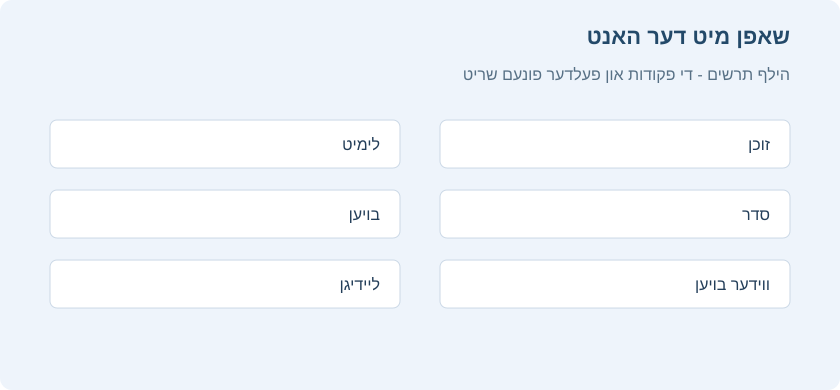

# געפילטערטע פעקלעך און שטארקער שינון

<!-- toc -->

ווען איר לערנט א געווענליכן פעקל אין אנקי, ווערט נאר געוויזן א באגרעניצטער צאל קארטלעך: די קארטלעך וואס אנקי האלט אז איר גייט פארגעסן, און א טעגליכע גרענעץ פון נייע קארטלעך. דאס איז געווענליך נוצליך, ווייל עס מאכט אז איר זאלט נישט נוצן מער לערנען צייט ווי נויטיג. אבער אמאל איז כדאי ארויסצוגיין פון די געווענליכע גרענעצן, למשל צו חזרן חומר פאר א בחינה אדער זיך קאנצענטרירן אויף א געוויסן חומר. דערפאר גיט אנקי א באזונדערן סארט פעקל מיטן נאמען "געפילטערטער פעקל".

געפילטערטע פעקלעך געבן אסאך מעגליכקייטן: פאראויס זען קארטלעך, שטארק איבערחזרן פאר א בחינה, לערנען געוויסע צעטלעך, נאכהאלן פארשפעטיגטע חזרות אין א געוויסן סדר, מקדים זיין חזרה, איבערגיין די קארטלעך וואס איר האט נישט געקענט אין יענעם טאג, און נאך.

## אייגענע לערנען

דער גרינגסטער וועג צו שאפן א געפילטערטן פעקל איז מיטן "אייגענע לערנען" קנעפל אינעם מעניו וואס עפנט זיך ביים דרוקן מיטן רעכטן מייז קנעפל אויף א פעקל. עס גיט פארגרייטע פילטערס פאר געווענליכע פעולות, ווי חזרן די קארטלעך וואס איר האט נישט געקענט היינט. עס שאפט א געפילטערטן פעקל מיטן נאמען "אייגענע לערן רונדע" און עפנט אים אויטאמאטיש.

אויב א פעקל מיטן נאמען "אייגענע לערן רונדע" איז שוין דא, ווערט ער אויסגעליידיגט פארן שאפן א נייעם. צו האלטן אן אייגענעם לערנען פעקל, טוישט זיין נאמען אין דער פעקלעך ליסטע.

דא איז א סיכום פון די אויסוואלן:

**פארגרעסערן היינט'ס גרענעץ פון נייע קארטלעך**\
לייגט צו נאך נייע קארטלעך צום פעקל וואס איר לערנט יעצט. אנדערש פון די אנדערע אויסוואלן, שאפט דאס נישט קיין נייעם געפילטערטן פעקל, נאר טוישט דעם עקזיסטירנדן פעקל.

**פארגרעסערן היינט'ס חזרה גרענעץ**\
אויב נישט אלע חזרות פאר היינט זענען געוויזן געווארן צוליב דער טעגליכער גרענעץ, לאזט דער אויסוואל ווייזן מער פון זיי. ווי ביים אויסוואל פאר נייע קארטלעך, טוישט דאס דעם עקזיסטירנדן פעקל.

**חזרה אויף פארגעסענע קארטלעך**\
ווייזט אלע קארטלעך אויף וועלכע איר האט געענטפערט "נאכאמאל" (1) אין דעם צאל טעג וואס איר שרייבט אריין.

**חזרן פאר דער צייט**\
ווייזט קארטלעך וואס וועלן ווערן גרייט צו חזרה בקרוב (אין דעם צאל טעג וואס איר שרייבט אריין). דאס העלפט איבערגיין א טייל אלטע קארטלעך פאר א רייזע, אבער וועט נישט העלפן פאר קארטלעך וואס איר האט ערשט לעצטנס געלערנט. זעט ווייטער [חזרן פאר דער צייט](#חזרה-מראש) פאר מער אינפארמאציע.

**פאראויס זען נייע קארטלעך**\
ווייזט קארטלעך וואס איר האט לעצטנס צוגעלייגט, אן זיי צו מאכן חזרה קארטלעך ווען מען ענטפערט.

**לערנען לויט קארטל צושטאנד אדער צעטל**\
קלייבט א געוויסן צאל קארטלעך פונעם יעצטיגן פעקל צום לערנען. מען קען אויסקלייבן נאר נייע קארטלעך, נאר קארטלעך גרייט צו חזרה, אדער אלע קארטלעך. נאכן דרוקן "אויסקלייבן צעטלעך", קען מען אויך באגרעניצן די בחירה לויט צעטלעך. צו זען אלע קארטלעך אינעם פעקל (למשל פאר א גרויסע בחינה), שטעלט דעם צאל קארטלעך העכער פון דעם צאל קארטלעך אינעם פעקל.

## היים פעקלעך

ווען א קארטל גייט אריבער אין א געפילטערטן פעקל, בלייבט זיין פארבינדונג מיטן פעקל פון וועלכן עס איז געקומען. דער פריערדיגער פעקל הייסט דאס קארטל'ס "היים פעקל".

קארטלעך גייען אויטאמאטיש צוריק אין זייער היים פעקל נאכן לערנען זיי אינעם געפילטערטן פעקל. דאס קען זיין נאך איין חזרה אדער עטליכע חזרות, לויט אייערע איינשטעלונגען.

מען קען אויך צוריקברענגען אלע קארטלעך אין זייערע היים פעקלעך אויף איינמאל:

- דער "אויסליידיגן" קנעפל אינעם פעקל מעניו אדער סיכום פענצטער ברענגט אלע קארטלעך פונעם געפילטערטן פעקל צוריק אין זייער היים פעקל, אבער מעקט נישט אויס דעם ליידיגן געפילטערטן פעקל. דאס העלפט אויב איר ווילט אים שפעטער ווידער אנפילן מיט "איבערבויען".

- אויסמעקן א געפילטערטן פעקל טוט די זעלבע פעולה ווי "אויסליידיגן", און נעמט אויך אראפ דעם ליידיגן פעקל פון דער פעקלעך ליסטע. קיין קארטל ווערט נישט אויסגעמעקט ביים אויסמעקן א געפילטערטן פעקל.

## שאפן מיט דער האנט

פארגעשריטענע באניצער קענען שאפן געפילטערטע פעקלעך מיט אייגענע זוכן אויסדרוקן ("פילטערס"), אנשטאט די פארגרייטע פילטערס. צו שאפן א געפילטערטן פעקל מיט דער האנט, דרוקט *פילטערט פראגעס*  אויבן אויפן עקרן.

ווען איר דרוקט "בויען", געפינט אנקי קארטלעך וואס שטימען מיט אייערע איינשטעלונגען און ברענגט זיי צייטווייליג פון זייערע עקזיסטירנדע פעקלעך אין דעם נייעם געפילטערטן פעקל צום לערנען.

צו ווידער ברענגען קארטלעך מיט די זעלבע פילטער אויסוואלן (למשל, צו לערנען טעגליך אלע קארטלעך מיט א געוויסן צעטל), נוצט "איבערבויען" אינעם פעקל מעניו אויפן הויפט פענצטער אדער אונטן אינעם סיכום פענצטער.

דאס **זוכן** פעלד באשטימט וועלכע קארטלעך אנקי זאל נעמען. יעדעס זוכן פון דורכבלעטערן קען מען אויך נוצן פאר געפילטערטע פעקלעך, ווי באגרעניצן צו צעטלעך, געפינען קארטלעך וואס איר האט פארגעסן א געוויסן צאל מאל אא"וו. זעט [זוכן](searching.md) אינעם מדריך פאר מער איבער די אויסוואלן.

נעבן דעם זוכן פעלד אינעם שאפן א געפילטערטן פעקל פענצטער איז דא **פארגעשריטענע זוכעניש**. דאס עפנט דעם פארגעשריטענעם זוכן בויער אין א שוועבנדיגן פענצטער. **אריינלייגן אינעם זוכן פעלד** ברענגט די שאילתא אינעם געפילטערטן פעקל'ס זוכן פעלד. אזוי קען מען בויען א קאמפליצירטן געפילטערטן פעקל לויט פעקל, צעטל, קארטל צושטאנד, פאן, דאטום אדער מאסן, אן צו שרייבן דעם זוכן סינטאקס מיט דער האנט.

געפילטערטע פעקלעך קענען נישט נעמען קארטלעך וואס זענען אפגעשטעלט, באזייטיגט ביז מארגן, אדער שוין אין אן אנדער געפילטערטן פעקל. דערפאר קען א זוכן אין דורכבלעטערן ווייזן קארטלעך וואס וועלן נישט אריינגיין אינעם געפילטערטן פעקל.

דער **גרענעץ** אויסוואל באשטימט וויפיל קארטלעך מען זאל נעמען. דער אויסגעקליבענער סדר באשטימט סיי וועלכע קארטלעך מען נעמט און סיי אין וועלכן סדר מען חזרט זיי. למשל, מיט "מערסטע פארגעסונגען" און א גרענעץ פון 20, וועט אנקי נאר ווייזן די 20 קארטלעך וואס איר האט דאס מערסטע פארגעסן.

**אנצינדן א צווייטן פילטער** לאזט שאפן א געפילטערטן פעקל פון צוויי פארשידענע זוכונגען. למשל, מען קען ארייננעמען קארטלעך גרייט צו חזרה אין איין סדר, און ווייניגער נייע קארטלעך אין אן אנדער סדר.

## סדר

"קארטלעך ווערן אויסגעקליבן לויט" באשטימט דעם סדר ווי די קארטלעך וועלן קומען. אויב אייער מאקסימום צאל איז ווייניגער פון דעם צאל קארטלעך וואס שטימען מיטן פילטער, וועט אנקי ערשט אויסלאזן די קארטלעך פונעם סוף פון דער אויסגעשטעלטער ליסטע.

**לאנגסטע צייט נישט געזען צום ערשטן**\
ווייזט ערשט די קארטלעך וואס איר האט די לענגסטע צייט נישט געחזרט.

**צופעליג**\
מישט דעם סדר פון אלע קארטלעך וואס שטימען מיטן פילטער, אן א קבוע'ן סדר.

**אפשטאנדן פון קליין צו גרויס**\
ווייזט ערשט די קארטלעך מיטן קלענסטן אפשטאנד.

**אפשטאנדן פון גרויס צו קליין**\
ווייזט ערשט די קארטלעך מיטן גרעסטן אפשטאנד.

**מערסטע פארגעסונגען**\
ווייזט ערשט די קארטלעך וואס איר האט די מערסטע מאל פארגעסן.

**סדר פון צולייגן**\
ווייזט ערשט די קארטלעך וואס איר האט ערשט צוגעלייגט, דאס הייסט מיטן פריסטען שאפן דאטום.

**חזרה דאטום**\
ווייזט ערשט די קארטלעך מיט דער פריסטער חזרה צייט.

**לעצטנס צוגעלייגט**\
ווייזט ערשט די קארטלעך וואס איר האט לעצטנס צוגעלייגט צום פעקל. דאס איז פארקערט פון "סדר פון צולייגן".

**פארשפעטיגונג לויטן אפשטאנד**\
ווייזט ערשט די קארטלעך וואס איר האט מסתמא דאס מערסטע פארגעסן. דאס איז נוצליך ביי א גרויסן פארשפעטיגטן הויפן וואס וועט נעמען צייט נאכצוהאלן, כדי ווייניגער צו ריזיקירן פארגעסן נאך קארטלעך.

ביים SM-2 אלגאריטם באשטימט מען די פארשפעטיגונג דורכן פארגלייכן ווי פארשפעטיגט דאס קארטל איז מיט זיין אפשטאנד. למשל, א קארטל מיט א 5 טאג אפשטאנד וואס איז 2 טעג פארשפעטיגט, וועט קומען פאר א קארטל מיט א 10 טאג אפשטאנד וואס איז 3 טעג פארשפעטיגט.

**שאנס צו געדענקען פון קליין צו גרויס / גרויס צו קליין**\

מיט FSRS ווערט די פארשפעטיגונג גערעכנט לויטן שאנס צו געדענקען יעדעס קארטל און די געוואונטשענע געדענק ראטע אין די פעקל איינשטעלונגען.

## טריט און חזרה

לויט דער ברירת מחדל נוצט אנקי די לערנען טריט פונעם קארטל'ס היים פעקל. אויב א נייעם קארטל דארף געווענליך צוויי חזרות ביים לערנען, וועט דאס אויך זיין אזוי אינעם געפילטערטן פעקל.
פאר מער איבער לערנען און איבערלערנען טריט, זעט [פעקל אויסוואלן](deck-options.md#שלבי-למידה).

קארטלעך גייען צוריק אין זייער היים פעקל ווען לערנען אדער איבערלערנען איז פארטיג. דעריבער, מיט 3 לערנען טריט גייט א נייעם קארטל צוריק נאך דריי דרוקן אויף "גוט" אדער איין דרוק אויף "גרינג".

געפילטערטע פעקלעך אן ניי באשטימען א צייט פלאן ווייזן 4 קנעפלעך. פאר **נאכאמאל**, **שווער** און **גוט** קען מען באשטימען אפשטאנדן. **גרינג** נעמט אראפ קארטלעך פונעם געפילטערטן פעקל.

## חזרות וועמענס צייט איז אנגעקומען

אויב דער געפילטערטער פעקל אנטהאלט קארטלעך גרייט צו חזרה, ווערן זיי געוויזן ווי אין זייער אריגינעלן פעקל: זיי שטייען אינעם חזרה צאל אונטן, און עס זענען דא פיר אויסוואלן לויט וויפיל איר געדענקט. נאך א ריכטיגן ענטפער גייט דאס קארטל צוריק אין זיין היים פעקל, און זיין קומענדיגע חזרה צייט ווערט באשטימט לויט די היים פעקל איינשטעלונגען. אויב איר פארגעסט דאס קארטל, קומט עס לויט די איבערלערנען טריט פונעם היים פעקל.

## חזרן פאר דער צייט

אויב אייער זוכן נעמט אריין קארטלעך וועמענס חזרה צייט איז נאכנישט אנגעקומען, וועט אנקי זיי ווייזן פריער.

אנקי נוצט פאר די חזרות א באזונדערן אלגאריטם וואס נעמט אין חשבון ווי פרי איר חזרט. אויב די קארטלעך זענען געווען נאענט צו זייער באשטימטער צייט, וועלן זיי באקומען א נייעם אפשטאנד ענליך צו דעם וואס זיי וואלטן באקומען ביים חזרן אין דער צייט. אבער ווען מען חזרט באלד נאך וואס זייער צייט איז באשטימט געווארן, וועט דער נייער אפשטאנד זיין ענליך צום פריערדיגן. די חשבון רוקט זיך שטופנווייז צווישן די צוויי עקן.

חזרן א קארטל באלד נאך וואס מען האט באשטימט זיין צייט ווירקט ווייניג אויפן צייט פלאן. למשל, א קארטל פאר מארגן מיט א איין טאג אפשטאנד וועט בלייבן פאר מארגן אפילו מען חזרט עס פריער. דערפאר **איז "חזרן פאר דער צייט" ביי אייגענע לערנען נישט פאסיג פאר כסדר'דיגן באנוץ**. אויב איר נוצט עס צו חזרן א גאנצע וואך'ס קארטלעך פאר א רייזע, וועלן די באפעסטיגטע קארטלעך באקומען שפעטערדיגע צייטן, און די נייע וועלן בלייבן מיט קורצע אפשטאנדן, ווייל איר קענט זיי נאכנישט גענוג גוט צו שטופן ווייטער. אויב איר טוט דאס ווידער צומארגנס, וועט איר נאר איבערגיין די זעלבע נייע קארטלעך אן פיל תועלת.

## ניי באשטימען דעם צייט פלאן

לויט דער ברירת מחדל ברענגט אנקי די קארטלעך צוריק אין זייערע היים פעקלעך מיט א צייט פלאן וואס איז געטוישט לויט אייערע רעזולטאטן אינעם געפילטערטן פעקל.

צו טוישן דעם וועג, לעשט אויס **ניי באשטימען חזרה צייטן לויט מיינע ענטפערס אין דעם פעקל**. ווען דער אויסוואל איז אויסגעלאשן, ווערן די קארטלעך געוויזן אין א פשוטן "פאראויסווייזונג" מצב. ווען זיי גייען צוריק אין זייער אריגינעלן פעקל, זענען זיי פונקט ווי זיי זענען געווען ביים אנהייב.

## נאכהאלן פארשפעטיגטע חזרות

געפילטערטע פעקלעך קענען העלפן נאכצוהאלן חזרות ווען איר זענט הינטערשטעליג.

אונטן ערקלערט אן אנקי באניצער ווי ער נוצט געפילטערטע פעקלעך צו נאכהאלן פארשפעטיגטע חזרות.

אין דער אנקי לזכרון הלימוד אויסגאבע קען מען דאס גרינג טון דורך דרוקן אויף דעם געלן אדער טורקיז טייל פון דער אינפארמאציע לייסט אויבן לינקס אינעם פעקלעך פענצטער.

    איך האב דאס געטון פאר א הויפן פון 800 פארשפעטיגטע קארטלעך מיט געפילטערטע אונטערפעקלעך. עס האט
    זייער גוט געארבעט פאר מיר.
    
    א "ערשט יעצט גרייט" פילטער מיט: "is:due prop:due>-7"
    
    א "פארשפעטיגט" פילטער מיט: "is:due prop:due<=-7"
    
    דער "ערשט יעצט גרייט" פעקל וועט אנטהאלטן קארטלעך וואס זענען געווארן גרייט צו חזרה אין דער לעצטער
    וואך. דעם פעקל דארף מען לערנען טעגליך, ווייל ער באקומט די קארטלעך וואס ווערן
    כסדר גרייט. דערמיט קען מען לערנען ווי עס וואלט נישט געווען קיין
    פארשפעטיגטער הויפן.
    
    דער "פארשפעטיגט" פעקל וועט אנטהאלטן אייער הויפן פון קארטלעך וואס איר האט נישט געלערנט אין דער צייט.
    מען קען זיי לערנען אזוי ווי נייע קארטלעך. זיי גייען צוריק צו די
    געווענליכע קארטלעך, אזוי אז דער צאל פארשפעטיגטע קארטלעך וועט נישט וואקסן
    כל זמן איר האלט דעם "ערשט יעצט גרייט" פעקל אונטער קאנטראל.
    
    וויפיל צייט דאס נעמט ווענדט זיך אין וויפיל פארשפעטיגטע קארטלעך איר לערנט יעדן טאג
    אויסער די וואס ווערן כסדר גרייט. איר קענט זיי נאך אלץ שטארק
    איבערחזרן ווען איר ווילט, אדער לערנען א באשטימטן צאל א טאג אזוי ווי
    ביי נייע קארטלעך. דאס איז אייער בחירה.
