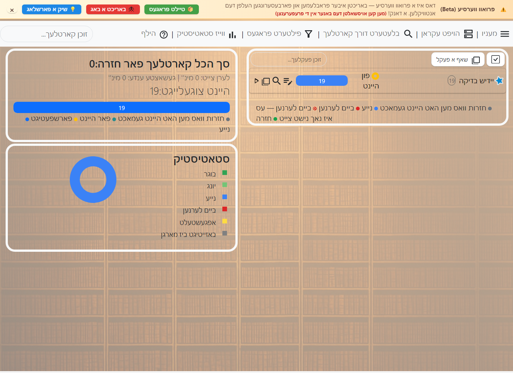

# ערשטע שריט

<!-- toc -->

## אינסטאלירן און דערהיינטיגן

די ספעציעלע **אנקי אויף יידיש** ווערסיע לאדט מען אראפ פון [דער לעצטער אויסגאבע אינעם פראיעקט ריפא](https://github.com/hafatsat-anki/anki_yidish/releases/latest). איר אינסטאלירער איז געמאכט פאר Windows 10 אדער 11, 64 ביט, און נוצט אן אייגענע דאטן טעקע.

די אריגינעלע אנקי אויסגאבע פאר לימוד תורה קען מען באקומען דורך [3422973@gmail.com](mailto:3422973@gmail.com). נאכן שיקן אן אימעיל צו דער אדרעס זאל מען אויטאמאטיש באקומען א תשובה מיטן אינסטאלירער אדער א לינק צו אים. עס איז אויך דא אן Android ווערסיע פון דער אריגינעלער אויסגאבע, וואס מען קען באקומען דורכן זעלבן אימעיל.

פאר אנווייזונגען איבער אינסטאלירן און דערהיינטיגן Anki אויפן קאמפיוטער, זעט:

- [Windows](./platform/windows/installing.md)

## יסודות

### קארטלעך

א פאר פון א פראגע און אן ענטפער הייסט א _קארטל_. דאס איז ענליך צו א פאפיר קארטל מיט א פראגע אויף איין זייט און אן ענטפער אויף דער צווייטער. אבער אין Anki זעט א קארטל נישט אויס ווי א פיזישער קארטל, און לויט דער ברירת מחדל בלייבט די פראגע זעבאר ווען מען ווייזט דעם ענטפער. למשל, ביים לערנען דעם סדר המסכתות קענט איר זען א פראגע ווי:

    ש: מהי המסכת הראשונה בש"ס?

נאכן באשליסן אז דער ענטפער איז ברכות, דרוקט איר "ווייזן ענטפער", און Anki ווייזט:

    ש: מהי המסכת הראשונה בש"ס?
    ת: ברכות

נאכן איבערקוקן אז איר געדענקט, זאגט איר Anki ווי גוט איר האט געדענקט דעם ענטפער. Anki קלייבט ווען דאס קארטל זאל ווידער קומען. למשל, Anki קען באשליסן עס צו ווייזן ווידער אין 3 טעג. מיר זאגן דעריבער אז דאס קארטל האט יעצט א 3 טאג אפשטאנד.

#### קארטל צושטאנדן

- **נייע:** קארטלעך וואס איר האט אימפארטירט אדער אליין געשאפן, אבער נאך קיינמאל נישט געלערנט.

- **ביים לערנען:** קארטלעך ערשט לעצטנס געלערנט צום ערשטן מאל, וואס זענען נאך אינעם לערנען תהליך.
- **אין חזרה:** קארטלעך וואס איר האט שוין פארענדיגט צו לערנען. זיי קומען ווידער נאכן פארבייגיין זייער אפשטאנד. עס זענען דא צוויי סארטן:
  - **פרישע (יונגע):** קארטלעך מיט אן אפשטאנד פון ווייניגער ווי 21 טעג.
  - **באפעסטיגטע (בוגר):** קארטלעך מיט אן אפשטאנד פון 21 טעג אדער מער.
- **ביים איבערלערנען:** קארטלעך וואס איר האט פארגעסן אין דער חזרה. זיי גייען צוריק צו איבערלערנען כדי מען זאל זיי ווידער לערנען.

### פעקלעך

א *פעקל* איז א גרופע קארטלעך, ענליך צו א טעקע אויפן קאמפיוטער. מען קען לייגן קארטלעך אין פארשידענע פעקלעך, כדי צו לערנען טיילן פון דער זאמלונג אנשטאט אלעס אויף איינמאל. יעדער פעקל קען האבן אנדערע איינשטעלונגען, ווי וויפיל נייע קארטלעך מען זאל ווייזן יעדן טאג און וויפיל צייט צו ווארטן ביז זיי קומען ווידער.

פעקלעך קענען אנטהאלטן אנדערע פעקלעך, אזוי קען מען זיי ארגאניזירן אין א בוים. Anki נוצט א טאפלטן צווייפינטל ("::") פאר די פארשידענע שטאפלען אינעם פעקלעך בוים. למשל, "ברכות::מאימתי" מיינט דעם "מאימתי" פעקל אינעם "ברכות" פעקל. אויב איר קלייבט "מאימתי", קומען נאר קארטלעך פון דעם פרק. אויב איר קלייבט "ברכות", קומען אלע קארטלעך וואס איר האט געשריבן אדער אימפארטירט אויף דער מסכת, אריינגערעכנט פרק מאימתי.

צו אריינשטעלן פעקלעך אינעם בוים, גיט זיי נעמען מיט א טאפלטן צווייפינטל צווישן די שטאפלען, אדער שלעפט זיי אין דער פעקלעך ליסטע. א פעקל אינעווייניג אין אן אנדערן הייסט אן "אונטערפעקל", און די אויבערשטע פעקלעך הייסן "הויפט פעקלעך".

Anki הייבט אן מיט א פעקל מיטן נאמען "ברירת מחדל". יעדעס קארטל וואס איז עפעס אפגעטיילט געווארן פון אנדערע פעקלעך גייט אריין דארט. Anki באהאלט דעם ברירת מחדל פעקל ווען ער איז ליידיג און איר האט צוגעלייגט אנדערע פעקלעך. מען קען אויך טוישן זיין נאמען און אים נוצן פאר אנדערע קארטלעך.

די פעקלעך ליסטע איז מסודר לויטן אלף בית. דאס קען געבן אן אומערווארטעטן סדר ביי נעמען מיט נומערן. למשל, "מיין פעקל 10" קומט פאר "מיין פעקל 9", ווייל 1 קומט פאר 9. צו מאכן אז "מיין פעקל 9" זאל קומען פריער, טוישט אים צו "מיין פעקל 09", וואס קומט פאר "מיין פעקל 10".

עס איז בעסער צו נוצן פעקלעך פאר ברייטע קאטעגאריעס, אנשטאט זייער באזונדערע נושאים ווי איין משנה אדער איין שיעור. פאר מער, זעט [ריכטיג נוצן פעקלעך](editing.md#שימוש-נכון-בחפיסות).

פאר אינפארמאציע ווי דער פעקלעך סדר ווירקט אויפן קארטלעך לערנען סדר, זעט [דער תצוגה סדר](studying.md#סדר-התצוגה).

### רשומות און פעלדער

ביים שאפן קארטלעך וויל מען אפט מער פון איין קארטל אויפן זעלבן חומר. למשל, ביים לערנען *דברי אביי בדף ז* קען מען וועלן איין קארטל מיט די דברי אביי וואס פרעגט וואו זיי שטייען, און אן אנדערן מיטן פלאץ וואס פרעגט וואס אביי זאגט. איין קארטל בחינה'ט צי איר געדענקט די דברי אביי, און דער צווייטער צי איר געדענקט זייער פלאץ אין ש"ס.

מיט פאפיר קארטלעך מוז מען אין דעם פאל שרייבן די אינפארמאציע צוויי מאל, איינמאל פאר יעדן קארטל. א טייל קארטלעך פראגראמען מאכן דאס גרינגער דורך א מעגליכקייט איבערצודרייען די פארנט און הינטן זייטן. דאס איז א פארבעסערונג קעגן פאפיר, אבער האט צוויי הויפט חסרונות:

- אזעלכע פראגראמען פאלגן נישט באזונדער נאך ווי גוט איר קענט יעדע זייט. דעריבער קומען די קארטלעך געווענליך נישט אין דער בעסטער צייט, און איר פארגעסט מער ווי געוואונטשן אדער לערנט מער ווי נויטיג.
- איבערדרייען פראגע און ענטפער ארבעט נאר ווען איר ווילט גענוי דעם זעלבן אינהאלט אויף יעדער זייט. מען קען דעריבער נישט, למשל, לייגן נאך אינפארמאציע אויף דער הינטערשטער זייט פון יעדן קארטל.

Anki פארריכט דאס דורך לאזן אייך צעטיילן דעם קארטל אינהאלט אין באזונדערע פרטים. איר זאגט דערנאך Anki וועלכע פרטים איר ווילט אויף יעדן קארטל, און Anki שאפט די קארטלעך און דערהיינטיגט זיי ווען איר רעדאקטירט שפעטער.

למשל, אין דעם אויבנדערמאנטן ביישפיל, אויב מיר ווילן אז דער מסכת נאמען זאל שטיין אויף יעדע זייט:

    ש: דברי אביי
    ת: דף ז
       מסכת שבת

און אויך אזוי:

    ש: דף ז
    ת: דברי אביי
       מסכת שבת

ביידע קארטלעך האבן די זעלבע דריי פארבונדענע פרטים: אינהאלט, בלאט און מסכת. צוזאמען זעען זיי אויס אזוי:

    תוכן: דברי אביי
    דף: ז
    מסכת: שבתעמוד: 12

אין Anki הייסט אזא פארבונדענע גרופע אינפארמאציע א *רשומה*, און יעדער פרט איז אין א *פעלד*. די רשומה אינעם ביישפיל האט דריי פעלדער: "תוכן", "דף" און "מסכת".

### סארטן קארטלעך

כדי Anki זאל שאפן קארטלעך פון אונזערע רשומות, דארף מען א הויפט מוסטער וואס באשטימט וועלכע פעלדער זאלן קומען פארנט און הינטן אויף יעדן קארטל. דער מוסטער הייסט א *סארט קארטל*. יעדער סארט רשומה קען האבן איין אדער מער סארטן קארטלעך. ביים צולייגן א רשומה שאפט Anki איין קארטל פאר יעדן סארט קארטל.

ווען איר לייגט צו א נייע רשומה, ווערט א קארטל געשאפן לויט דעם סארט קארטל. סארטן רשומות העלפן האלטן דעם קארטל אויסשטעל אייניג און קענען פיל פארמינערן די ארבעט ביים צולייגן אינפארמאציע. זיי מאכן אויך אז פארבונדענע קארטלעך זאלן נישט קומען צו נאענט איינס צום אנדערן. מען קען פארריכטן א שרייב טעות אדער א טעות אין א פרט איין מאל, און אלע פארבונדענע קארטלעך ווערן דערהיינטיגט צוזאמען.

### סארטן רשומות

Anki לאזט נוצן פארשידענע סארטן רשומות פאר פארשידענע וועגן פון לערנען. יעדער סארט רשומה האט זיינע פעלדער און סארטן קארטלעך. ביים שאפן קארטלעך איז כדאי צו נוצן דעם סארט וואס פאסט צום לערנען וועג, כדי צו פארבעסערן די חזרה און זכרון.

אנקי פאר תורה קומט מיט עטליכע סארטן רשומות פאר געווענליכע תורה לערנען וועגן. ביי יעדן סארט שטייען די הויפט פעלדער און וואס עס ווערט פון זיי בשעת מען לערנט. די נעמען פון די תורה פעלדער בלייבן אין זייער אריגינעלן פארמאט, כדי אימפארט און עקזיסטירנדע רשומות זאלן ווייטער שטימען.

פרטים פון די תורה סארטן רשומות

#### 01 געווענליכע שאלה (איין קארטל)

דאס איז דער פשוטער סארט רשומה פאר א שאלה און תשובה. די פעלדער זענען **שאלה**, **תשובה**, **מקור** און **רמז**. ביים לערנען קומען די שאלה און מקור, און דער רמז איז באהאלטן, אזוי אז מען עפנט אים נאר ווען מען דארף. נאכן דרוקן **ווייזן ענטפער** קומט די תשובה.

דער סארט פאסט פאר רוב פשוטע שאלות: א דעפיניציע, א דין, א סיכום פון א גמרא נקודה, א קורצער מקור אדער א שאלה וואס דערמאנט איין קלארן רעיון.

#### 02 שאלות מיט א בילד פונעם בלאט און אן אויספירליכע תשובה (איין קארטל)

דער סארט לייגט צו ברייטערע פעלדער צו דער געווענליכער שאלה: **מסכת ודף**, **תשובה מלאה** און **צילום הדף**, אויסער **שאלה**, **תשובה** און **רמז**. אין **תשובה** איז כדאי צו שרייבן א קורצע תשובה וואס לאזט שנעל איבערקוקן צי איר האט געדענקט. אין **תשובה מלאה** קען מען צולייגן א ברייטערן מהלך, די לשון הסוגיה, הערות אדער טעמים. אין **צילום הדף** קען מען צולייגן א בילד וואס קומט אויף דער תשובה זייט.

דער סארט פאסט בפרט פאר גמרא אדער מקורות וואו מען וויל סיי א קורצן ענטפער פאר שנעלע חזרה, און סיי א פלאץ צו עפענען דעם ברייטערן בילד ווען מען דארף.

#### 03 געווענליכע שאלה מיט א באהאלטענעם מקור אלס רמז (איין קארטל)

די פעלדער זענען **שאלה**, **תשובה**, **מקור** און **רמז**, ווי ביי 01, אבער דער מקור קומט נישט גלייך. ער איז באהאלטן ווי א רמז, און מען קען אים עפענען מיט א דרוק.

דער סארט פאסט ווען מען וויל זיך בחינה'ן סיי אויפן אינהאלט און סיי אויפן מקור, אן אז דער מקור זאל אויסזאגן דעם ענטפער. למשל, א שאלה אויף א דין וואו דער פלאץ פון דער סוגיא איז א טייל פון וואס מען וויל געדענקען.

#### 04 שרייבט אריין די תשובה (איין קארטל)

די פעלדער זענען **שאלה**, **תשובה**, **מקור** און **רמז**. ביים לערנען קומט א שרייבן פעלד פארן ווייזן דעם ענטפער. נאכן עפענען דעם ענטפער, פארגלייכט Anki וואס איר האט געשריבן מיטן **תשובה** פעלד.

דער סארט פאסט ווען גענויקייט איז וויכטיג: קורצע לשונות, מונחים, פסוקים, סימנים, ראשי תיבות אדער תשובות וואו א קליינע טעות טוישט דעם באדייט.

#### 05 בחינה אויף נושאים און מקורות (צוויי קארטלעך: וואו שטייט עס און וואס שטייט אין א מקור)

די פעלדער זענען **הנושאים**, **מיקום (מסכת ודף / פרשה ופרק וכדו')** און **רמז**. פון איין רשומה ווערן צוויי קארטלעך: איינס ווייזט דעם נושא און פרעגט וואו עס שטייט, און דאס צווייטע ווייזט דעם פלאץ און פרעגט וואס שטייט דארט.

דער סארט פאסט צו איבערחזרן מראי מקומות, דעם מבנה הסוגיא, סימנים אין שולחן ערוך, פרקים, פרשיות אדער סיי וועלכן חומר וואו מען דארף געדענקען סיי דעם אינהאלט און סיי זיין פלאץ.

#### 06 עטליכע שאלות און תשובות - נאך דער תשובה קומט נאך א פארבינדענע שאלה (איין קארטל)

דער סארט האט ביז צען פארלעך פון **שאלה 1** ביז **שאלה 10** און **תשובה 1** ביז **תשובה 10**, און אויך **מקור**, **רמז** און אן אינערליכן פעלד מיטן נאמען **type**. ביים לערנען ווערט די ערשטע שאלה געפרעגט. נאכן ווייזן די תשובה, קען מען שטופנווייז עפענען די קומענדיגע שאלות און תשובות אויפן זעלבן קארטל.

דער סארט פאסט פאר איין רצף וואס מען דארף האלטן צוזאמען: שקלא וטריא, א מהלך פון קושיא און תירוץ, עטליכע נפקא מינות פון איין דין, אדער א רייע טריט וואו יעדער פרט באקומט זיין באדייט פון די פרטים פאר אים.

#### 07 ווי 06: יעדע שאלה אלס המשך און אויך אלס באזונדער קארטל (ביז 10 קארטלעך)

די פעלדער זענען ענליך צו 06: ביז צען פארלעך שאלות און תשובות, מיט **מקור**, **רמז** און **type**. דער חילוק איז אז דער סארט שאפט עטליכע קארטלעך. יעדער קארטל גייט נאך א שריט ווייטער אינעם רצף, אזוי אז יעדער טייל קען האבן אן אייגענע אפשאצונג און צייט פלאן.

דער סארט פאסט ווען עס איז דא איין רצף, אבער נישט אלע טריט זענען גלייך שווער. אויב איר געדענקט גוט דעם אנהייב פונעם מהלך און נאר דער דריטער שריט איז שווער, וועט זיין קארטל באקומען אפטערע חזרות אן איבערצולאדן נאכאמאל און נאכאמאל דעם גאנצן רצף.

#### 08 פילט אויס דאס אויסגעלאזטע - א טייל אינהאלט איז באהאלטן (דער צאל קארטלעך ווענדט זיך אין די באהאלטונגען; איין אדער מער אין א שאלה אדער באזונדערע קארטלעך)

די פעלדער זענען **טקסט**, **הוספות**, **מקור** און **רמז**. אין **טקסט** צייכנט מען אן די ווערטער וואס מען וויל באהאלטן און דרוקט דעם אויסלאז קנעפל אינעם רעדאקטאר. Anki לייגט צו א סימון ווי `{{c1::מילה}}`, און יעדער נומער שאפט א פאסיגן קארטל. עטליכע ווערטער מיטן זעלבן נומער ווערן באהאלטן אויפן זעלבן קארטל; מיט פארשידענע נומערן ווערן באזונדערע קארטלעך געשאפן.

דער סארט פאסט פאר ליסטעס, לשונות וואס מען דארף אויספילן, קבוע'ע זאצן, פסוקים, סדרי דינים אדער וואו דער הקשר דארף בלייבן זעבאר און מען בחינה'ט נאר א געוויסן פרט.

#### 09 פילט אויס דאס אויסגעלאזטע - בילד

די פעלדער זענען **הסתרה**, **תמונה**, **כותרת**, **מקור**, **רמז**, **תוספת לתשובה** און **הערות**. נאכן צולייגן א בילד, צייכנט מען אן טיילן צו באהאלטן. יעדער טייל אדער גרופע טיילן קען שאפן א קארטל וואו דער טייל איז באהאלטן בשעת דער שאלה און ווערט אנטפלעקט ביים תשובה.

דער סארט פאסט פאר וויזועלן חומר: דיאגראמען, מאפעס, צורת הדף, מבנים, איברים, טאבעלעס, צייכענונגען אדער מקורות וואו דער זכרון ווענדט זיך אין פלאץ און אויסזען. אין די אנדערע פעלדער קען מען צולייגן א קעפל איבערן בילד, מקור, רמז און הערות פאר דער תשובה.

#### 10 שאלות מיט אן אויסוואל פון תשובות (איין קארטל)

די הויפט פעלדער זענען **שאלה**, **title**, **qtype**, **q1** ביז **q5**, **answers**, **sources** און **extra**. מען שרייבט די שאלה, לייגט צו ביז פינף תשובה אויסוואלן און באשטימט דעם סארט שאלה אין **qtype**: `0` צו אנצייכענען ביי יעדער תשובה צי זי איז ריכטיג אדער נישט, `1` צו אנצייכענען אלע ריכטיגע תשובות, און `2` צו אויסקלייבן איין ריכטיגע תשובה. אין **answers** שרייבט מען די נומערן פון די ריכטיגע תשובות, למשל `1` אדער `1 2`.

דער סארט פאסט פאר בחינות מיט אויסוואלן, פארגלייכן קליינע חילוקים צווישן ענליכע תשובות, אדער חזרה אויף חומר וואו מען דארף דערקענען דעם גענויען אויסוואל פון עטליכע ענליכע נוסחאות.

אויסער די סארטן וואס זענען צוגעלייגט אין דער אויסגאבע, זענען דא נאך סארטן וואס קומען מיט דער יסודות'דיגער אנקי פראגראם. ביי עקזיסטירנדע רשומות קענען די אלטע נעמען פון די סארטן און פעלדער בלייבן אין דער פריערדיגער שפראך:

- **פשוט**
  האט "פארנט" און "הינטן" פעלדער און שאפט איין קארטל. דער טעקסט אין "פארנט" קומט אויף דער פארנט זייט, און דער טעקסט אין "הינטן" אויף דער הינטערשטער זייט.
- **פשוט (מיט א פארקערטן קארטל)**
  ווי "פשוט", אבער שאפט צוויי קארטלעך פונעם אריינגעשריבענעם טעקסט: פארנט←הינטן און הינטן←פארנט.
- **פשוט (פארקערטער קארטל לויטן וואונטש)**
  ווי "פשוט", אבער מיט א דריטן פעלד מיטן נאמען "צולייגן פארקערט". אויב איר שרייבט עפעס אין דעם פעלד, ווערט אויך געשאפן א פארקערטער קארטל (הינטן←פארנט).
- **פשוט (אריינטייפן דעם ענטפער)**
  למעשה "פשוט" מיט נאך א טעקסט פעלד אויף דער פארנט זייט, וואו מען קען שרייבן דעם ענטפער. ווען מען אנטפלעקט די הינטערשטע זייט, ווייזט Anki די חילוקים צווישן אייער טעקסט און דעם ריכטיגן ענטפער. פאר מער, זעט [פעלדער ערזעצונגען](templates/fields.md).
- **אויסגעלאזטע ווערטער**
  א סארט רשומה וואס לאזט אויסקלייבן טעקסט און מאכן אן אויסלאז, ענליך צו 08 אויבן (למשל, "שנים אוחזין ב-[…]" ← "שנים אוחזין בטלית"). פאר מער, זעט [פילט אויס דאס אויסגעלאזטע](editing.md#השלם-את-החסר).
- **פארדעקן א בילד (Image Occlusion)**\
  ווי דער אויסלאז סארט רשומה, אבער מיט בילדער אנשטאט טעקסט. דאס העלפט בפרט ביי חומר וואס פארלאזט זיך שטארק אויף בילדער. עס ארבעט ענליך צו 09, אבער איז ווייניגער רעקאמענדירט צוליב פארשידענע פראבלעמען. פאר אנווייזונגען, זעט [פארדעקן א בילד](editing.md#הסתרת-תמונה) אינעם מדריך.

רשומות און סארטן רשומות זענען פאר דער גאנצער זאמלונג און נישט באגרעניצט צו איין פעקל. מען קען דעריבער נוצן פארשידענע סארטן רשומות אין איין פעקל, אדער לייגן קארטלעך פון דער זעלבער רשומה אין פארשידענע פעקלעך. ביים צולייגן רשומות קען מען אויסקלייבן סיי דעם סארט רשומה און סיי דעם פעקל, און די בחירות זענען אינגאנצן אומאפהענגיג. מען קען אויך [טוישן דעם סארט רשומה פון רשומות](browsing.md#רשומות) נאכן זיי שוין שאפן.

### זאמלונג

אייער *זאמלונג* איז אלע חומר געהיטן אין Anki: קארטלעך, רשומות, פעקלעך, סארטן רשומות, פעקל אויסוואלן אא"וו.

## געטיילטע פעקלעך

דער גרינגסטער וועג אנצוהייבן מיט Anki איז צו נוצן א קארטלעך פעקל וואס אן אנדערער האט געשריבן:

1. דרוקט "מעניו" אויבן רעכטס און דערנאך די שאלות זאמלונג.
2. ווען איר געפינט א פעקל וואס אינטערעסירט אייך, דרוקט "באשטעטיגן" צו אימפארטירן דאס פעקל. זעט [די אויסוואלן אינעם מאגר פענצטער](question-bank.md#האפשרויות-לפני-האישור).
3. דרוקט צוויי מאל אויף א פעקל צו אימפארטירן אים אין Anki. אויב איר האט באקומען א פעקל פון אן אנדערן, עפנט דעם הויפט מעניו און קלייבט **אימפארטירן**.

שאפן אן אייגענעם פעקל איז דער ווירקזאמסטער וועג צו לערנען א קאמפליצירטן נושא. רוב תורה און הלכה נושאים קען מען נישט לערנען ווירקזאם אן פארשטיין זייער הסבר און הקשר. אויך צווינגט דאס אליין אריינלייגן אינפארמאציע אייך אויסצוקלייבן די הויפט נקודות, און דאס ברענגט צו א בעסערער הבנה.

    לערנט נישט אויב איר פארשטייט נישט.
    --SuperMemo

רוב געטיילטע פעקלעך ווערן געשאפן דורך מענטשן וואס לערנען דעם חומר אויסער Anki, למשל פון ספרים און שיעורים. זיי קלייבן די אינטערעסאנטע נקודות און לייגן זיי אריין אין Anki. זיי קענען נישט מאכן אן עקסטרע מי צוצולייגן הינטערגרונט אדער הסברים, ווייל זיי פארשטייען שוין דעם חומר. ווען אן אנדערער נוצט זייער פעקל, קען עס דעריבער זיין זייער שווער צוליב די פעלנדיגע הינטערגרונט און הסברים.

דאס מיינט נישט אז געטיילטע פעקלעך האבן נישט קיין תועלת. אויב איר האט ווייניג צייט, לערנט א געוויסן ספר און איינער האט געטיילט א שאלות פעקל פון יענעם ספר, קען עס שפארן צייט. פאר פשוטע נושאים וואס זענען בלויז א ליסטע פאקטן דארף מען מסתמא נישט קיין אויסערליכן חומר. אבער ביי קאמפליצירטע נושאים זאל מען נוצן געטיילטע פעקלעך אלס א *צוגאב* צום אויסערליכן חומר און נישט אלס א *ערזעצונג* דערפאר.
