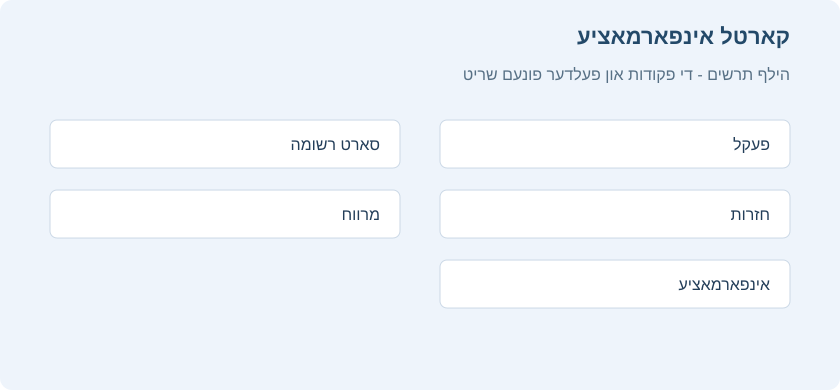
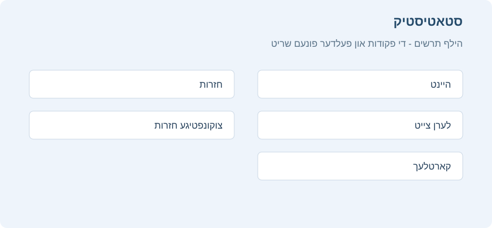

# קארטל אינפארמאציע, גראפן און סטאטיסטיק

<!-- toc -->

## קארטל אינפארמאציע

מען קען ווייזן קארטל אינפארמאציע דורך **קארטלעך > אינפארמאציע** אינעם מעניו, דורך דרוקן מיטן רעכטן מייז קנעפל אויפן קארטל און אויסקלייבן **אינפארמאציע**, אדער דורך <kbd>I</kbd> אינעם לערנען פענצטער.

עטליכע באמערקונגען:

**פלאץ**\
ווייזט דעם סדר ווען דאס קארטל וועט קומען צווישן אנדערע נייע קארטלעך. מען קען טוישן דעם פלאץ אין דורכבלעטערן. נאכן לערנען דאס קארטל ווערט דער פלאץ נישט גענוצט, חוץ אויב מען שטעלט דאס קארטל מיט דער האנט צוריק צו 'נייע'.

**אפשטאנד**\
די ווארט צייט פון איין חזרה ביז דער קומענדיגער.

**גרינגקייט**\
די געשאצטע מאס וויפיל דער אפשטאנד וועט וואקסן ווען מען ענטפערט אויף א חזרה קארטל מיטן "גוט" קנעפל.

דער אונטערשטער טייל ווייזט דעם קארטל'ס חזרות היסטאריע. 'אפשאצונג' ווייזט וועלכן קנעפל מען האט געדרוקט (1 = נאכאמאל, 4 = גרינג). ווען מען באשטימט א נייעם צייט פלאן מיט דער האנט דורך "צוריקשטעלן" אדער "שטעלן א חזרה דאטום", שטייט דער סארט אלס 'מיט דער האנט' און די אפשאצונג איז 0.

## סטאטיסטיק

מען קען עפענען דעם סטאטיסטיק פענצטער דורך דרוקן **סטאטיסטיק** אויבן אינעם הויפט פענצטער, אדער <kbd>T</kbd>.

די חזרות היץ מאפע ווערט ערקלערט ביי [דער פעקלעך פענצטער](deck-browser.md#מפת-חום), און זי קומט אויפן הויפט פענצטער און אינעם פעקל סיכום. דער סטאטיסטיק פענצטער אליין איז בעיקר פאר גראפן, פארטיילונגען און מער אויספירליכע באריכטן איבער אייער לערנען מיט דער צייט.

## אויסקלייבן פעקלעך / זאמלונג

### פעקל

לויט דער ברירת מחדל ווייזט דער סטאטיסטיק פענצטער דאטן פונעם יעצטיגן אויסגעקליבענעם פעקל און אלע זיינע אונטערפעקלעך. מען קען אבער אויסקלייבן יעדן פעקל פון דער זאמלונג דורך שרייבן זיין נאמען אינעם טעקסט פעלד אויבן, אדער מיטן פעקל אויסוואל אונטן.

### זאמלונג

אויב איר צייכנט אן דעם קעסטל, וועט די סטאטיסטיק זיין פאר אייער גאנצע זאמלונג. מען קען אויך ווייזן גראפן פאר סיי וועלכן זוכן דורך צולייגן פילטערס אינעם זוכן פעלד אויבן.

### היסטאריע

לויט דער ברירת מחדל ווייזט Anki סטאטיסטיק פאר די לעצטע 12 חדשים. אויבן קען מען דאס טוישן צו דער גאנצער היסטאריע אדער דער גאנצער לעבנס צייט פונעם פעקל. דער "היינט" טייל אויבן ווערט פארשטייט זיך נישט געטוישט דורך דעם אויסוואל.

### נאך

- דרוקן "אפזיכערן אלס PDF" אונטן זיכערט אפ א PDF דאקומענט פון דער סטאטיסטיק אין א טעקע אויפן דעסקטאפ, כדי גרינג צו טיילן די סטאטיסטיק מיט אנדערע.
- ווען מען מעקט אויס רשומות, בלייבט זייער חזרות היסטאריע אין Anki. זי ווערט נישט אריינגערעכנט אין א באזונדערן פעקל'ס סטאטיסטיק, ווייל Anki קען נישט וויסן אין וועלכן פעקל די אויסגעמעקטע קארטלעך זענען געווען. זי ווערט אבער אריינגערעכנט אין דער סטאטיסטיק פון דער גאנצער זאמלונג.

## היינט

אויבן אינעם סטאטיסטיק פענצטער איז דא א קורצע ליסטע פון סטאטיסטיק איבער די חזרות וואס איר האט פארענדיגט היינט. א "חזרה" מיינט דא "איין ענטפער אויף א קארטל". דאס זעלבע קארטל קען דעריבער ווערן געציילט אלס עטליכע חזרות אויב מען האט עס געדארפט זען עטליכע מאל. אויך ענטפערן אויף א לערנען קארטל ווערט געציילט אלס א "חזרה". דא זענען עטליכע פרטים וועמענס באדייט קען נישט זיין גלייך קלאר:

### צאל "נאכאמאל"

דאס איז דער צאל חזרות וואס איר האט נישט געקענט (דאס הייסט, געדרוקט 'נאכאמאל'). דער פראצענט ריכטיגע ענטפערס דערנאך איז דער צאל קארטלעך וואס איר האט *נישט* דורכגעפאלן, צעטיילט דורכן גאנצן צאל קארטלעך וואס איר האט געלערנט.

### לערנען, חזרה, איבערלערנען, געפילטערט

דער צאל חזרות וואס זענען געווען לערנען קארטלעך, חזרה קארטלעך, קארטלעך ביים איבערלערנען, אדער קארטלעך געלערנט אין א געפילטערטן פעקל פאר זייער באשטימטער חזרה צייט.

די סטאטיסטיק פון היינט איז נישט קיין גוטער אלגעמיינער מאס פון אייער לערנען פארשריט. יעדער האט גוטע און שווערע טעג, און א נידריגער הצלחה פראצענט אין איין טאג איז נישט קיין סיבה צו זארגן. די אנדערע סטאטיסטיק, וואס נעמט אריין לענגערע תקופות, גיט מער נוצליכע אינפארמאציע אויב איר ווילט צופאסן אייערע לערנען געוואוינהייטן אדער צייט פלאן איינשטעלונגען לויט אייערע רעזולטאטן.

די "היינט" סטאטיסטיק ווערט נישט געטוישט דורך דער תקופה וואס איר קלייבט אונטן אינעם פענצטער.

## די גראפן

### קומענדיגע חזרות

דער גראף ווייזט א שאצונג פונעם צאל חזרות פאר א טאג אין דער צוקונפט, אויב איר וועט נישט לערנען נייע קארטלעך און נישט פארגעסן קיין קארטלעך. די זיילן און דער לינקער אקס ווייזן וויפיל קארטלעך וועלן ווערן גרייט צו חזרה יעדן טאג אויב איר לערנט אלע קארטלעך טעגליך. דער גראער שאטירטער טייל און דער רעכטער אקס ווייזן וויפיל קארטלעך וועלן זיין גרייט אין יענעם טאג אויב איר לערנט גארנישט ביז דעמאלט.
דער פאראויסשאצונג גראף רעכנט נישט קארטלעך וואס זענען שוין פארשפעטיגט; א גרויסער הויפן פון פארשפעטיגטע קארטלעך וועט דעריבער נישט ווערן געוויזן.

טעגליכער עול איז א שאצונג פונעם דורכשניטליכן צאל חזרה קארטלעך פאר א טאג. אויב איר האט נישט קיין פארשפעטיגטן הויפן, זאל דער טעגליכער עול זיין בערך גלייך צו אייער צאל חזרה קארטלעך.

### קאלענדאר

דער גראף ווייזט די פריערדיגע חזרה טעטיגקייט. האלטן דעם מייז איבער א טאג לאזט אייך זען דעם צאל חזרות אין יענעם טאג. דרוקט אויף א וואכן טאג צו שטעלן אים אלס ערשטן טאג.

### חזרות

דער גראף ציילט וויפיל קארטל חזרות איר האט געטון. די זיילן קענען באדייטן טעג, וואכן אדער חדשים, לויט דער תקופה וואס איר האט אויסגעקליבן אונטן. די פארשידענע קאלירן ווייזן וויפיל פון די קארטלעך וואס איר האט געענטפערט יעדן טאג זענען געווען [באפעסטיגטע](getting-started.md#מצבי-כרטיסים), פרישע, ביים איבערלערנען אדער ביים לערנען. עס איז אויך דא א באזונדערע גרופע פאר קארטלעך געענטפערט אין א געפילטערטן אדער שינון פעקל פאר זייער חזרה צייט. דער גראער שאטירטער טייל און דער רעכטער אקס ווייזן דעם צוזאמענגעציילטן סך הכל פאר יעדן סארט חזרה ווי די צייט גייט ווייטער אינעם גראף. ביים טאג 0 זעט מען דעריבער דעם סך הכל פאר דער גאנצער געוויזענער תקופה.

### צאל קארטלעך

דער קיילעכדיגער דיאגראם ווייזט וועלכער פראצענט פון אייער פעקל אדער זאמלונג איז באפעסטיגטע קארטלעך, קארטלעך וואס איר האט נאך נישט געזען, פרישע / לערנען קארטלעך און אפגעשטעלטע קארטלעך. צו רעכענען גענויער, ווייזט דער שליסל דעם גענויען צאל קארטלעך אין יעדער קאטעגאריע, און דער גאנצער צאל קארטלעך שטייט ביי דער זייט.

### חזרה צייט

דער גראף ארבעט ווי 'צאל חזרות', אבער עס רעכנט וויפיל צייט איר האט גענוצט פאר יעדן קארטל, אנשטאט דעם צאל געענטפערטע קארטלעך.

### חזרה אפשטאנדן

דער גראף ווייזט וויפיל קארטלעך האבן א געוויסן אפשטאנד (די ווארט צייט צווישן צוויי חזרות). דער גראער שאטירטער טייל און דער רעכטער אקס ווייזן וועלכער פראצענט פון אייערע קארטלעך האט אן אפשטאנד קלענער אדער גלייך צו דער צייט אונטער יענעם פינטל. די אויסגעקליבענע תקופה ווירקט דא אנדערש ווי ביי אנדערע גראפן: אנשטאט באשטימען וועלכע קארטלעך אדער לערנען תקופה מען נעמט אריין, באגרעניצט זי די געוויזענע אפשטאנדן. למשל, אפשטאנדן פון 14 חדשים ווערן נישט געוויזן אויף א גראף פון איין יאר.

### קארטל גרינגקייט

דער גראף ווייזט וויפיל קארטלעך האבן א געוויסן גרינגקייט פאקטאר. מען זעט אויך די דורכשניטליכע גרינגקייט פונעם אויסגעקליבענעם פעקל אדער זאמלונג.

### קארטל פעסטקייט

ווערט נאר געוויזן ווען FSRS איז אנגעצונדן. פעסטקייט ווערט באשטימט אלס די צייט וואס עס נעמט אז דער שאנס צו געדענקען זאל פאלן פון 100% צו 90%.

### קארטל שוועריגקייט

ווערט נאר געוויזן ווען FSRS איז אנגעצונדן. שוועריגקייט באשטימט ווי שנעל דער קארטל אפשטאנד וואקסט נאך יעדער חזרה.

### שאנס צו געדענקען

ווערט נאר געוויזן ווען FSRS איז אנגעצונדן. "קענען זיך דערמאנען" און "דער שאנס זיך דערמאנען" באדייטן דא די זעלבע זאך.

געשאצטע גאנצע ידיעה איז דער גאנצער צאל קארטלעך וואס איר געדענקט מסתמא יעצט. מען רעכנט דאס דורך מולטיפליצירן דעם דורכשניטליכן שאנס צו געדענקען מיטן צאל קארטלעך וואס איר האט שוין געחזרט כאטש איינמאל.

### צעטיילונג לויט שעה'ן

דער גראף ווייזט דעם פראצענט געלונגענע חזרות אין געוויסע שעה'ן.

1. דער X אקס (אונטן): די שעה פונעם טאג.
2. דער Y אקס (רעכטס): דער צאל געלערנטע קארטלעך.
3. דער צווייטער Y אקס (לינקס): דער הצלחה פראצענט.

די בלויע זיילן ווייזן וויפיל חזרות איר האט געטון אין יענער שעה, כדי צו וויסן ווי שטארק מען קען זיך פארלאזן אויף די רעזולטאטן. דער גראער שאטירטער טייל ווייזט דעם פראצענט געלונגענע חזרות (ווען איר האט נישט געדרוקט _נאכאמאל_) אין יענער שעה.

### ענטפער קנעפלעך

דער גראף ווייזט וויפיל מאל איר האט אויסגעקליבן 'נאכאמאל', 'שווער', 'גוט' אדער 'גרינג' ביים לערנען נייע / לערנען קארטלעך, פרישע און [באפעסטיגטע](getting-started.md#מצבי-כרטיסים). Anki ווייזט אויך דעם פראצענט ריכטיגע חזרות פאר יעדן סארט קארטל.

### אמת'ע געדענק ראטע טאבעלע

די טאבעלע ווייזט אייער געדענק ראטע פאר פארשידענע קארטלעך און תקופות. א קארטל איז "באפעסטיגט" ווען זיין אפשטאנד איז ≥21 טעג. נאר איין חזרה א טאג, די ערשטע, ווערט געציילט. 'נאכאמאל' ווערט גערעכנט אלס "פארגעסן"; 'שווער', 'גוט' און 'גרינג' אלס "געוואוסט". מען קען מיט דער טאבעלע איבערקוקן ווי גוט [Anki'ס אפשטאנד חזרות אלגאריטם](../faq/what-spaced-repetition-algorithm.md) ארבעט פאר אייך.

אויב איר נוצט FSRS, זאל אייער אמת'ע געדענק ראטע זיין נאענט צו דער [געוואונטשענער געדענק ראטע](deck-options.md#שימור-רצוי). דאטן פון איין טאג האבן ווייניג באדייט, דעריבער איז בעסער צו קוקן אויף חודש'ליכע דאטן. אויב אייער אמת'ע געדענק ראטע שטימט נישט גוט מיט דער געוואונטשענער ראטע, זענען דא עטליכע אלגעמיינע עצות:

1) פארבעסערט אייערע FSRS פאראמעטערס.
2) נוצט באזונדערע פאראיינשטעלונגען מיט אייגענע פאראמעטערס פאר פארשידענע נושאים.
3) שטעלט אפ אדער שרייבט איבער [עלוקות](leeches.md).
4) מאכט זיכער אז איר [נוצט די ענטפער קנעפלעך ווי זיי זענען געמאכט](studying.md#כפתורי-תשובה).
