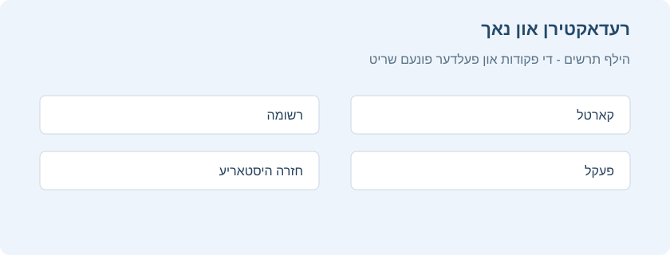
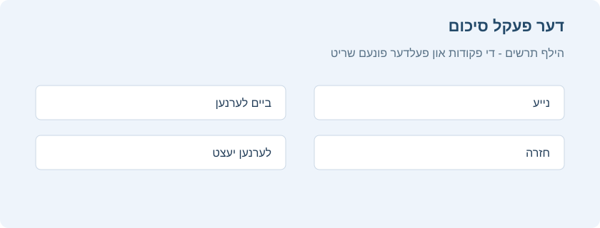
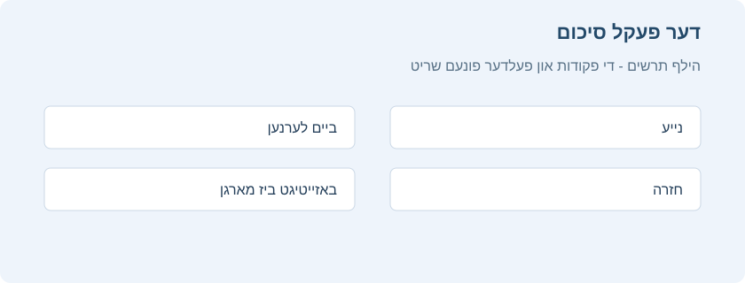

# לערנען

<!-- toc -->

ווען איר האט געפונען א פעקל אויף א נושא וואס איר לערנט, אדער אריינגעלייגט עטליכע רשומות, איז צייט אנצוהייבן לערנען.

## פעקלעך

לערנען אין אנקי איז באגרעניצט צום יעצטיגן אויסגעקליבענעם פעקל און אלע זיינע אונטערפעקלעך. אינעם פעקלעך פענצטער קלייבט מען דעם פעקל, זעט וויפיל קארטלעך ווארטן פאר היינט און עפנט פעולות ווי צולייגן, דורכבלעטערן, פילטערן און פעקל אויסוואלן.

פאר פרטים איבער די קנעפלעך אין דער פעקל שורה, פארשריט לייסטן, היץ מאפע, צוזאמענגעדריקטער מצב און גראע שאטירונגען, זעט [דער פעקלעך פענצטער](deck-browser.md).

## פראגעס

ווען א קארטל קומט, ווערט ערשט נאר די פראגע געוויזן. נאכן טראכטן פונעם ענטפער, דרוקט **ווייזן ענטפער** אדער <kbd>רווח</kbd>. דער ענטפער קומט דערנאך. עס איז אין ארדענונג אויב עס נעמט א ביסל צייט זיך דערמאנען. אבער אלס אלגעמיינער כלל, אויב איר קענט נישט ענטפערן אין בערך 10 סעקונדעס, איז מסתמא בעסער צו ווייזן דעם ענטפער אנשטאט ווייטער זיך אנשטרענגען צו געדענקען.

## ענטפער קנעפלעך

נאכן ווייזן דעם ענטפער, פארגלייכט אייער געדאכטן ענטפער מיט דעם געוויזענעם און קלייבט איינס פון די פאלגנדע קנעפלעך.

- **נאכאמאל**: קלייבט ווען אייער ענטפער איז נישט ריכטיג אדער איר האט זיך נישט געקענט דערמאנען. ביי א טיילווייז ריכטיגן ענטפער זאל מען זיין שטרענג מיט זיך: אויב דאס וואלט געהייסן א דורכפאל אין אמת'ן לעבן אויסער אנקי, הייסט עס אויך א דורכפאל אין אנקי. געווענליך נוצט מען דעם קנעפל בערך 5–20% פון די מאל.

  קורצוועג קנעפל: <kbd>1</kbd>

- **שווער**: קלייבט ווען אייער ענטפער איז ריכטיג, אבער איר האט געהאט ספיקות אדער עס האט גענומען לאנג זיך דערמאנען.

  קורצוועג קנעפל: <kbd>2</kbd>

- **גוט**: קלייבט ווען אייער ענטפער איז ריכטיג, אבער עס האט געפאדערט א ביסל מחשבה זיך דערמאנען. ביים ריכטיגן נוצן אנקי איז דאס דער מערסט גענוצטער קנעפל. געווענליך נוצט מען אים בערך 80–95% פון די מאל.

  קורצוועג קנעפל: <kbd>3</kbd>, <kbd>רווח</kbd>, <kbd>Enter</kbd>

- **גרינג**: קלייבט ווען אייער ענטפער איז ריכטיג און איר האט זיך דערמאנט אן קיין אנשטרענגונג.

  קורצוועג קנעפל: <kbd>4</kbd>

אויב פיר ענטפער קנעפלעך זענען אייך שווער צו נוצן, קען מען נוצן נאר **נאכאמאל** און **גוט**: **נאכאמאל** פאר נישט ריכטיגע ענטפערס, און **גוט** פאר ריכטיגע.

איבער יעדן ענטפער קנעפל שטייט ווען דאס קארטל וועט נאכאמאל קומען אויב איר קלייבט יענעם קנעפל. פאר די איינשטעלונגען וואס באשטימען די קומענדיגע חזרה אפשטאנדן, זעט [לערנען טריט](deck-options.md#שלבי-למידה), [פארגעסונגען](deck-options.md#שגיאות), [FSRS](deck-options.md#fsrs) און [פארגעשריטן](deck-options.md#מתקדם) אינעם פעקל אויסוואלן פרק.

### ענטפער קנעפלעך און פארשריט תצוגה

אויב איר ווילט א פשוטערע בחירה, כדי נישט געפרואווט צו ווערן צו דרוקן שווער אנשטאט נאכאמאל ווען איר קענט נישט דעם ענטפער, עפנט **הויפט מעניו > איינשטעלונגען > חזרה** און צייכנט אן **ווייזן נאר צוויי ענטפער קנעפלעך**. דער חזרה פענצטער וועט דערנאך ווייזן **איך ווייס** / **איך ווייס נישט**. נוצט **איך ווייס נישט** ווען איר האט נישט געקענט ענטפערן, און **איך ווייס** ווען איר האט געוואוסט. אויך די קורצוועגן בלייבן באקוועם: <kbd>1</kbd> איז א נעגאטיווער ענטפער, און די אנדערע הויפט ענטפער קנעפלעך פירן צו א פאזיטיוון ענטפער.

אונטן אינעם לערנען פענצטער איז דא א פארשריט לייסט וואס ווייזט וויפיל קארטלעך איר זענט שוין דורכגעגאנגען און וויפיל בלייבן אינעם יעצטיגן רונדע. צו ווייזן אדער באהאלטן די לייסט, עפנט **הויפט מעניו > איינשטעלונגען > אויסזען** און טוישט **ווייזן פארשריט לייסט**.

בשעת א בחינה קומט אויך א קליינע סימבאלן לייסט איבער די ענטפער קנעפלעך. די סימבאלן זענען פאר שנעלע פעולות אויפן יעצטיגן קארטל: דער פירעק מיטן בלייפעדער ווייזט אדער באהאלט א פעלד צו פריי שרייבן דעם ענטפער, כדי איר זאלט קענען פאר זיך שרייבן דעם ענטפער פארן דרוקן **ווייזן ענטפער**. מען קען עס נוצן אויך ביי געווענליכע קארטלעך וואס האבן נישט דעם באזונדערן שרייבן תשובה סארט רשומה. דער שפיל סימבאל שפילט נאכאמאל דעם קול אדער ווידיא פונעם קארטל; דער געבויגענער פייל נעמט צוריק די לעצטע פעולה אדער גייט צוריק צו דער פריערדיגער פראגע; דער באזייטיגן סימבאל שטופט דאס קארטל אדער די רשומה ביז מארגן; דער קיילעכדיגער פייל עפנט ניי באשטימען א צייט פלאן מיט דער האנט; און דער שטערן צייכנט אן אדער נעמט אראפ דעם סימון פון דער יעצטיגער רשומה, כדי איר זאלט זי שפעטער קענען געפינען אין דורכבלעטערן.

## צופעליגקייט פאקטאר

ווען איר קלייבט אן ענטפער קנעפל אויף א חזרה קארטל, לייגט Anki אויך צו א קליינע מאס "צופעליגקייט". דאס פארמיידט אז קארטלעך וואס זענען געוויזן געווארן אינעם זעלבן צייט און באקומען די זעלבע אפשאצונגען זאלן בלייבן צוזאמען און שטענדיג קומען אין דעם זעלבן חזרה טאג.

דעריבער, אפילו איר דרוקט גוט אויף עטליכע פראגעס וואס זענען צוגעקומען אינעם זעלבן צייט, קען יעדע קומען אין אן אנדער צייט.

לערנען קארטלעך באקומען אויך ביז 5 מינוט צוגעלייגטע ווארט צייט, כדי זיי זאלן נישט שטענדיג קומען אינעם זעלבן סדר. די ענטפער קנעפלעך ווייזן אבער נישט דעם צוגעלייגטן צייט. מען קען דאס נישט אויסלעשן.

## רעדאקטירן און נאך

מען קען דרוקן **רעדאקטירן** אונטן רעכטס צו רעדאקטירן די יעצטיגע רשומה. נאכן פארענדיגן גייט מען צוריק צום לערנען. דער רעדאקטירן פענצטער ארבעט זייער ענליך צו [צולייגן רשומות](editing.md#הוספת-כרטיסים-ורשומות).

נעבן אים איז **שיקט צום באארבעטן**. דאס ברענגט די רשומה אין א באזונדערן פעקל וואו די רשומות ווערן געהיטן באזונדער. עס איז געמאכט פאר ווען איר טרעפט אינעם בחינה א רשומה וואס דארף א באזונדערע רעדאקציע, און איר ווילט נישט אפשטעלן דעם בחינה עס יעצט צו באארבעטן. די רשומה גייט צוריק אין דעם יעצטיגן פעקל נאכן איר חזרן איין מאל אינעם באזונדערן פעקל.

נעבן אים איז **אינפארמאציע**, וואס עפנט א פענצטער ביי דער רעכטער זייט מיט פרטים איבערן יעצטיגן קארטל.

לינקס פון די ענטפער קנעפלעך איז **איבערשפרינגען**, וואס ברענגט אייך צו דער קומענדיגער פראגע.

נעבן אים איז **צוריקנעמען די לעצטע פעולה / צוריק צו דער פריערדיגער פראגע**. דאס נעמט צוריק די לעצטע פעולה. אויב די לעצטע פעולה איז געווען דרוקן אן ענטפער קנעפל, וועט עס צוריקברענגען די פריערדיגע פראגע און צוריקנעמען אייער אפשאצונג. אויב די לעצטע פעולה איז געווען רעדאקטירן, גייט דאס קארטל צוריק צו זיין אריגינעלן צושטאנד, און אזוי ווייטער.

מען קען רעדאקטירן געוויסע פעלדער גלייך אינעם חזרה פענצטער, אן אפשטעלן דאס לערנען און עפענען א פולן רעדאקטירן פענצטער. פאר א קליינעם תיקון ווי ניקוד, א שרייב טעות אדער נוסח, דרוקט אינעם פעלד וואס מען קען רעדאקטירן, טוישט וואס מען דארף און זיכערט אפ. דערנאך קומט מען צוריק צום זעלבן קארטל און קען ווייטער לערנען.

אויב איר רעדאקטירט מנוקד'דיגע עברית בשעת חזרה, דרוקט מיטן רעכטן מייז קנעפל אינעם רעדאקטירבארן פעלד. אינעם מעניו וועלן קומען ניקוד און טעמי המקרא סימנים, ווי אינעם רעדאקטאר מעניו. קלייבט דעם סימן, און ער גייט אריין ביים סמן. אזוי קען מען פארריכטן א קליינע ניקוד טעות אן צו עפענען דעם פולן רעדאקטירן פענצטער.

אונטן לינקס אינעם לערנען פענצטער איז **נאך אויסוואלן**. עס גיט נאך פעולות אויפן יעצטיגן קארטל אדער רשומה:

- [**אנצייכענען א קארטל מיט א פאן**](editing.md#שימוש-בדגלים): לייגט צו אדער נעמט אראפ א קאלירטן סימן אויפן קארטל. פאנען ווערן געוויזן ביים לערנען, און מען קען זוכן אנגעצייכנטע קארטלעך אין דורכבלעטערן. דאס העלפט ווען איר ווילט שפעטער טון עפעס אויפן קארטל, ווי זוכן א ווארט. מען קען אויך טוישן די פאנען נעמען אין [דורכבלעטערן](browsing.md).

- **באזייטיגן א קארטל / רשומה ביז מארגן**: באהאלט א קארטל אדער אלע קארטלעך פון דער יעצטיגער רשומה ביז צומארגנס. צו צוריקנעמען דאס פריער, דרוקט "צוריקברענגען פון באזייטיגן" אינעם [סיכום](studying.md#סיכום-החפיסה) פענצטער. דאס העלפט ווען איר קענט יעצט נישט ענטפערן אדער ווילט צוריקקומען אן אנדער מאל. פארבונדענע קארטלעך פון דער זעלבער רשומה קענען אויך ווערן [אויטאמאטיש באזייטיגט](studying.md#אחים-והטמנה).

- **צוריקשטעלן צייט פלאן (פארגעסן קארטל)**: ברענגט דאס יעצטיגע קארטל צום [סוף פונעם נייע קארטלעך ריי](browsing.md#כרטיסים).

  "צוריקשטעלן אריגינעלן פלאץ" לאזט צוריקשטעלן דאס קארטל צו זיין אריגינעלן פלאץ ביים צוריקשטעלן.

  "צוריקשטעלן צאל חזרות און פארגעסונגען" שטעלט ביידע ציילערס צו נול, אויב דער אויסוואל איז אנגעצונדן. עס נעמט נישט אראפ די חזרות היסטאריע אונטן אינעם קארטל אינפארמאציע פענצטער.

- **שטעלן א חזרה דאטום**: לאזט באשטימען אן אייגענעם דאטום פארן יעצטיגן קארטל ווען די צייטן איבער די ענטפער קנעפלעך פאסן נישט פאר דעם באזונדערן פאל. מען קען שרייבן א צאל טעג, א דאטום אדער א טעג פארנעם ווי `7-14`. די פעולה שרייבט נישט איין קיין ענטפער און ערזעצט נישט **נאכאמאל**, **גוט** און **גרינג**. זי טוישט נאר ווען דאס קארטל וועט צוריקקומען. דערפאר איז כדאי עס בעיקר צו נוצן פאר א בחינה, א באוואוסטזיניגע אפשטופונג פון א קארטל אדער א באזונדערן צייט פלאן תיקון.

- **אפשטעלן א קארטל / רשומה**: באהאלט דאס קארטל אדער אלע קארטלעך פון דער יעצטיגער רשומה ביז מען ברענגט זיי צוריק מיט דער האנט, דורך דרוקן דעם אפשטעלן קנעפל אין דורכבלעטערן. דאס העלפט צו נישט חזרן די רשומה א תקופה אן איר אויסצומעקן.

- **אפציעס**: רעדאקטירט די [אויסוואלן](deck-options.md) פונעם יעצטיגן פעקל.

- **קארטל אינפארמאציע**: ווייזט [סטאטיסטיק](stats.md#מידע-על-כרטיס) איבערן קארטל.

- **פריערדיגער קארטל אינפארמאציע**: ווייזט [סטאטיסטיק](stats.md#מידע-על-כרטיס) איבערן פריערדיגן קארטל.

- [**אנצייכענען א רשומה**](editing.md#התגית-מסומן): לייגט צו דעם "אנגעצייכנט" צעטל צו דער יעצטיגער רשומה, כדי גרינג צו געפינען זי אין דורכבלעטערן. דאס איז ענליך צו אנצייכענען איינציגע קארטלעך מיט א פאן, אבער נוצט א צעטל. אויב די רשומה האט עטליכע קארטלעך, וועלן אלע קומען ביים זוכן דעם "marked" צעטל. רוב באניצער וועלן בעסער נוצן פאנען.

- **שאפן א קאפיע**: עפנט א [קאפיע](browsing.md#מציאת-כפילויות) פון דער יעצטיגער רשומה אינעם רעדאקטאר. מען קען איר א ביסל טוישן צו גרינג באקומען פארשידענע ווערסיעס פון די קארטלעך. לויט דער ברירת מחדל קומט די קאפיע אינעם זעלבן פעקל ווי דער אריגינעל.

- **אויסמעקן רשומה**: מעקט אויס די רשומה מיט אלע אירע קארטלעך.

- **נאכאמאל אפשפילן קול**: אויב דאס קארטל האט קול פארנט אדער הינטן, שפילט אים נאכאמאל.

- **אפשטעלן קול צייטווייליג**: שטעלט צייטווייליג אפ דעם קול ווען עס שפילט.

- **קול -5 סעקונדעס / +5 סעקונדעס**: שפרינגט צוריק אדער פאראויס 5 סעקונדעס אינעם קול וואס שפילט יעצט.

- **רעקארדירן אייער קול**: רעקארדירט פונעם מיקראפאן כדי צו איבערקוקן אייער אויסשפראך. די רעקארדירונג איז צייטווייליג און פארשווינדט ביים קומענדיגן קארטל. צו שטענדיג צולייגן קול צום קארטל, טוט עס אינעם רעדאקטירן פענצטער.

- **נאכאמאל אפשפילן אייגענעם קול**: שפילט נאכאמאל די צייטווייליגע רעקארדירונג פון **רעקארדירן אייער קול**, כדי צו פארגלייכן מיט דער תשובה אדער דער געוואונטשענער אויסשפראך. אויב איר האט נישט רעקארדירט אויפן יעצטיגן קארטל, איז נישט דא וואס אפצושפילן.

- **אויטאמאטיש ווייטערגיין**: מאכט אז אנקי זאל אויטאמאטיש ווייזן די קומענדיגע פראגע אדער ענטפער נאך א צייט וואס מען קען באשטימען אין די [פעקל אויסוואלן](deck-options.md).

- **באשטימען א דאטום מיט דער האנט**: עפנט א באקוועמען פענצטער צום ניי באשטימען דעם יעצטיגן קארטל'ס צייט פלאן. אנשטאט געדענקען דעם סינטאקס, קען מען מסודר אויסקלייבן אדער שרייבן א דאטום און פארנעם. דאס איז נאך א פעולה בשעת דער בחינה און נישט קיין פעקל איינשטעלונג. נוצט עס ווען איר ווילט באשטימען ווען דאס קארטל זאל צוריקקומען, אנשטאט טוישן דעם פעקל'ס קבוע'ן לערנען וועג.

- **באהאלט די תשובה**: לאזט באהאלטן דעם ענטפער נאכן דרוקן "ווייזן ענטפער".

- **פראגעס געענטפערט אין דער בחינה**: האלטן דעם מייז איבער דעם אויסוואל עפנט א מעניו מיט די פראגעס וואס זענען שוין געענטפערט געווארן אינעם יעצטיגן בחינה. דרוקן אויף א פראגע עפנט דורכבלעטערן מיט יענער פראגע. דאס העלפט אויב איר דערמאנט זיך צו רעדאקטירן עפעס וואס איר זענט שוין דורכגעגאנגען, אדער טרעפט א טאפלטע רשומה אא"וו.

## דער תצוגה סדר

אנקי ווייזט קארטלעך פונעם אויסגעקליבענעם פעקל און אלע זיינע אונטערפעקלעך. דעריבער, אויב איר קלייבט "אורח חיים", קומען אויך די אונטערפעקלעך "אורח חיים::דיני השכמת הבוקר" און "אורח חיים::דיני ציצית::סימן ח".

לויט דער ברירת מחדל נעמט אנקי נייע קארטלעך פון די פעקלעך לויטן אלף בית. אינעם אויבנדערמאנטן ביישפיל באקומט מען ערשט "אורח חיים", דערנאך "דיני ציצית" און צום סוף "סימן ח". מען קען דערמיט באשטימען דעם סדר דורך לייגן וויכטיגערע קארטלעך אין פעקלעך וואס קומען העכער אין דער ליסטע. ביים אלף בית סארטירן קומט "-" פאר די אותיות און "~" נאך זיי. דעריבער קען מען רופן א פעקל "-דיני ציצית" כדי ער זאל קומען ערשט, און אן אנדערן "~דיני השכמת הבוקר" כדי ער זאל קומען נאכן גאנצן רעשט.

נייע קארטלעך און חזרות ווערן גענומען באזונדער. אנקי ווארט נישט אז ביידע רייען זאלן זיין ליידיג פארן גיין צום קומענדיגן פעקל. מען קען דעריבער זען נייע קארטלעך פון איין פעקל צוזאמען מיט חזרות פון אן אנדערן. אויב איר ווילט דאס נישט, דרוקט גלייך אויפן פעקל וואס איר ווילט לערנען אנשטאט אויף זיין הויפט פעקל.

לערנען קארטלעך זענען זייער צייט עמפינדליך. מען נעמט זיי דערפאר פון אלע פעקלעך צוזאמען און ווייזט זיי לויט דעם סדר ווען זיי ווערן גרייט.

צו באשטימען דעם סדר, זעט [חזרה סדר אין די פעקל אויסוואלן](./deck-options.md#סדר-חזרה). פאר א גענויערן סדר פון נייע קארטלעך, קען מען עס טוישן אין [דורכבלעטערן](browsing.md).

## פארבונדענע קארטלעך און באזייטיגן ביז מארגן

ווי דערמאנט אין די [יסודות](getting-started.md), קען אנקי שאפן מער פון איין קארטל פאר יעדן אריינגעלייגטן פרט, ווי פארנט←הינטן און הינטן←פארנט, אדער צוויי פארשידענע אויסלאזן פונעם זעלבן טעקסט. די פארבונדענע קארטלעך הייסן "ברידער".

ווען איר ענטפערט אויף א קארטל מיט ברידער, קען אנקי זיי פארמיידן פון קומען אינעם זעלבן לערנען רונדע דורך אויטאמאטיש באזייטיגן זיי ביז מארגן. די קארטלעך בלייבן באהאלטן ביז דער זייגער הייבט אן א נייעם טאג, אדער ביז איר ברענגט זיי צוריק מיט דער האנט דורך **צוריקברענגען פון באזייטיגן** אונטן אינעם [פעקל סיכום](studying.md#סיכום-החפיסה). אנקי באזייטיגט ברידער אפילו פון אן אנדער פעקל, למשל ווען איר נוצט [פעקל איבערשרייבן](templates/intro.md).

מען קען אנצינדן באזייטיגן אין די [פעקל אויסוואלן](deck-options.md). עס זענען דא באזונדערע איינשטעלונגען פאר נייע קארטלעך און חזרות.

אנקי באזייטיגט נאר ברידער וואס זענען נייע אדער חזרה קארטלעך. עס באהאלט נישט לערנען קארטלעך, ווייל זייער צייט איז קריטיש. אבער ווען איר לערנט א לערנען קארטל, ווערן זיינע נייע און חזרה ברידער יא באזייטיגט.

מען קען נישט סיי באזייטיגן און סיי אפשטעלן א קארטל אויף איינמאל. אפשטעלן א באזייטיגט קארטל נעמט אים ארויס פון באזייטיגן. מען קען נישט באזייטיגן אפגעשטעלטע קארטלעך.

## קורצוועג קנעפלעך

רוב געווענליכע אנקי פעולות האבן קורצוועג קנעפלעך. מען קען רוב פון זיי געפינען אינעם ממשק: מעניו זאכן ווייזן זייער קורצוועג נעבן זיי, און האלטן דעם מייז איבער א קנעפל ווייזט געווענליך דעם קורצוועג אין א קליינעם שוועבנדיגן פענצטער.

מען קען טוישן די קורצוועגן דורך **איינשטעלן קורצוועג קנעפלעך** אינעם הויפט מעניו. פאר אן הסבר, זעט [קורצוועג קנעפלעך](misc.md#קיצורי-מקשים).

ביים לערנען ווייזן <kbd>רווח</kbd> אדער <kbd>Enter</kbd> דעם ענטפער. ווען דער ענטפער איז שוין זעבאר, קען מען מיט <kbd>רווח</kbd> אדער <kbd>Enter</kbd> אויסקלייבן 'גוט'. <kbd>1</kbd> ביז <kbd>4</kbd> קלייבן א באזונדערן אפשאצונג קנעפל. פאר אסאך מענטשן איז באקוועם צו ענטפערן רוב קארטלעך מיט <kbd>רווח</kbd> און האלטן איין פינגער אויף <kbd>1</kbd> פאר ווען מען פארגעסט.

## א הויפן פארשפעטיגטע חזרות

ווען חזרות הויפענען זיך אן, גיט אנקי לויט דער ברירת מחדל א קדימה פאר די קארטלעך וואס האבן דאס לענגסטע געווארט. דער סדר מאכט אז קיין קארטל זאל נישט בלייבן ווארטן אן א גרענעץ. אבער אויב איר לייגט צו נייע קארטלעך, וועלן זייערע חזרות ערשט קומען נאכן פארענדיגן דעם הויפן.

ווען איר ענטפערט אויף קארטלעך וואס האבן שוין א צייט געווארט, נעמט אנקי דעם פארשפעטיגונג אין חשבון ביים באשטימען דער קומענדיגער צייט. דעריבער, ווען איר קומט צוריק נאך א לאנגע הפסקה, דארף מען נישט אנהייבן פון דאסניי; מען קען פשוט ווייטערגיין פון וואו מען האט געהאלטן.

## דער פעקל סיכום

נאך דער חזרה זעט איר א פענצטער וואס ווייזט וויפיל קארטלעך עס זענען דא צום לערנען היינט. דאס הייסט "דער פעקל סיכום":

די קארטלעך זענען צעטיילט אין [דריי סארטן](getting-started.md#מצבי-כרטיסים): נייע, ביים לערנען און פאר חזרה. אויב איר האט אנגעצונדן [באזייטיגן ברידער](#אחים-והטמנה) אין די פעקל אויסוואלן, קענט איר זען אין גרא וויפיל קארטלעך וועלן ווערן באזייטיגט:

צו אנהייבן א לערנען רונדע, דרוקט **לערנען יעצט**. אנקי וועט ווייטער ווייזן קארטלעך ביז אלע קארטלעך באשטימט פאר היינט זענען פארטיג.

בשעת איר לערנט קען מען צוריקגיין צום סיכום מיט <kbd>S</kbd>.
